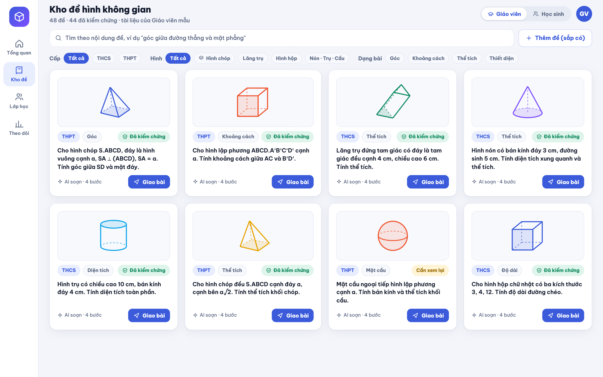
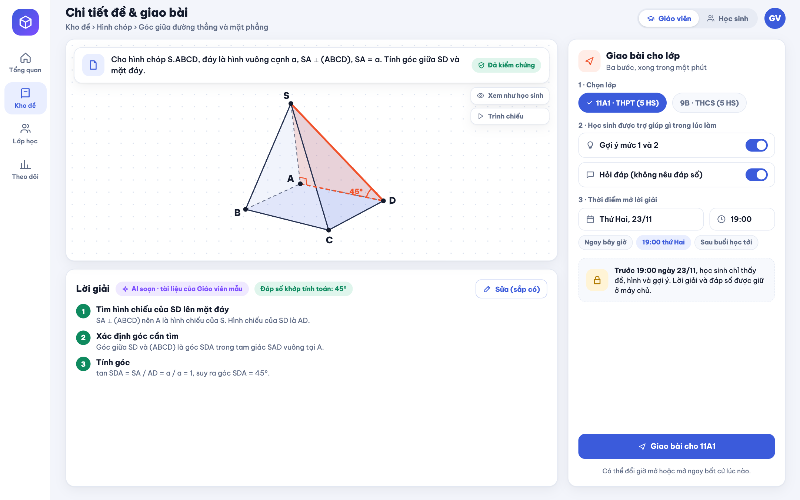
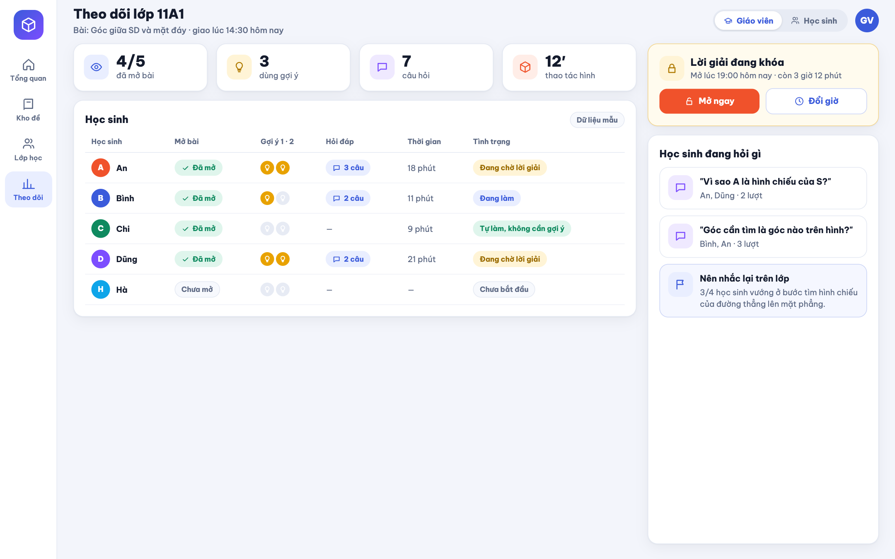
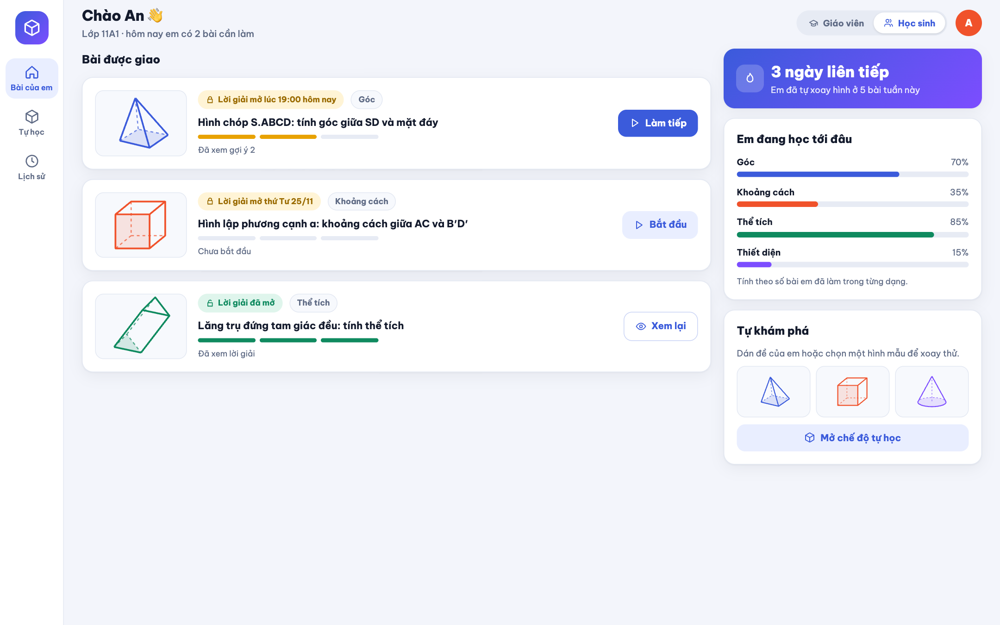
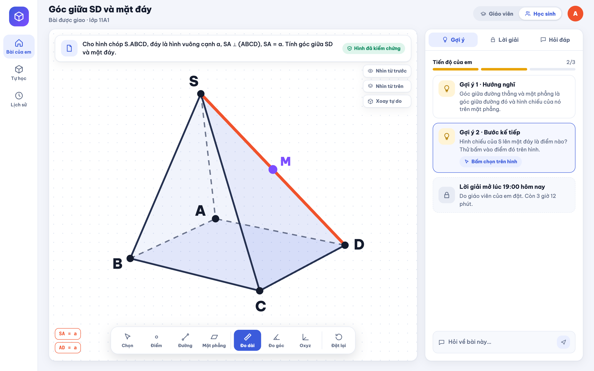
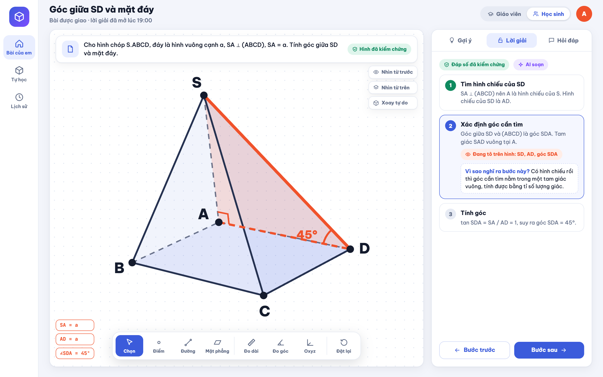
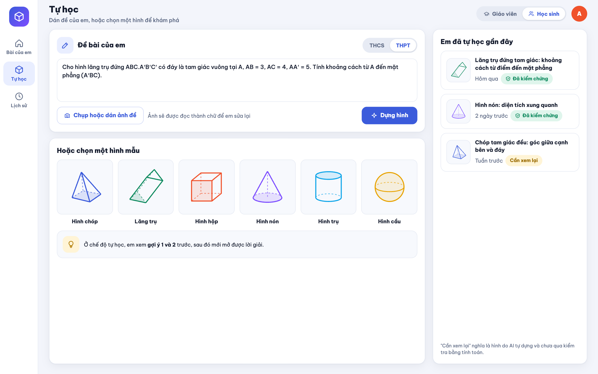
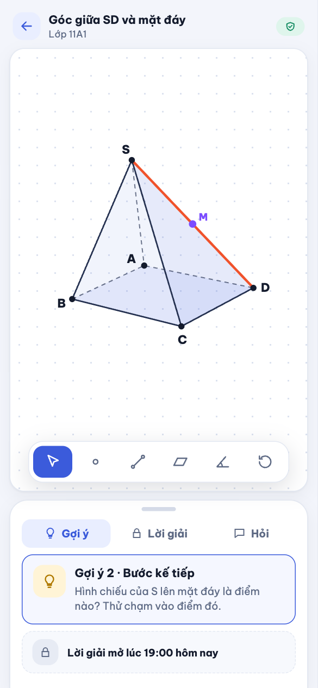
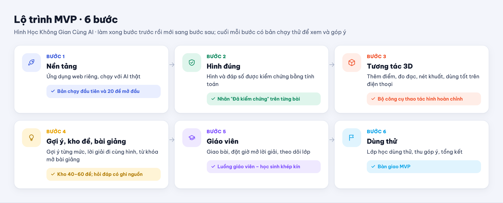

# MVP — Hình Học Không Gian Cùng AI

- **Ngày:** 21/11/2026
- **Trạng thái:** Đề xuất, chờ chủ sản phẩm duyệt
- **Thuộc về:** [`PRODUCT-MASTER.md`](PRODUCT-MASTER.md) (Phần B). Hiện trạng tool: [`SPEC.md`](SPEC.md), [`SPEC-technical.md`](SPEC-technical.md).

Các ngưỡng KPI dưới đây là ước lượng để bàn; chưa có số đo thực tế nào vì bản hiện tại mới chạy với dữ liệu mẫu.

---

## 1. Quyết định đã chốt

| # | Quyết định | Nguồn |
|---|---|---|
| 1 | MVP **chỉ làm hình học không gian**. Hình phẳng để sau. | Chủ sản phẩm |
| 2 | Phục vụ cả THCS và THPT, trong phạm vi hình không gian. | Chủ sản phẩm |
| 3 | **Gợi ý trước.** Lời giải chỉ hiện từ thời điểm giáo viên thiết lập. | Chủ sản phẩm |
| 4 | Có **vai trò giáo viên** trong MVP; được dùng dữ liệu mẫu (dummy) để tương tác. | Chủ sản phẩm |
| 5 | Có **kho đề soạn sẵn** làm tài liệu của giáo viên; lời giải do AI sinh, đứng tên một giáo viên. | Chủ sản phẩm |
| 6 | Rời runtime Claude artifact, làm web app riêng có backend. | Chủ sản phẩm |

**Cách hiểu của người soạn, cần xác nhận**
- Quyết định 5: có **một tài khoản "Giáo viên mẫu"** tạo sẵn, sở hữu toàn bộ kho đề. Lời giải trong kho do AI sinh, engine kiểm chứng phần tính toán, và được lưu như tài liệu của giáo viên này. Chưa có giáo viên thật duyệt.
- Quyết định 4: MVP chưa có đăng ký giáo viên thật. Người dùng thử vào vai giáo viên bằng tài khoản mẫu và lớp mẫu.

## 2. Mục tiêu

MVP là một web app mà:
- Học sinh mở một bài hình không gian, **nhìn và thao tác trên hình đúng**, được gợi ý từng mức, và chỉ xem được lời giải khi giáo viên cho phép.
- Giáo viên (tài khoản mẫu) có sẵn kho đề kèm lời giải, giao bài cho lớp và đặt thời điểm mở lời giải.
- Hình và đáp số được **kiểm chứng bằng tính toán**, không tin thẳng tọa độ AI sinh ra.

## 3. Hình dung giao diện

Thiết kế theo hướng "Phòng học sáng". Các màn hình dưới đây là bản thiết kế với dữ liệu mẫu, chưa phải sản phẩm chạy thật. File nguồn: [`Design/screens.html`](Design/screens.html).

#### Giáo viên 1 · Kho đề

Kho đề soạn sẵn của Giáo viên mẫu. Lọc theo cấp, loại hình, dạng bài. Mỗi đề có nhãn "Đã kiểm chứng" hoặc "Cần xem lại", ghi rõ "AI soạn", và nút Giao bài.

#### Giáo viên 2 · Xem đề và giao bài

Bên trái là hình và lời giải đầy đủ. Bên phải giao bài trong ba bước: chọn lớp, chọn trợ giúp học sinh được dùng, đặt thời điểm mở lời giải.

#### Giáo viên 3 · Theo dõi lớp

Ai đã mở bài, dùng gợi ý mức nào, hỏi gì. Thẻ vàng cho biết lời giải đang khóa, kèm nút Mở ngay và Đổi giờ.

#### Học sinh 1 · Bài của em

Danh sách bài được giao, mỗi bài hiện rõ lời giải mở lúc nào và em đã đi tới bước nào.

#### Học sinh 2 · Làm bài

Hình 3D là trung tâm. Thanh công cụ có biểu tượng và nhãn ở dưới hình. Bảng bên phải là gợi ý từng mức; lời giải đang khóa tới giờ giáo viên đặt.

#### Học sinh 3 · Lời giải đã mở

Bấm bước nào, hình tô màu đối tượng của bước đó. Mỗi bước có phần "Vì sao nghĩ ra bước này?". Kết quả đo hiện ngay trên hình.

#### Học sinh 4 · Tự học

Dán đề hoặc ảnh đề của mình, hoặc chọn một hình mẫu để khám phá.

#### Điện thoại · Làm bài

Hình ở trên, bảng gợi ý trượt lên từ dưới.

#### Lộ trình MVP

## 3b. Người dùng và ba chế độ

| Chế độ | Ai dùng | Làm gì |
|---|---|---|
| **Giáo viên (mẫu)** | Người vào vai "Giáo viên mẫu" | Xem kho đề, xem lời giải đầy đủ, giao bài cho lớp mẫu, đặt/đổi thời điểm mở lời giải, xem học sinh đã làm gì |
| **Học sinh – bài được giao** | Học sinh trong lớp mẫu | Mở bài, thao tác hình 3D, xin gợi ý, hỏi chat; lời giải khóa tới giờ mở |
| **Học sinh – tự học** | Bất kỳ học sinh | Dán đề của mình (chữ hoặc ảnh), AI dựng hình và giải; phải qua gợi ý rồi mới mở lời giải |

Dữ liệu mẫu tạo sẵn: 1 giáo viên, 2 lớp (một THCS, một THPT), mỗi lớp vài học sinh mẫu, vài bài đã giao với giờ mở khác nhau (đã mở, sắp mở, chưa đặt).

## 4. Phạm vi

| Trong MVP | Ngoài MVP |
|---|---|
| Hình không gian: chóp, lăng trụ, hộp, lập phương; nón, trụ, cầu mức cơ bản; Oxyz | Hình phẳng (tam giác, tứ giác, đường tròn) |
| Kho đề soạn sẵn của "Giáo viên mẫu", lời giải AI đã kiểm chứng phần tính toán; bộ bài giảng mẫu có ghi nguồn | Giáo viên tự soạn đề và bài giảng với AI, import từ file và ảnh, tự sửa lời giải, giáo trình riêng cho từng học sinh |
| Lớp mẫu, giao bài, thời điểm mở lời giải | Đăng ký giáo viên thật, trường, tenant, phụ huynh |
| Gợi ý 2 mức + lời giải; khóa ở server, áp dụng cả cho chat; từ khóa mở bài giảng; hỏi đáp có ghi nguồn | Rubric, nộp bài viết tay, AI chấm bài |
| Chế độ tự học với đề tự nhập | Bài luyện có chấm điểm, bảng xếp hạng |
| Đăng nhập nhẹ cho học sinh (tên + mã lớp), dữ liệu riêng từng người | Chat nhóm, video, thông báo, lịch |

## 5. Tính năng

### P0 — phải có

**A. Nền tảng**
- Web app riêng; backend gọi AI, giấu key, ghi chi phí mỗi lượt gọi.
- Tách mã thành `geometry-engine`, `solver`, `scene3d`, `store`, `ui`.
- Lưu trữ riêng theo người dùng (không còn dùng chung như bản artifact).

**B. Hình đúng**
- AI mô tả hình bằng **ràng buộc** (ví dụ: "chóp S.ABCD, đáy vuông cạnh a, SA ⊥ đáy, SA = a"); engine tính tọa độ và kiểm tra lại ràng buộc.
- Thư viện hình mẫu có tham số (chóp, lăng trụ, hộp, nón, trụ, cầu), dựng không cần AI.
- Kiểm chứng đáp số bằng số: thay giá trị cụ thể, tính góc, khoảng cách, thể tích từ tọa độ, so với đáp số của AI.
- Nhãn trên mỗi bài: "Đã kiểm chứng" / "Cần xem lại". Đề lạ không khớp mẫu thì dùng tọa độ AI kèm cảnh báo.

**C. Tương tác 3D**
- Giữ toàn bộ công cụ hiện có (xoay, zoom, highlight, vẽ đường, dựng mặt phẳng, giao điểm, giao tuyến, Oxyz).
- Thêm điểm: trung điểm, điểm chia theo tỉ lệ, điểm tự do trên cạnh.
- Đo độ dài, góc, khoảng cách ngay trên hình.
- Nét đứt cho cạnh khuất; bấm chọn đối tượng trực tiếp trên hình.
- Điện thoại: pinch-zoom, nút đặt lại góc nhìn.
- Sửa lỗi đã biết: nhãn "Mặt Mặt …", cảnh báo khi hai đường chéo nhau, chia tam giác cho mặt nhiều đỉnh, nhật ký hỏi đáp lọc theo bài.

**D. Gợi ý và lời giải**
- Thang gợi ý: mức 1 hướng nghĩ, mức 2 bước kế tiếp, mức 3 lời giải đầy đủ kèm nguyên lý.
- Bấm vào bước nào, hình tự highlight đối tượng và đường phụ của bước đó; đường vẽ thêm của từng bước hiện dần trên hình.
- Từ khóa trong gợi ý, lời giải, câu trả lời bấm được để mở bài giảng đọc lại; bài giảng ghi rõ nguồn (bài soạn của giáo viên hoặc do AI viết, có nhãn).
- Hỏi AI: câu trả lời dựa trên giáo trình và ghi nguồn; trước giờ mở không nêu đáp số; ngoài giáo trình thì nói rõ là chưa có (PO-37, PO-49).
- Bài được giao: mức 3 khóa tới giờ mở do giáo viên đặt. Trước giờ đó server không gửi lời giải xuống trình duyệt; chat chỉ được gợi ý, không nêu đáp số.
- Bài tự học: mức 3 mở sau khi đã xem mức 1 và 2 (giả định, xem mục 10).

**E. Giáo viên (dữ liệu mẫu)**
- Kho đề: 84 đề hình không gian chia theo cấp và chủ đề (mỗi dạng bài 16–20 đề, DECISIONS 27/11), mỗi đề có hình, đáp số, lời giải từng bước, gợi ý, nhãn kiểm chứng, và ghi rõ "AI soạn".
- Giao một đề hoặc một bộ đề cho lớp mẫu; đặt, đổi, mở sớm thời điểm hiện lời giải.
- Trang theo dõi lớp: ai đã mở bài, dùng gợi ý mức nào, hỏi gì trong chat.
- Xem trước giao diện học sinh.

**F. Đo lường**
- Bộ đề chuẩn có đáp án tham chiếu (dùng chung với kho đề) để đo tỉ lệ hình và đáp số đúng.
- Bộ câu thử moi đáp án để kiểm tra việc khóa lời giải.
- Ghi sự kiện: mở bài, thao tác hình, gợi ý, chat, mở lời giải.

### P1 — ngay sau MVP
- Giáo viên thật vào bằng lời mời: tự thêm đề, soạn đề và bài giảng với AI hoặc import từ file và ảnh, chat chỉnh bản nháp, sửa và duyệt lời giải AI (chặng 2, 5). Đăng ký và xác nhận tài khoản thuộc chặng 3 (PO-05, giả định).
- Chế độ trình chiếu, link chia sẻ, xuất ảnh/PDF.
- Kéo mặt phẳng bằng chuột, thiết diện cập nhật trực tiếp.
- Bài luyện có chấm tự động (điền đáp số).

## 6. Dữ liệu cần thiết kế từ đầu

| Đối tượng | Trường chính | Ghi chú |
|---|---|---|
| `User` | id, tên, vai trò (teacher / student) | Giáo viên mẫu được tạo sẵn |
| `Class` | id, tên, cấp, mã lớp, teacher_id | 2 lớp mẫu |
| `Problem` | id, đề bài, cấp, chủ đề, nguồn (kho / tự nhập), owner_id | Kho đề thuộc Giáo viên mẫu |
| `SceneSpec` | problem_id, version, ràng buộc, tọa độ đã tính | Engine sinh ra |
| `Solution` | problem_id, version, các bước, gợi ý, đáp số, model, prompt_version, author_id | Tác giả là Giáo viên mẫu; có cờ "AI soạn" |
| `VerificationReport` | solution_id, kết quả từng kiểm tra, trạng thái | Quyết định nhãn kiểm chứng |
| `Assignment` | class_id, problem_id, release_at, trạng thái | `release_at` là giờ mở lời giải |
| `Interaction` | user_id, problem_id, loại (thao tác / gợi ý / chat / mở lời giải), thời điểm | Nền cho theo dõi lớp |

Mọi JSON có `schema_version`. Mọi bản ghi có `owner_id`; `org_id` để trống, dành cho trường về sau. Lời giải đã giao không sửa tại chỗ, sửa thì tạo version mới.

## 7. Luồng chính

**Giáo viên giao bài**
1. Vào vai Giáo viên mẫu, mở kho đề, lọc theo cấp và chủ đề.
2. Mở một đề: xem hình, lời giải, nhãn kiểm chứng.
3. Chọn lớp, đặt giờ mở lời giải, giao bài.
4. Theo dõi lớp; có thể đổi giờ mở hoặc mở ngay.

**Học sinh làm bài được giao**
1. Nhập tên và mã lớp, thấy danh sách bài.
2. Mở bài: hình 3D và đề bài; thao tác, đo đạc trên hình.
3. Xin gợi ý mức 1, mức 2; hỏi chat.
4. Tới giờ mở: xem lời giải đầy đủ, bấm từng bước để hình highlight theo.

**Trạng thái lời giải:** sinh ra → đã kiểm chứng hoặc cần xem lại → vào kho → đã giao (khóa) → đã mở.

## 8. Mốc phát triển

Các mốc làm nối tiếp nhau: xong mốc trước rồi mới sang mốc sau. Không đặt thời hạn cho từng mốc.

Giả định team 2–4 người: 1 full-stack/3D, 1 backend/AI, 1 người có chuyên môn Toán bán thời gian để soát đề.

| Thứ tự | Mốc | Kết quả kiểm được |
|---|---|---|
| 1 | M0 Nền | App chạy ngoài artifact với AI thật; 20 đề đầu tiên; đo tỉ lệ hình và đáp số đúng lần đầu |
| 2 | M1 Hình đúng | Engine, mô tả hình bằng ràng buộc, thư viện hình mẫu, kiểm chứng đáp số; đo lại |
| 3 | M2 Tương tác | Thêm điểm, đo đạc, nét khuất, chọn trực tiếp, điện thoại, sửa lỗi đã biết |
| 4 | M3 Gợi ý và kho đề | Thang gợi ý, lời giải đồng bộ hình; kho 84 đề hoàn chỉnh (trần tiêu chí 100) |
| 5 | M4 Giáo viên mẫu | Lớp mẫu, giao bài, giờ mở lời giải, khóa ở server, trang theo dõi lớp |
| 6 | M5 Dùng thử | Một nhóm nhỏ học sinh và giáo viên dùng thử; tổng hợp số liệu; quyết định bước tiếp |

## 9. Tiêu chí hoàn thành và cách đo

| Nhóm | Chỉ số | Ngưỡng đề xuất |
|---|---|---|
| Độ đúng (bắt buộc) | Hình thỏa ràng buộc trên bộ đề chuẩn | ≥ 95% |
| Độ đúng (bắt buộc) | Đáp số đúng trên bộ đề chuẩn | ≥ 90% |
| Độ đúng (bắt buộc) | Bài sai mà vẫn gắn "Đã kiểm chứng" | 0 |
| Khóa lời giải (bắt buộc) | Lời giải hoặc đáp số lộ trước giờ mở trong bộ câu thử | 0 |
| Tương tác | Phiên có ít nhất 1 thao tác trên hình | ≥ 60% |
| Gợi ý | Lượt xem gợi ý trước khi xem lời giải (bài tự học) | Đo, chưa đặt ngưỡng |
| Vận hành | Thời gian trung vị từ lúc gửi đề tới lúc có hình | < 40 giây |
| Vận hành | Chi phí AI mỗi bài | Đo, chưa đặt ngưỡng |

MVP xong khi: bốn chỉ số bắt buộc đạt, toàn bộ P0 chạy trên máy tính và điện thoại, kho đề đủ 40 đề đã kiểm chứng, và có số đo cho các chỉ số còn lại.

## 10. Rủi ro và câu hỏi mở

**Rủi ro**
1. **Lời giải AI đứng tên giáo viên nhưng chưa có người duyệt.** Engine chỉ kiểm chứng được phần tính toán, không kiểm chứng lập luận chứng minh. Cần ghi rõ "AI soạn" trên giao diện, và nên có người biết Toán soát kho đề trước khi cho học sinh thật dùng.
2. **Engine không phủ hết dạng đề.** Đề tự nhập lạ sẽ rơi về tọa độ AI kèm cảnh báo; cần đo tỉ lệ này ở M1.
3. **Khóa lời giải qua chat.** AI có thể lỡ nêu đáp số khi gợi ý; phải có bộ câu thử và kiểm tra đầu ra trước khi trả về.
4. **Dữ liệu trẻ vị thành niên.** Chỉ thu tên hiển thị và mã lớp trong MVP; cần tư vấn pháp lý trước khi mở rộng.
5. **Giáo viên mẫu không cho biết giáo viên thật có dùng không.** MVP chứng minh được luồng, chưa chứng minh được nhu cầu; P1 phải có giáo viên thật.

**Câu hỏi mở**
1. Bài tự học: lời giải mở sau khi xem gợi ý mức 1 và 2 (đang giả định), hay cách khác?
2. Cách hiểu "lời giải AI thành 1 giáo viên" ở mục 1 có đúng ý bạn không?
3. Ai soát kho 84 đề? Có nguồn đề nào ưu tiên (sách giáo khoa, đề thi) không?
4. Dùng thử ở M5 với ai: nội bộ, hay một lớp thật?
5. Giữ tên "Hình Học Cùng AI" hay đổi?
