# Hình Học Cùng AI — Tài liệu sản phẩm tổng hợp

- **Ngày:** 21/11/2026
- **Trạng thái:** Đề xuất, chờ chủ sản phẩm duyệt
- **Tài liệu này thay thế** vai trò "baseline" của 8 file trong `input/ChatGPT Concept/` (00–07). Tám file đó được giữ nguyên làm nguồn tham khảo chi tiết.

## Cách đọc

| Phần | Nội dung | Tính chất |
|---|---|---|
| A | Hiện trạng | Thứ đang có |
| B | MVP trước mắt: hình học không gian | **Kế hoạch có hiệu lực triển khai** |
| C | Tầm nhìn dài hạn: hệ sinh thái giáo dục | Định hướng, chưa cam kết, chưa kiểm chứng |
| D | Lộ trình nối B lên C, và bảng quyết định | Thứ tự mở rộng và điều kiện mở |

Khi B và C mâu thuẫn, **B thắng**. Mọi thứ ở Phần C chỉ được đưa vào làm khi đạt điều kiện mở ở Phần D.

Các ngưỡng KPI trong tài liệu là ước lượng để bàn. Lộ trình chỉ ghi thứ tự, không đặt thời hạn. Chưa có số đo thực tế nào: bản hiện tại mới chạy với dữ liệu mẫu.

---

# Phần A — Hiện trạng

"Hình Học Cùng AI" hiện là một trang web một file (HTML/JS, Three.js) chạy dưới dạng Claude artifact. Học sinh nhập đề hình học bằng chữ hoặc ảnh; AI chép lại đề, vẽ hình 2D hoặc 3D, giải từng bước kèm nguyên lý. Học sinh xoay hình 3D, highlight cạnh và mặt, vẽ thêm đường, dựng mặt phẳng, xem giao điểm và giao tuyến, bật trục Oxyz, bấm thuật ngữ để đọc bài giảng ngắn, hỏi thêm trong chat, xem lại lịch sử.

Giới hạn chính:
- Tọa độ hình và đáp số do AI sinh ra, **không được kiểm chứng**.
- Không có tài khoản; lịch sử dùng chung cho mọi người xem.
- Phụ thuộc runtime của Claude artifact để gọi AI và lưu dữ liệu.
- Chưa có vai trò giáo viên; lời giải hiện ra ngay.
- Thiếu thêm điểm tự do, đo đạc, nét khuất, thao tác cảm ứng đầy đủ.

Chi tiết: [`SPEC.md`](SPEC.md) (giới thiệu, có ảnh), [`SPEC-technical.md`](SPEC-technical.md) (kỹ thuật, hạn chế, backlog).

---

# Phần B — MVP trước mắt: Hình Học Không Gian Cùng AI

Bản đầy đủ: [`MVP.md`](MVP.md). Dưới đây là phần cốt lõi.

## B1. Quyết định đã chốt
1. MVP chỉ làm **hình học không gian**; hình phẳng để sau.
2. Phục vụ cả THCS và THPT trong phạm vi đó.
3. **Gợi ý trước**; lời giải chỉ hiện từ thời điểm giáo viên thiết lập.
4. Có **vai trò giáo viên**, dùng dữ liệu mẫu để tương tác.
5. Có **kho đề soạn sẵn** làm tài liệu của giáo viên; lời giải do AI sinh, đứng tên một "Giáo viên mẫu".
6. Rời runtime artifact, làm web app riêng có backend.
7. Từ khóa bấm được mở bài giảng; hỏi AI nhận câu trả lời dựa trên giáo trình và ghi rõ nguồn. Mức MVP là bài giảng và giáo trình mẫu (giả định PO-49).
8. Học sinh và phụ huynh dùng iPad hoặc iPhone; giáo viên dùng web, kiểm tra nhanh bằng điện thoại.

## B2. Mục tiêu
MVP là một web app mà học sinh nhìn và thao tác trên **hình đúng**, được gợi ý từng mức, chỉ xem lời giải khi giáo viên cho phép; giáo viên mẫu có kho đề, giao bài và đặt giờ mở lời giải.

## B3. Ba chế độ

| Chế độ | Làm gì |
|---|---|
| Giáo viên (mẫu) | Xem kho đề và lời giải, giao bài cho lớp mẫu, đặt/đổi giờ mở lời giải, theo dõi lớp |
| Học sinh – bài được giao | Thao tác hình, xin gợi ý, hỏi chat; lời giải khóa tới giờ mở |
| Học sinh – tự học | Dán đề của mình; phải qua gợi ý rồi mới mở lời giải |

## B3b. Giao diện MVP (bốn màn hình chính)

Bản thiết kế với dữ liệu mẫu. Đủ 8 màn hình xem ở [`MVP.md`](MVP.md) mục 3.

#### Giáo viên 2 · Xem đề và giao bài

Bên trái là hình và lời giải đầy đủ. Bên phải giao bài trong ba bước: chọn lớp, chọn trợ giúp học sinh được dùng, đặt thời điểm mở lời giải.

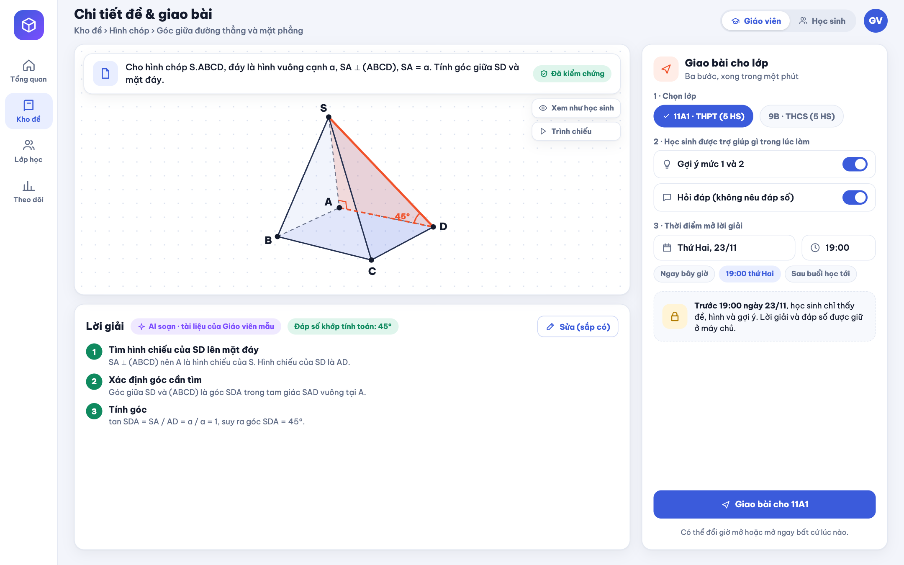

#### Học sinh 2 · Làm bài

Hình 3D là trung tâm. Thanh công cụ có biểu tượng và nhãn ở dưới hình. Bảng bên phải là gợi ý từng mức; lời giải đang khóa tới giờ giáo viên đặt.

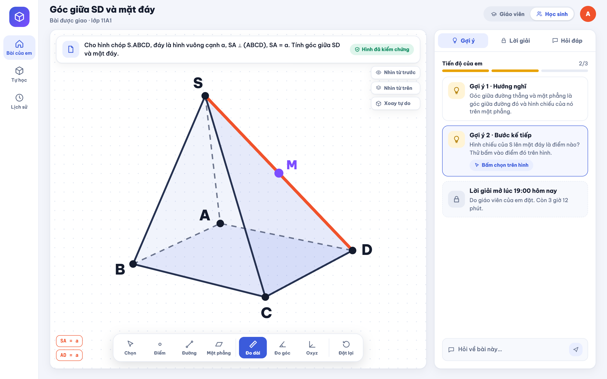

#### Học sinh 3 · Lời giải đã mở

Bấm bước nào, hình tô màu đối tượng của bước đó. Mỗi bước có phần "Vì sao nghĩ ra bước này?". Kết quả đo hiện ngay trên hình.

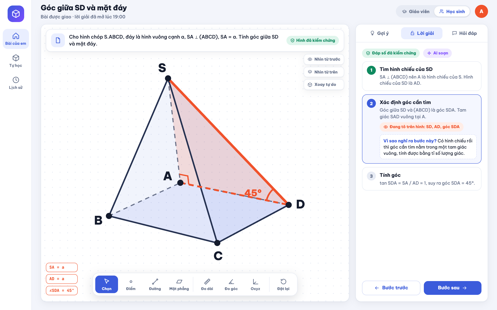

#### Giáo viên 3 · Theo dõi lớp

Ai đã mở bài, dùng gợi ý mức nào, hỏi gì. Thẻ vàng cho biết lời giải đang khóa, kèm nút Mở ngay và Đổi giờ.

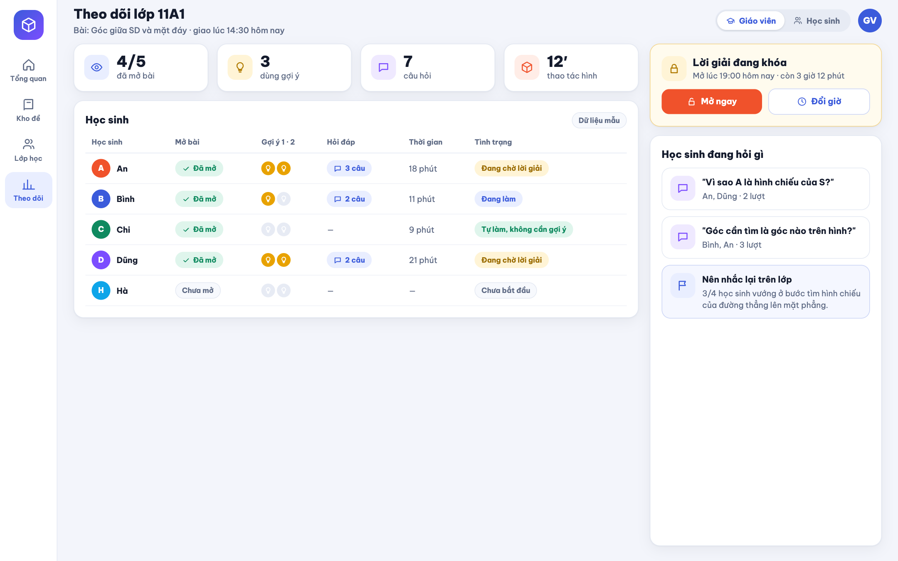

#### Học sinh · Từ khóa mở bài giảng

Từ khóa gạch chân trong gợi ý, lời giải và câu trả lời. Bấm vào mở bài giảng có hình minh họa, ghi rõ nguồn (bài soạn của giáo viên hoặc do AI viết) và các từ khóa liên quan.

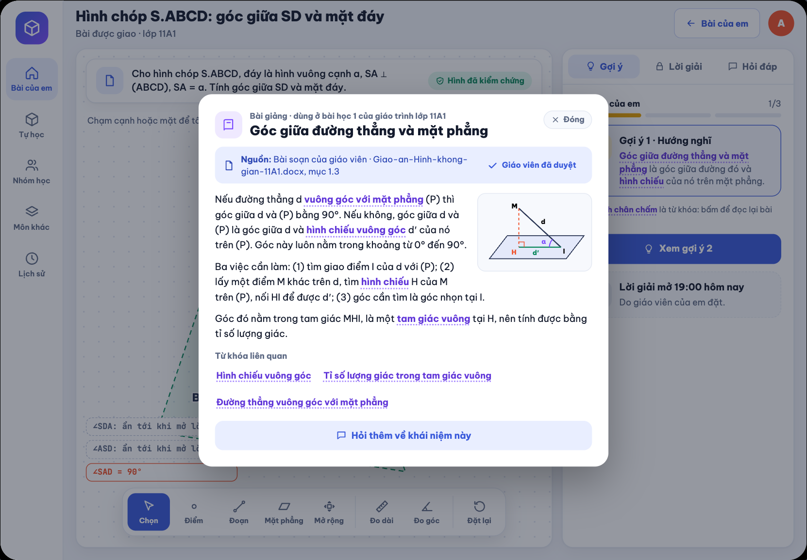

#### Học sinh · Hỏi AI, câu trả lời có nguồn

Câu trả lời dựa trên giáo trình của lớp và ghi dòng "Nguồn" bấm được. Trước giờ mở lời giải, AI không nêu đáp số; ngoài phạm vi giáo trình thì nói rõ là giáo trình chưa có phần này.

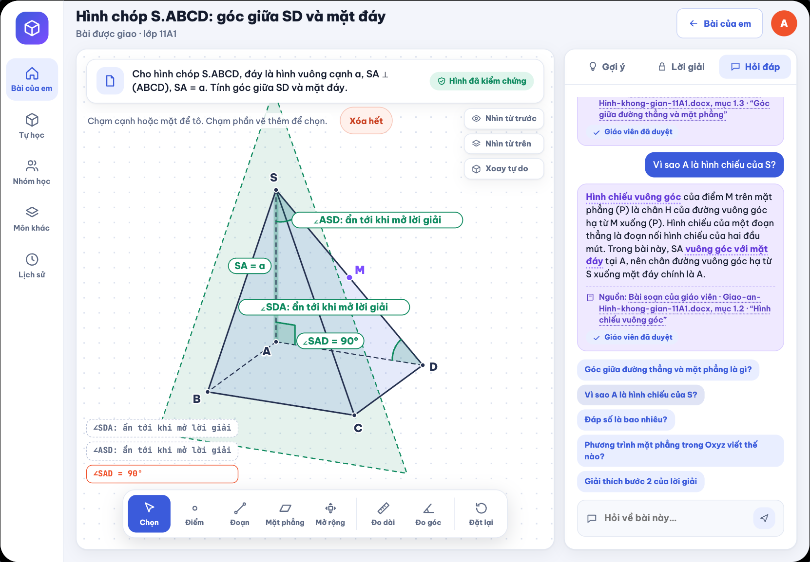

#### Bản mẫu tương tác và trình chiếu có chú thích

Ngoài ảnh thiết kế, có một bản mẫu tương tác chạy bằng dữ liệu mẫu: `Design/prototype/index.html`. Trong bản mẫu, AI trả lời bằng nội dung soạn sẵn và hình 3D chạy thật trên trình duyệt; chưa có máy chủ hay AI thật. Nút "▶ Trình chiếu" tự chạy ba kịch bản có chú thích như đang thuyết trình:

| Kịch bản | Số bước | Nội dung |
|---|---|---|
| Kịch bản chính | 22 | Giáo viên giao bài → học sinh xoay hình, vẽ thêm, mở rộng mặt, đo (đại lượng đề hỏi bị ẩn), bấm từ khóa đọc bài giảng, hỏi AI nhận câu trả lời có nguồn, hỏi đáp số bị từ chối khéo → giáo viên mở lời giải → học sinh xem từng bước, hình vẽ thêm dần → phụ huynh xem tiến độ |
| Soạn bài và giáo trình | 25 | Giáo viên soạn bài tập và bài giảng với AI, chat qua lại để chỉnh bản nháp, import từ file và ảnh, giáo trình riêng cho từng học sinh |
| Tầm nhìn | 12 | Các màn concept của chặng 2 đến 9 |

Thiết bị trong bản mẫu theo từng vai: học sinh iPad hoặc iPhone, phụ huynh iPhone, giáo viên web và kiểm tra nhanh bằng điện thoại.

## B4. Phạm vi

| Trong MVP | Ngoài MVP |
|---|---|
| Chóp, lăng trụ, hộp; nón, trụ, cầu cơ bản; Oxyz | Hình phẳng |
| Kho 40–60 đề soạn sẵn, lời giải AI đã kiểm chứng phần tính toán; bộ bài giảng mẫu có ghi nguồn | Giáo viên tự soạn đề và bài giảng, import tài liệu và ảnh, giáo trình riêng, đăng ký giáo viên thật |
| Lớp mẫu, giao bài, giờ mở lời giải | Trường, tenant, phụ huynh |
| Gợi ý 2 mức + lời giải; khóa ở server, kể cả chat; từ khóa mở bài giảng; hỏi đáp có ghi nguồn | Rubric, nộp bài viết tay, AI chấm bài |
| Đăng nhập nhẹ cho học sinh | Chat nhóm, video, thông báo, lịch |

## B5. Tính năng P0

| Nhóm | Nội dung |
|---|---|
| Nền tảng | Web app riêng; backend gọi AI; tách `geometry-engine`, `solver`, `scene3d`, `store`, `ui`; dữ liệu riêng từng người |
| Hình đúng | AI mô tả hình bằng ràng buộc, engine tính tọa độ; thư viện hình mẫu; kiểm chứng đáp số bằng số; nhãn "Đã kiểm chứng" / "Cần xem lại" |
| Tương tác 3D | Giữ công cụ hiện có; thêm trung điểm, điểm chia tỉ lệ, đo độ dài/góc/khoảng cách, nét khuất, bấm chọn trên hình, pinch-zoom; sửa các lỗi đã biết |
| Gợi ý và lời giải | Thang 3 mức; bấm bước nào, đường vẽ thêm của bước đó hiện dần trên hình; khóa lời giải theo giờ mở |
| Bài giảng và hỏi đáp | Từ khóa bấm được mở bài giảng có nguồn (bài soạn của giáo viên hoặc do AI viết, có nhãn); hỏi AI trả lời dựa trên giáo trình, ghi nguồn, không nêu đáp số trước giờ mở, nói rõ khi ngoài giáo trình |
| Giáo viên mẫu | Kho đề, giao bài, giờ mở lời giải, trang theo dõi lớp, xem trước giao diện học sinh |
| Đo lường | Bộ đề chuẩn, bộ câu thử moi đáp án, ghi sự kiện sử dụng |

## B6. Mốc phát triển

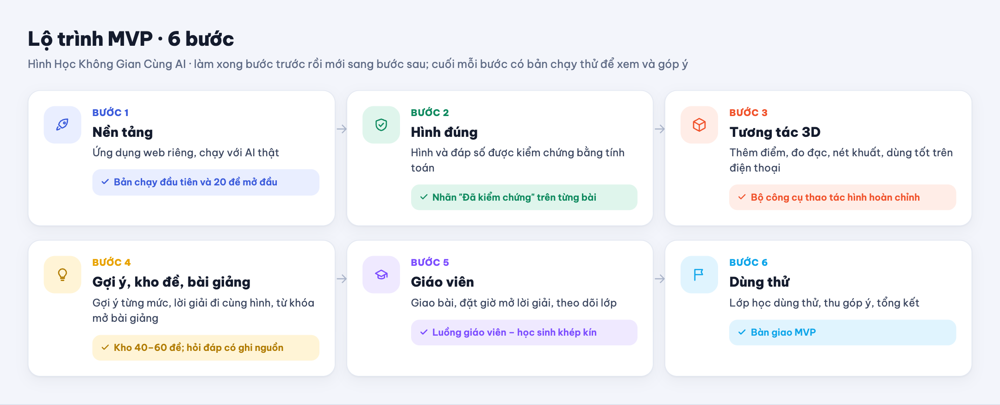

Các mốc làm nối tiếp nhau, xong mốc trước rồi mới sang mốc sau.

| Thứ tự | Mốc |
|---|---|
| 1 | M0 Nền: chạy ngoài artifact với AI thật, 20 đề đầu, đo độ đúng lần đầu |
| 2 | M1 Hình đúng: engine, ràng buộc, thư viện hình mẫu, kiểm chứng |
| 3 | M2 Tương tác: thêm điểm, đo đạc, nét khuất, điện thoại |
| 4 | M3 Gợi ý và kho đề 40–60 bài |
| 5 | M4 Giáo viên mẫu: lớp, giao bài, giờ mở, khóa ở server |
| 6 | M5 Dùng thử và quyết định bước tiếp |

## B7. Xong MVP khi
- Hình thỏa ràng buộc ≥ 95% và đáp số đúng ≥ 90% trên bộ đề chuẩn.
- Không bài sai nào mang nhãn "Đã kiểm chứng".
- Không lần nào lời giải lộ trước giờ mở trong bộ câu thử.
- Toàn bộ P0 chạy trên máy tính và điện thoại; kho đề đủ 40 bài đã kiểm chứng.

## B8. Nền móng đặt sẵn cho Phần C
Chỉ làm những thứ rẻ bây giờ và đắt nếu làm lại:
- `schema_version` trên mọi JSON; tách `Problem`, `SceneSpec`, `Solution`, `VerificationReport`, `Assignment`, `Interaction`.
- Lời giải lưu `model`, `prompt_version`, `author_id`; đã giao thì sửa bằng version mới.
- `geometry-engine` thuần hàm, không phụ thuộc giao diện.
- Lớp gọi AI phía server, đổi được model, ghi chi phí.
- `owner_id` trên mọi bản ghi; `org_id` để trống cho trường về sau.
- `release_at` trên bài giao: mầm của kiểm soát đáp án.
- Nhật ký tương tác: mầm của hồ sơ học tập.

Chưa làm: phân quyền nhiều tầng, tenant, kế thừa policy, liên trường.

---

# Phần C — Tầm nhìn dài hạn

Phần này cô đọng 8 file concept. Đây là **định hướng**, không phải phạm vi đã cam kết. Mô hình kinh doanh, pháp lý và nhu cầu thực tế đều chưa được kiểm chứng.

## C1. Vision, mission, định vị

**Vision.** Một mạng lưới giáo dục thống nhất, nơi mọi trường có thể kết nối, chia sẻ và phát triển; mọi giáo viên có công cụ tốt hơn để dạy; mọi học sinh có lộ trình học rõ ràng; cơ quan quản lý có dữ liệu đáng tin để điều phối và hỗ trợ.

**Mission.** Kết nối con người, tri thức, quy trình và dữ liệu giáo dục trên một nền tảng chung, dùng AI có trách nhiệm để nâng chất lượng học, giảm tải công việc và hỗ trợ quyết định dựa trên bằng chứng.

**Định vị dài hạn.** Hệ sinh thái giáo dục AI thống nhất: một mạng lưới chung, mỗi trường giữ bản sắc riêng.

**Điểm khởi đầu.** Làm thật tốt một môn. Môn đầu tiên là Hình học, bắt đầu từ hình không gian (Phần B).

**Không định vị là:** chatbot giải bài tập; phần mềm giao bài chấm điểm đơn lẻ; ERP trường học thuần túy; mạng xã hội học sinh không kiểm soát; AI thay giáo viên.

## C1b. Tầm nhìn qua giao diện

Bảy màn hình **concept** minh họa các năng lực chính của tầm nhìn. Chúng chưa có trong MVP, số liệu là giả định, và thiết kế sẽ đổi khi tới lượt làm.

#### Đánh giá và AI chấm bài

AI đọc bài viết tay, đề xuất điểm theo từng tiêu chí kèm độ tin cậy và chỉ ra chỗ sai. Giáo viên nhận, sửa, rồi duyệt mới thành điểm chính thức.

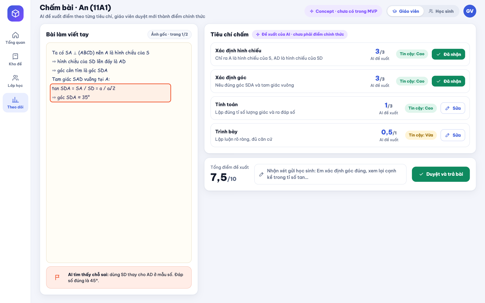

#### Hồ sơ học tập

Mức nắm theo từng khái niệm, chỗ hay vướng kèm bài làm căn cứ, và ghi nhận của giáo viên. Không gắn nhãn học sinh.

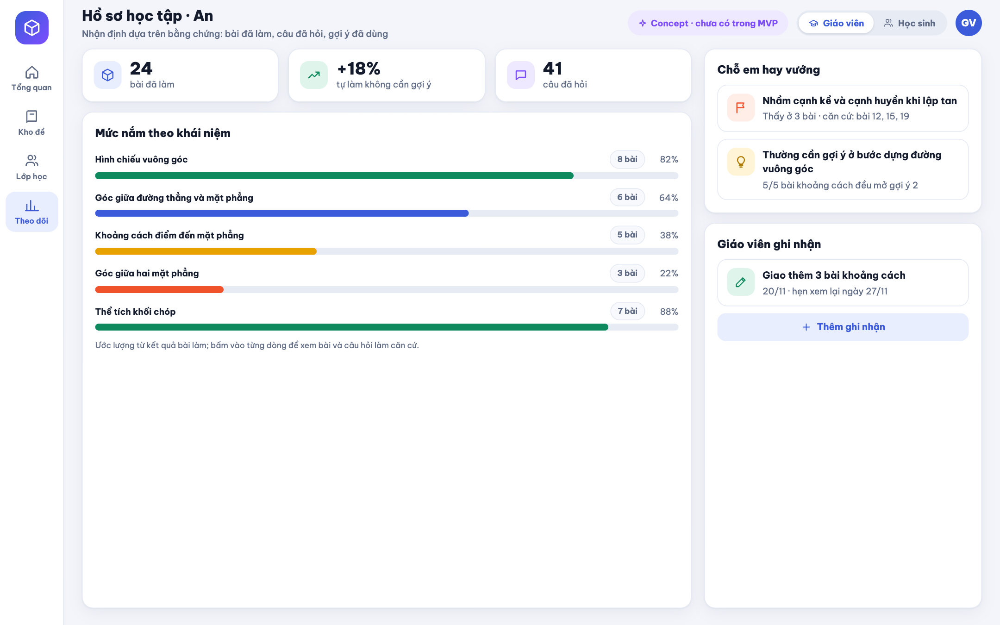

#### Trợ lý giáo viên

AI soạn nháp bộ đề từ tài liệu của thầy cô, có nhãn kiểm chứng trên từng bài. Chỉ vào kho đề khi thầy cô duyệt.

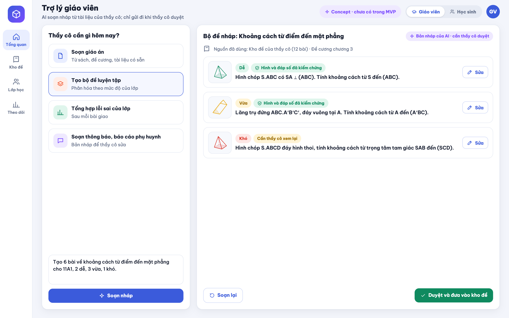

#### Phụ huynh

Tiến độ của con, điểm mạnh và phần cần luyện đã được giáo viên duyệt, lịch sắp tới, và kênh trao đổi với giáo viên.

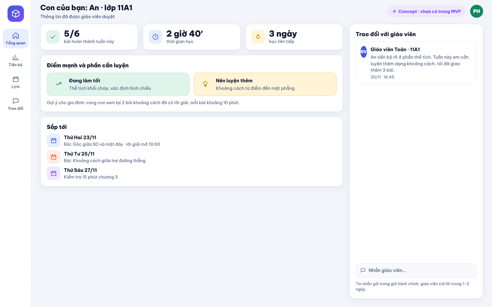

#### Cộng tác và liên trường

Nhóm học liên trường cùng thao tác trên một hình 3D, trao đổi có giáo viên điều phối, trợ lý nhóm chỉ gợi ý chứ không nêu đáp số. Nhóm do hai trường cùng duyệt và có nút báo cáo.

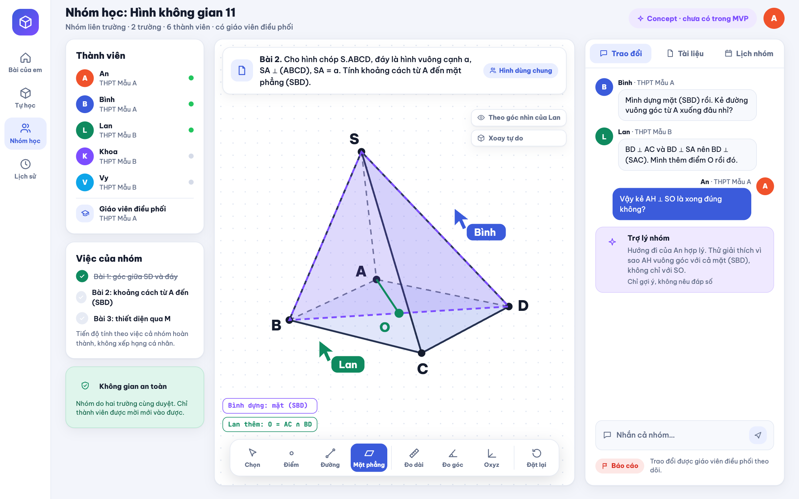

#### Vận hành trường

Số liệu tổng hợp theo tổ bộ môn, thông báo của trường, và nhận diện riêng của trường trên nền tảng chung.

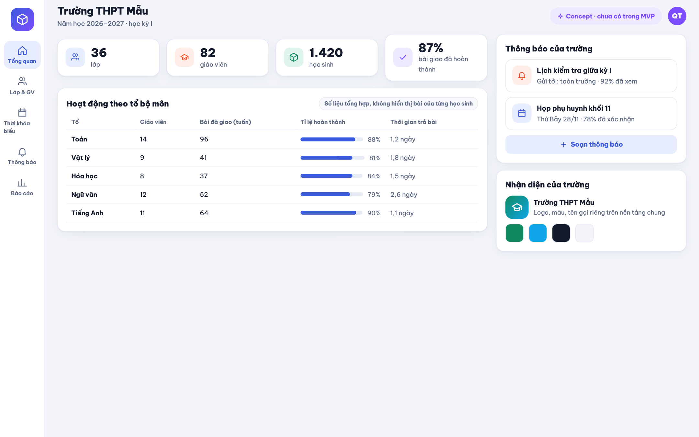

#### Quản trị giáo dục

Cơ quan quản lý phát hành văn bản, theo dõi xác nhận và triển khai theo từng trường. Chỉ xem số liệu tổng hợp trong phạm vi được ủy quyền.

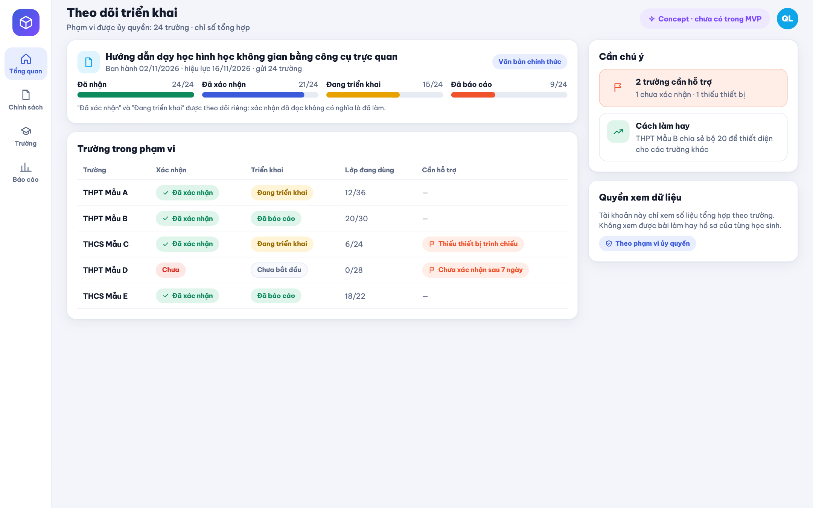

## C1c. Soạn giáo trình với AI (concept)

Ba việc giáo viên cần: soạn bài tập và bài giảng với AI, import từ file hoặc nhiều ảnh, và chat với AI để chỉnh bản nháp. Mọi nội dung AI soạn chỉ vào giáo trình khi giáo viên duyệt. Các màn dưới đây thuộc chặng 2, 5 và 6, chưa có trong MVP.

#### Chat với AI để chỉnh bản nháp

AI hỏi lại khi yêu cầu chưa rõ. Mỗi thay đổi hiện thành đề xuất "trước → sau" kèm lý do và chỗ AI chưa chắc. Giáo viên nhận hoặc bỏ từng đề xuất, hoàn tác, sửa tay; AI không tự lưu.

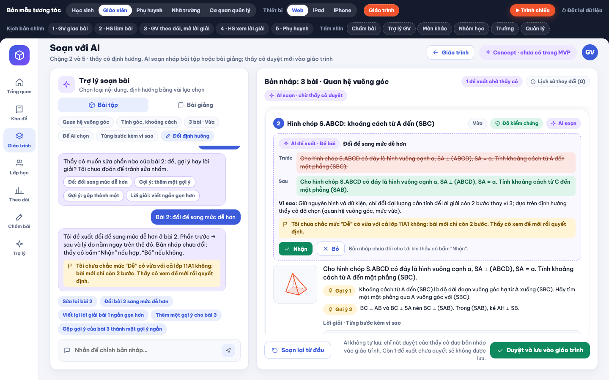

#### Soạn bài giảng với AI

Giáo viên định hướng khái niệm, lớp, có ví dụ và hình hay không; AI soạn nháp; giáo viên chỉnh, xem như học sinh rồi duyệt. Bài giảng ghi rõ nguồn và nhãn.

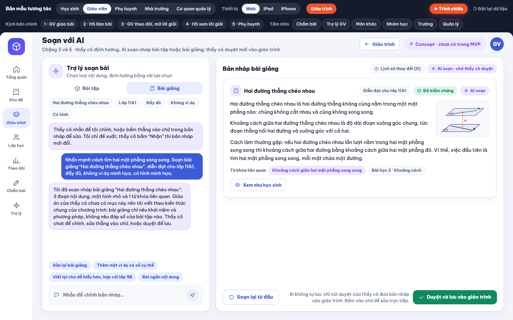

#### Import file: tách bài tập và bài giảng

File giáo án được tách thành hai nhóm. Giáo viên chọn mục muốn lưu, sửa bằng chat, rồi lưu vào giáo trình. Mục đã có trong kho được đối chiếu, không tạo bản trùng.

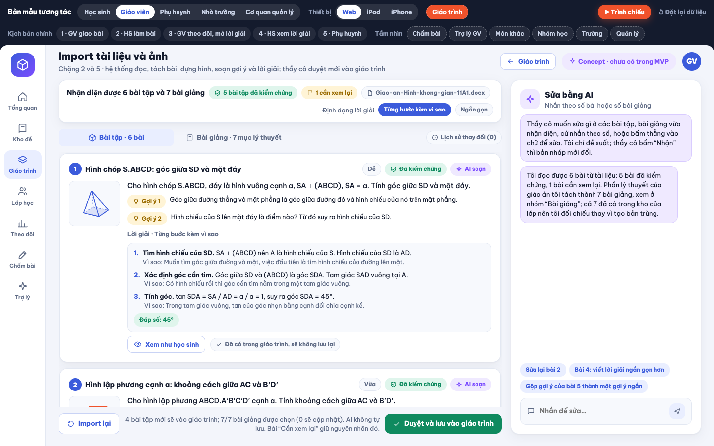

#### Import từ nhiều ảnh

Hệ thống đọc chữ trong ảnh, tô vàng chỗ máy chưa chắc để giáo viên sửa, rồi dựng bài với gợi ý và lời giải theo định dạng giáo viên chọn.

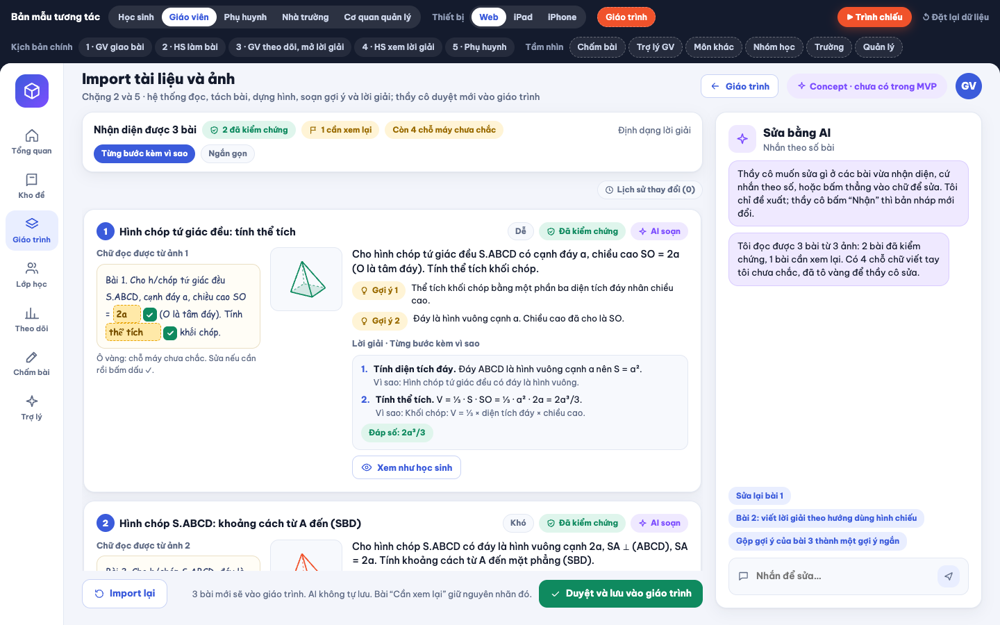

#### Giáo trình riêng cho từng học sinh

Từ giáo trình chung, AI đề xuất lộ trình riêng dựa trên phần đã vững và phần đang luyện, kèm bằng chứng. Giáo viên bỏ hoặc thêm từng mục rồi duyệt. Không gắn nhãn học sinh, không xếp hạng; phụ huynh chỉ thấy một dòng tóm tắt đã duyệt.

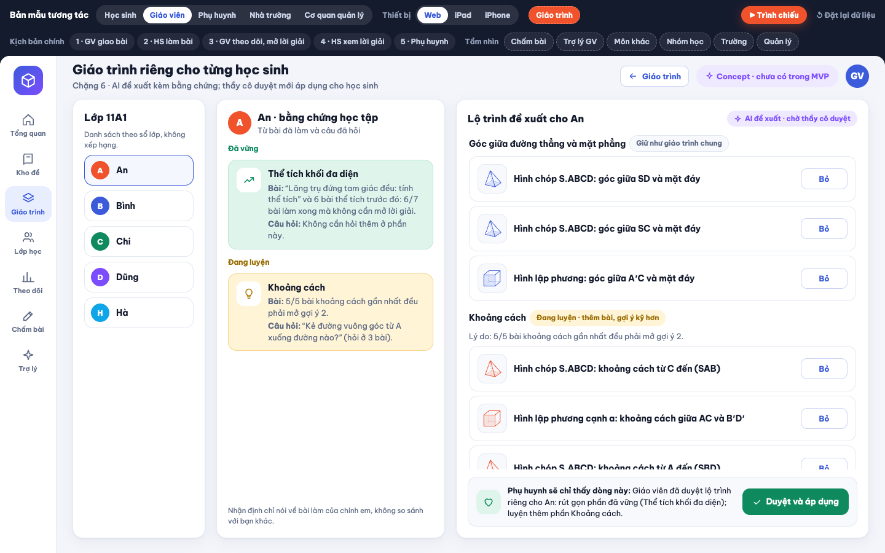

## C2. Nguyên tắc sản phẩm
1. Giáo viên dẫn dắt, AI hỗ trợ.
2. Học trước, đáp án sau.
3. Tri thức đã duyệt đứng trước nội dung AI tự sinh.
4. Đánh giá có hệ quả phải có người duyệt.
5. Nhận định về học sinh dựa trên bằng chứng, không gắn nhãn cố định.
6. Quyền tối thiểu, riêng tư mặc định.
7. Chuẩn chung, trường giữ bản sắc.
8. Nền tảng tập trung, ranh giới dữ liệu rõ ràng.
9. Dễ tiếp cận, phù hợp lứa tuổi.
10. Mọi hành động tác động lớn đều có dấu vết kiểm tra.
11. Kết nối hệ thống khác mà không nhân bản dữ liệu tràn lan.
12. Xây nền một lần, bật năng lực dần.
13. *(Bổ sung từ MVP)* Kết quả AI không được tin mặc định: hình và đáp số phải qua kiểm chứng.

## C3. Ai được gì

| Nhóm | Kết quả mong muốn |
|---|---|
| Học sinh | Hiểu cách giải và nguyên lý; phản hồi đúng lúc; theo dõi tiến bộ; học nhóm an toàn |
| Giáo viên | Giảm thời gian soạn, chấm, việc hành chính; thấy lịch sử câu hỏi và chỗ hiểu sai của từng học sinh |
| Phụ huynh | Theo dõi tiến độ, bài tập, phản hồi; phối hợp với giáo viên mà không tạo áp lực |
| Nhà trường | Quản trị lớp, lịch, chương trình, truyền thông; giữ bản sắc; hợp tác với trường khác |
| Cơ quan quản lý | Truyền tải chính sách; theo dõi triển khai; xem chỉ số tổng hợp trong thẩm quyền |

## C4. Bản đồ năng lực

| Lĩnh vực | Năng lực chính | Có trong MVP? |
|---|---|---|
| Môn học tương tác | Dựng hình, kiểm chứng, thao tác, gợi ý | **Có** (hình không gian) |
| Nền tảng dạy và học | Lớp, bài giao, tài liệu, nộp bài, phản hồi | Một phần (lớp mẫu, giao bài) |
| Kiểm soát đáp án | Giờ mở lời giải, chặn lộ đáp án qua AI | Một phần (giờ mở, khóa ở server) |
| Tri thức do giáo viên kiểm soát | Kho tài liệu có version, duyệt, cấp quyền theo lớp | Mầm (kho đề của Giáo viên mẫu; bài giảng mẫu có ghi nguồn) |
| Soạn giáo trình | Soạn bài tập và bài giảng với AI, import từ tài liệu và ảnh, chat chỉnh bản nháp, giáo trình chung và riêng | Chưa (chặng 2, 5, 6) |
| Đánh giá và AI chấm bài | Rubric, AI đề xuất điểm, giáo viên duyệt, phúc khảo | Chưa |
| Hồ sơ học tập | Lịch sử câu hỏi, mức nắm khái niệm, tiến bộ | Mầm (nhật ký tương tác) |
| Trợ lý giáo viên | Soạn bài, tạo đề, tổng hợp lỗi sai, soạn thông báo | Chưa |
| Phụ huynh | Xác minh quan hệ, xem tiến độ, trao đổi | Chưa |
| Cộng tác | Nhóm học, chat, video có điều phối, liên trường | Chưa |
| Vận hành trường | Nhân sự, thời khóa biểu, điểm danh, sự kiện | Chưa |
| Quản trị giáo dục | Thông báo chính sách, theo dõi triển khai, báo cáo | Chưa |
| Định danh và liên thông | Tổ chức nhiều cấp, phân quyền, tích hợp hệ thống ngoài | Chưa |
| An toàn và tin cậy | Riêng tư, bảo vệ trẻ em, kiểm duyệt, audit | Tối thiểu |

## C5. Yêu cầu đích theo lĩnh vực (rút gọn)

**Tổ chức và định danh.** Phân cấp nền tảng → cơ quan quản lý → nhóm trường → trường → năm học → lớp. Một người có thể giữ nhiều vai trò theo phạm vi. Trường tùy biến nhận diện và policy trong giới hạn cấp trên cho phép.

**Dạy và học.** Giáo viên tạo lớp, giao bài từ chữ, ảnh, PDF; gắn mục tiêu, hạn nộp, tài liệu được phép. Học sinh chỉ thấy bài của lớp mình, nộp bài chữ hoặc nhiều ảnh viết tay; ảnh gốc được giữ nguyên, bản đọc chữ là bản phái sinh sửa được.

**Đánh giá và AI chấm bài.** Rubric có version bất biến. AI chấm từng tiêu chí, kèm lý do, bằng chứng, độ tin cậy. Điểm AI là đề xuất; chỉ giáo viên duyệt mới thành điểm chính thức. Giáo viên điều khiển thời điểm công bố điểm, đáp án, lời giải.

**Tri thức do giáo viên kiểm soát.** Kho tài liệu có chủ sở hữu, trạng thái, version, phạm vi. AI phía học sinh chỉ dùng tài liệu đã duyệt và đang hiệu lực; mỗi câu trả lời truy được về nguồn.

**Kiểm soát đáp án (Answer Firewall).** Mọi yêu cầu AI của học sinh được kiểm tra ở server: danh tính, lớp, bài, trạng thái, lịch công bố đáp án. Trong lúc làm bài, AI chỉ gợi ý hoặc giải thích khái niệm. Không lộ đáp án, ghi chú riêng của giáo viên, hay bài của học sinh khác.

**Hồ sơ học tập.** Ghi lại câu hỏi, câu trả lời, ngữ cảnh. Giáo viên xem lịch sử câu hỏi của học sinh lớp mình. Nhận định gắn với bằng chứng, không mô tả học sinh là yếu, lười hay kém.

**Trợ lý giáo viên.** Soạn nháp giáo án, bộ câu hỏi, rubric, tổng hợp lỗi phổ biến, thông báo, báo cáo phụ huynh. Không gửi, không công bố, không đổi điểm nếu giáo viên chưa bấm duyệt.

**Soạn giáo trình với AI.** Giáo viên soạn bài tập và bài giảng bằng cách trao đổi với AI, hoặc import từ tài liệu (docx, xlsx, pdf) và từ nhiều ảnh chụp. Hệ thống đọc chữ trong ảnh, giữ ảnh gốc, tô chỗ máy chưa chắc để giáo viên sửa, tách bài tập và bài giảng, dựng gợi ý và lời giải theo định dạng giáo viên chọn. Trao đổi hai chiều: AI hỏi lại khi yêu cầu chưa rõ; mỗi thay đổi là một đề xuất "trước → sau" kèm lý do và chỗ chưa chắc; giáo viên nhận, bỏ, sửa tay hoặc hoàn tác. AI không tự lưu: chỉ giáo viên bấm duyệt mới vào giáo trình. Nhãn hai trục: máy ("Đã kiểm chứng" / "Cần xem lại") và người ("AI soạn" / "Giáo viên đã duyệt").

**Giáo trình riêng.** Từ giáo trình chung, AI đề xuất lộ trình cho từng học sinh dựa trên bằng chứng (bài nào, câu hỏi nào); giáo viên duyệt mới áp dụng. Diễn đạt là "đã vững" và "đang luyện", không gắn nhãn, không xếp hạng, không so sánh học sinh. Học sinh thấy lộ trình của mình; phụ huynh chỉ thấy phần giáo viên đã duyệt.

**Hỏi đáp theo giáo trình.** Câu trả lời của AI dựa trên giáo trình của lớp và ghi rõ nguồn; từ khóa bấm được mở bài giảng. Trước giờ mở lời giải, AI chỉ giải thích khái niệm và gợi hướng, không nêu đáp số; ngoài phạm vi giáo trình thì nói rõ là giáo trình chưa có phần này.

**Phụ huynh.** Quan hệ phụ huynh–học sinh được trường xác minh; chỉ xem thông tin của con mình và trong phạm vi cho phép.

**Giao tiếp và cộng tác.** Thông báo lớp, nhắc hạn; về sau là lịch, nhóm học, chat, video có điều phối và cơ chế báo cáo an toàn.

**Vận hành trường, liên trường, quản trị giáo dục.** Quản lý nhân sự, lớp, thời khóa biểu; trang trường, chia sẻ tài nguyên có cấp phép; cơ quan quản lý phát hành thông báo chính sách và theo dõi triển khai trong phạm vi thẩm quyền.

**Yêu cầu chung.** Cách ly dữ liệu ở server; mã hóa; audit hành động nhạy cảm; tác vụ AI chạy nền, chạy lại an toàn; ưu tiên tiếng Việt, dùng được trên điện thoại; version hóa prompt, model và bộ đề đánh giá.

## C6. Kiến trúc đích

| Hạng mục | Định hướng |
|---|---|
| Kiểu ứng dụng | Modular monolith; chỉ tách dịch vụ khi có số đo chứng minh cần |
| Triển khai | Một nền tảng tập trung |
| Dữ liệu | PostgreSQL; file trên object storage; hàng đợi cho tác vụ nền |
| Nhiều trường | Bản ghi gắn tenant, lọc bắt buộc ở server; chia sẻ liên trường qua cấp phép tường minh |
| AI | Một lớp gọi AI phía server, không phụ thuộc nhà cung cấp; kiểm tra cấu trúc đầu ra; đo chi phí |
| Policy | Nền tảng → cơ quan quản lý → trường → lớp/giáo viên; cấp dưới không tắt được yêu cầu bắt buộc cấp trên |
| Môn học | Mỗi môn là một module có `parse`, `solve`, `verify`, `render`, `hint` *(bổ sung từ MVP)* |

Luồng AI phía học sinh ở đích: xác thực → xác định lớp và bài → kiểm tra trạng thái và lịch công bố đáp án → lấy tài liệu đã duyệt → sinh câu trả lời → kiểm tra nguồn và lộ đáp án → cho phép, sửa, từ chối hoặc chuyển giáo viên → lưu tương tác.

Luồng chấm bài ở đích: nhận bài → giữ ảnh gốc → đọc chữ → AI chấm theo tiêu chí → kiểm tra điểm bằng quy tắc cứng → lưu đề xuất → giáo viên xem, sửa, duyệt → công bố.

## C7. Dữ liệu và phân quyền

Nguyên tắc: mỗi tài nguyên có chủ, phạm vi và vòng đời; dữ liệu học sinh riêng tư mặc định; kết quả AI là bản ghi hạng nhất có nguồn gốc model và prompt; bản đã công bố thì bất biến.

Nhóm thực thể ở đích: tổ chức và định danh; học vụ (năm học, lớp, môn, chuẩn chương trình); bài giao, rubric, bài nộp, đề xuất chấm, điểm đã duyệt; kho tri thức và tương tác AI; tín hiệu học tập và can thiệp của giáo viên; giao tiếp, nhóm học, an toàn; liên trường và quản trị; audit.

Phân quyền ở đích (tóm tắt):

| Tài nguyên | Giáo viên | Học sinh | Phụ huynh | Quản trị trường | Cơ quan quản lý |
|---|---|---|---|---|---|
| Bài đã giao | Lớp mình dạy | Lớp mình học | Lớp của con, nếu được phép | Theo phạm vi trường | Tổng hợp |
| Bài nộp | Lớp mình dạy | Của mình | Của con, bản được duyệt | Giới hạn theo policy | Tổng hợp hoặc được ủy quyền |
| Đề xuất chấm của AI | Lớp mình dạy | Không | Không | Không mặc định | Không |
| Điểm đã duyệt | Lớp mình dạy | Của mình | Của con | Phạm vi học vụ | Tổng hợp hoặc được ủy quyền |
| Lịch sử câu hỏi | Học sinh mình dạy | Của mình | Không mặc định | Theo policy | Tổng hợp hoặc được ủy quyền |

Quản trị nền tảng không mặc nhiên xem được nội dung học tập; truy cập khẩn cấp phải có mục đích, thời hạn và audit.

## C8. Luồng nghiệp vụ ở đích
- Giáo viên soạn và công bố bài giao (có rubric, tài liệu, lịch công bố đáp án).
- Học sinh làm và nộp bài.
- AI chấm, giáo viên duyệt.
- Học sinh hỏi AI trong lúc làm bài, qua lớp kiểm soát đáp án.
- Giáo viên quản lý kho tri thức.
- Giáo viên xem lịch sử câu hỏi và ghi nhận can thiệp.
- Giáo viên soạn bài tập và bài giảng với AI hoặc import từ file và ảnh, chỉnh bằng chat, duyệt, lưu vào giáo trình; tạo giáo trình riêng cho từng học sinh.
- Trợ lý giáo viên soạn nháp.
- Phụ huynh được xác minh và truy cập.
- Hợp tác liên trường qua cấp phép.
- Cơ quan quản lý phát hành và theo dõi chính sách.

Trạng thái chính: bài giao (nháp → công bố → đóng → lưu trữ); bài nộp (nháp → đã nộp → xử lý → chờ giáo viên → đã duyệt → đã trả); kho tri thức (nháp → chờ duyệt → đang dùng → lưu trữ).

## C9. Chỉ số dài hạn

**North Star dài hạn.** Số vòng học đã xác nhận mỗi lớp mỗi tuần: bài được giao, học sinh làm, AI phân tích, giáo viên duyệt, học sinh nhận phản hồi.

**North Star giai đoạn MVP.** Số bài hình không gian mà học sinh thao tác trên hình và đi hết gợi ý mỗi tuần.

Nhóm chỉ số về sau: tiến bộ học tập; thời gian giáo viên tiết kiệm; mức phụ huynh tham gia; mức số hóa của trường; hợp tác liên trường; độ phủ chính sách; sự cố truy cập sai và lộ đáp án.

## C10. Cổng phát hành ở đích

| Cổng | Điều kiện chính |
|---|---|
| A — Nội bộ | Vòng giáo viên–học sinh chạy; cách ly dữ liệu đạt; giáo viên duyệt là bắt buộc |
| B — Pilot có kiểm soát | Không còn lỗi bảo mật nghiêm trọng; bộ thử moi đáp án đạt; AI chấm đã chạy song song với giáo viên trên dữ liệu thật |
| C — Mở rộng pilot | Thời gian chấm giảm mà chất lượng không giảm; không sự cố an toàn nghiêm trọng |
| D — Sang giai đoạn hệ sinh thái | Nền học tập ổn định; thiết kế bảo vệ trẻ em được duyệt trước khi mở chat/video; xác minh phụ huynh được thử trước khi mở cổng phụ huynh |

Công tắc an toàn: tắt được AI chấm theo trường, môn, chủ đề; tắt được AI phía học sinh độc lập với giao bài; khi lộ đáp án thì tắt AI học sinh ngay, luồng học vẫn chạy.

## C11. Rủi ro dài hạn

| Rủi ro | Hướng xử lý |
|---|---|
| Tầm nhìn quá rộng làm mất trọng tâm | Phần B thắng Phần C; chỉ mở khi đạt điều kiện ở Phần D |
| AI sinh hình hoặc đáp số sai | Kiểm chứng bằng engine; nhãn trạng thái; bộ đề chuẩn |
| AI chấm sai | Giáo viên duyệt, bằng chứng, chạy song song trước khi dùng |
| AI lộ đáp án | Khóa ở server, bộ câu thử |
| Truy cập sai dữ liệu học sinh | Phân quyền theo phạm vi, cách ly, audit |
| Chưa có người mua | Xác định người trả tiền trước khi xây phần cho trường |
| Chat/video gây rủi ro cho trẻ | Thiết kế an toàn và kiểm duyệt trước khi mở |
| Nhà cung cấp model thay đổi | Lớp gọi AI trung gian, bộ đề đánh giá |

## C12. Việc cần quyết trước khi vận hành thật
- Pháp nhân vận hành và chủ thể quản lý dữ liệu.
- Quy định áp dụng cho dữ liệu trẻ em và hồ sơ học tập.
- Nơi lưu dữ liệu, nhà cung cấp hạ tầng và model.
- Chính sách lưu giữ, xóa, xuất dữ liệu, đồng thuận.
- Cách cấp tài khoản học sinh và xác minh phụ huynh.
- Mô hình kinh doanh và người trả tiền.

---

# Phần D — Lộ trình và quyết định

## D1. Lộ trình nối MVP lên tầm nhìn

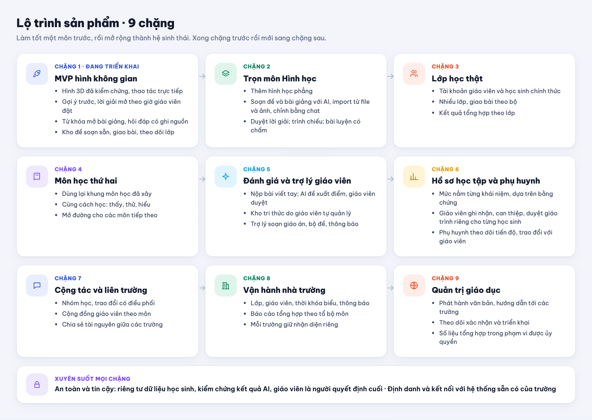

Chín chặng nối tiếp nhau. Lộ trình chỉ ghi thứ tự, không đặt thời hạn; mỗi chặng mở khi đạt điều kiện ở cột cuối.

| Chặng | Nội dung | Điều kiện mở |
|---|---|---|
| 1 | **MVP hình không gian** (Phần B): kho đề, giáo viên mẫu, giờ mở lời giải, hình được kiểm chứng | Đang làm |
| 2 | **Trọn môn Hình học**: hình phẳng; giáo viên thật tự thêm đề, soạn đề và bài giảng với AI, import từ file và ảnh, chat chỉnh bản nháp, duyệt lời giải; trình chiếu; bài luyện có chấm tự động | MVP đạt tiêu chí B7 |
| 3 | **Lớp học thật**: đăng ký giáo viên, nhiều lớp, giao bài theo bộ, kết quả tổng hợp theo lớp | Có giáo viên thật dùng lặp lại ở chặng 2 |
| 4 | **Môn học thứ hai** dùng lại khung môn học | Hình học giữ chân được học sinh |
| 5 | **Đánh giá và trợ lý giáo viên**: nộp bài viết tay, rubric, AI đề xuất điểm, giáo viên duyệt; kho tri thức và kiểm soát đáp án đầy đủ; trợ lý soạn giáo án, bộ đề, thông báo; hỏi đáp của học sinh dựa trên kho tri thức do giáo viên tự quản lý | Có ít nhất một trường cam kết pilot |
| 6 | **Hồ sơ học tập và phụ huynh**: mức nắm theo bằng chứng, giáo trình riêng cho từng học sinh | Chặng 5 ổn định; xác minh phụ huynh đã thử |
| 7 | **Cộng tác và liên trường**: nhóm học, chat, video có điều phối, cộng đồng giáo viên, chia sẻ tài nguyên giữa các trường | Thiết kế bảo vệ trẻ em được duyệt |
| 8 | **Vận hành nhà trường** | Có trường yêu cầu và trả tiền |
| 9 | **Quản trị giáo dục** | Có ủy quyền pháp lý và đối tác quản lý |

Xuyên suốt mọi chặng: an toàn và tin cậy (riêng tư dữ liệu học sinh, kiểm chứng kết quả AI, giáo viên quyết định cuối); định danh và kết nối với hệ thống sẵn có của trường.

Chặng 5 đến 9 giữ đúng trình tự của roadmap trong file 06 của bộ concept.

## D2. Bảng quyết định

| ID | Quyết định trong bộ concept | Trạng thái mới |
|---|---|---|
| D-01 | Hệ sinh thái giáo dục AI thống nhất | Tầm nhìn dài hạn |
| D-02 | Quản trị liên bang (chuẩn chung, trường tự chủ) | Tầm nhìn dài hạn |
| D-03 | Một nền tảng tập trung, phân quyền đa cấp | Tầm nhìn dài hạn |
| D-04 | Thiết kế cả hệ sinh thái từ đầu | **Thay**: chỉ đặt sẵn nền móng ở B8, xây theo từng môn |
| D-05 | MVP = Teacher + Student + AI Grading | **Thay**: MVP = hình không gian, giáo viên mẫu, giờ mở lời giải; AI chấm bài lùi về chặng 5 |
| D-06 | Pilot Toán 10–12 | **Thay**: hình không gian, THCS và THPT |
| D-07 | Modular monolith + multi-tenant | Giữ modular monolith; multi-tenant lùi về chặng 5, để sẵn `org_id` |
| D-08 | Kho tri thức giáo viên + Answer Firewall | Làm một phần trong MVP (kho đề mẫu, giờ mở, khóa ở server); bản đầy đủ ở chặng 5 |
| D-09 | Giáo viên duyệt điểm cuối | Giữ làm nguyên tắc |
| D-10 | Mỗi trường giữ bản sắc riêng | Tầm nhìn dài hạn |
| **D-11** | — | **Mới**: bắt đầu bằng một môn; môn đầu là Hình học, mở đầu bằng hình không gian |
| **D-12** | — | **Mới**: gợi ý trước; lời giải mở theo thời điểm giáo viên đặt |
| **D-13** | — | **Mới**: hình và đáp số phải qua kiểm chứng bằng tính toán trước khi gắn nhãn tin cậy |
| **D-14** | — | **Mới**: giáo viên soạn bài tập và bài giảng với AI hoặc import từ file và ảnh; AI hỏi lại, đề xuất trước/sau, giáo viên duyệt mới lưu (PO-27, PO-28, PO-45, PO-46) |
| **D-15** | — | **Mới**: hỏi đáp dựa trên giáo trình và ghi nguồn; từ khóa mở bài giảng có nguồn; hình tương tác, lời giải cập nhật hình (PO-33 đến PO-36). Mức MVP theo giả định PO-49 |
| **D-16** | — | **Mới**: giáo trình riêng cho từng học sinh, dựa trên bằng chứng, giáo viên duyệt (PO-29, PO-31) |

## D3. Câu hỏi còn mở
1. Bài tự học không có giáo viên: lời giải mở sau khi xem hết gợi ý (đang giả định), hay cách khác?
2. "Lời giải AI thành một giáo viên": hiểu là một tài khoản Giáo viên mẫu sở hữu kho đề và lời giải AI. Có đúng không?
3. Ai soát kho đề trước khi học sinh thật dùng?
4. Người trả tiền đầu tiên là ai?
5. Giữ tên "Hình Học Cùng AI" hay đặt tên nền tảng?
6. Bài giảng do AI viết mà giáo viên chưa duyệt có được hiện cho học sinh không? Đang để hiện kèm nhãn "AI soạn · chờ giáo viên duyệt" (PO-43).
7. Hộp bài giảng phía học sinh có cần nhãn máy ("Đã kiểm chứng" / "Cần xem lại") không? (PO-48)
8. Từ khóa, bài giảng có nguồn và hỏi đáp theo giáo trình đặt ở MVP hay dời sang chặng 5? Đang giả định MVP ở mức mẫu (PO-49).

## D4. Tài liệu nguồn

| Tài liệu | Vai trò |
|---|---|
| `PRODUCT-MASTER.md` | Tài liệu sản phẩm duy nhất, có hiệu lực |
| `MVP.md` | Chi tiết triển khai của Phần B |
| `SPEC.md`, `GUIDELINE.pdf` | Giới thiệu bản hiện tại, có ảnh |
| `SPEC-technical.md` | Kỹ thuật, hạn chế, backlog của bản hiện tại |
| `PO-DECISIONS.md` | Sổ quyết định: điều chủ đầu tư đã chốt và các giả định của PO chờ xác nhận |
| `STAGES-AFTER-MVP.md` | Thiết kế chi tiết các chặng 2 đến 9 |
| `DOMAIN-PROFILE.md` | Hồ sơ domain làm đầu vào cho skill |
| `Design/prototype/index.html` | Bản mẫu tương tác và trình chiếu có chú thích |
| `REVIEW-AND-MVP.md` | Nhận xét và so sánh dẫn tới các quyết định trên |
| `input/ChatGPT Concept/00–07` | Nguồn chi tiết của Phần C, không còn là baseline |
