# Hình Học Không Gian Cùng AI

**MVP và lộ trình phát triển**

Một môn Hình học mà học sinh nhìn thấy, tự tay thao tác trên hình 3D và được gợi ý từng bước; giáo viên có sẵn kho đề, giao bài và quyết định khi nào học sinh được xem lời giải.

---

## 1. MVP mang lại gì

| Cho học sinh | Cho giáo viên | Về độ tin cậy |
|---|---|---|
| Hình 3D xoay, phóng to, đo đạc, thêm điểm và đường ngay trên hình | Kho đề hình không gian soạn sẵn, kèm hình và lời giải từng bước | Hình và đáp số được kiểm chứng bằng tính toán, không chỉ dựa vào AI |
| Gợi ý từng mức thay vì đưa đáp án ngay | Giao bài cho lớp trong ba bước | Mỗi bài có nhãn "Đã kiểm chứng" hoặc "Cần xem lại" |
| Lời giải đi cùng hình: bấm bước nào, đường vẽ thêm của bước đó hiện dần trên hình | Đặt thời điểm mở lời giải; đổi giờ hoặc mở ngay bất cứ lúc nào | Lời giải được giữ ở máy chủ cho tới giờ mở |
| Từ khóa bấm được mở bài giảng để đọc lại; hỏi AI và nhận câu trả lời dựa trên giáo trình, ghi rõ nguồn | Bài giảng và giáo trình mẫu có sẵn, ghi rõ nguồn là bài soạn của giáo viên hay do AI viết | Hỏi đáp trước giờ mở lời giải không nêu đáp số; ngoài giáo trình thì nói rõ là chưa có |
| Dùng được trên iPad, iPhone (học sinh, phụ huynh) và web (giáo viên) | Theo dõi lớp: ai đã mở bài, dùng gợi ý nào, đang hỏi gì | Lời giải ghi rõ nguồn "AI soạn" để giáo viên soát lại |

MVP tập trung vào **hình học không gian** cho cả THCS và THPT: hình chóp, lăng trụ, hình hộp, nón, trụ, cầu và hệ trục Oxyz.

## 2. Giao diện MVP

Các hình dưới đây là bản thiết kế giao diện. Ngoài ra có bản mẫu tương tác và trình chiếu có chú thích (mục "Bản mẫu tương tác" bên dưới).

#### Giáo viên giao bài và đặt giờ mở lời giải

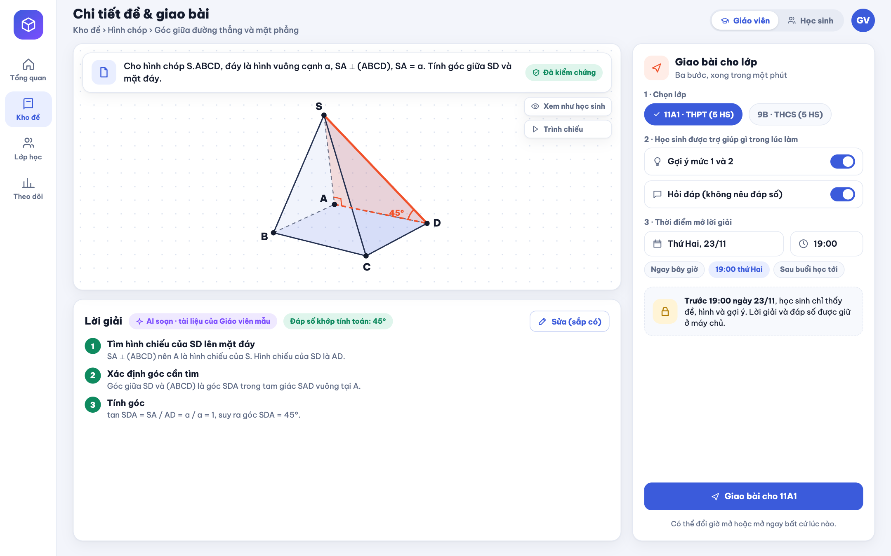

#### Học sinh làm bài: hình 3D ở giữa, gợi ý bên phải, lời giải đang khóa

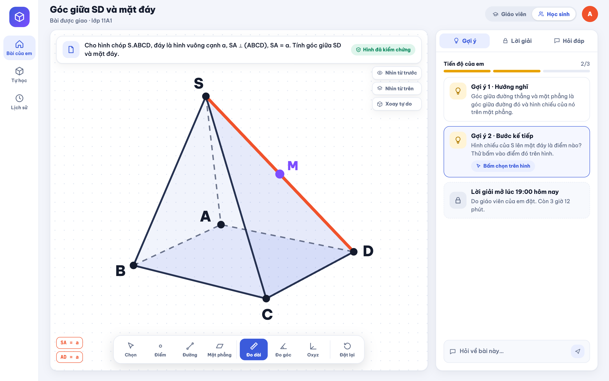

#### Lời giải đã mở: từng bước đi cùng hình

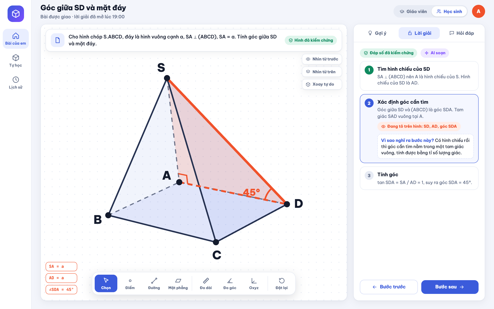

#### Giáo viên theo dõi lớp

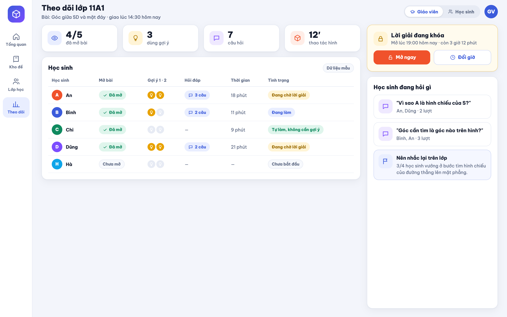

#### Học sinh · Từ khóa mở bài giảng

Từ khóa gạch chân trong gợi ý, lời giải và câu trả lời. Bấm vào mở bài giảng có hình minh họa, ghi rõ nguồn (bài soạn của giáo viên hoặc do AI viết) và các từ khóa liên quan.

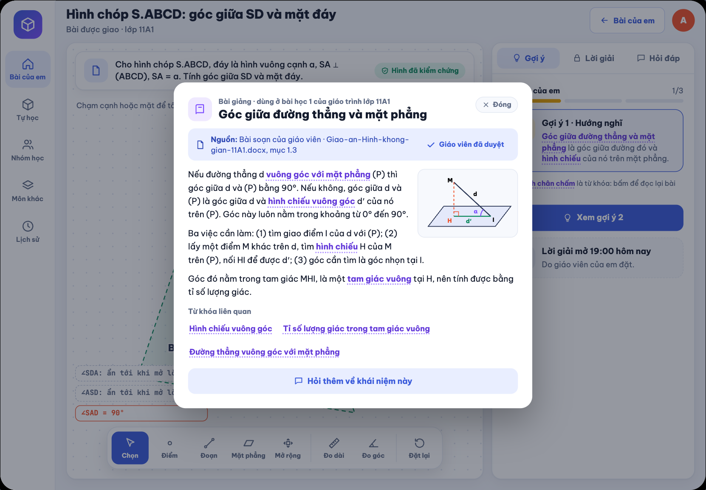

#### Học sinh · Hỏi AI, câu trả lời có nguồn

Câu trả lời dựa trên giáo trình của lớp và ghi dòng "Nguồn" bấm được. Trước giờ mở lời giải, AI không nêu đáp số; ngoài phạm vi giáo trình thì nói rõ là giáo trình chưa có phần này.

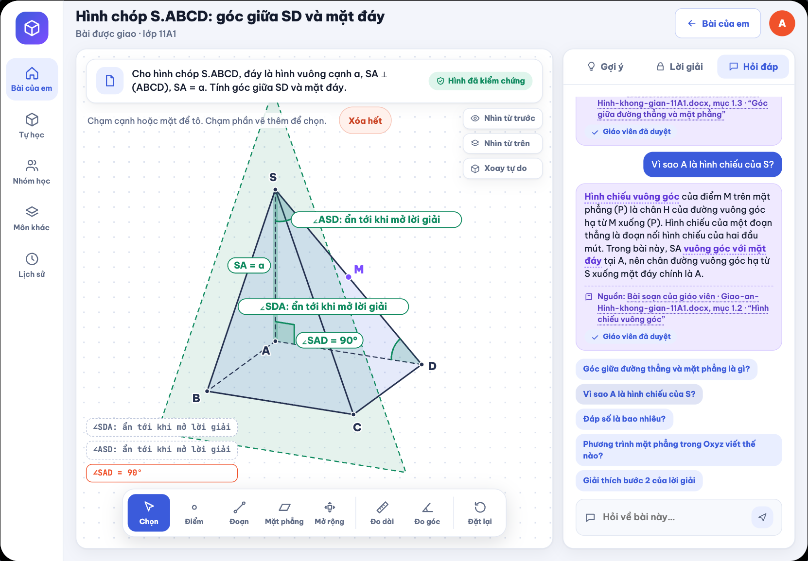

#### Bản mẫu tương tác và trình chiếu có chú thích

Ngoài ảnh thiết kế, có một bản mẫu tương tác chạy bằng dữ liệu mẫu: `Design/prototype/index.html`. Trong bản mẫu, AI trả lời bằng nội dung soạn sẵn và hình 3D chạy thật trên trình duyệt; chưa có máy chủ hay AI thật. Nút "▶ Trình chiếu" tự chạy ba kịch bản có chú thích như đang thuyết trình:

| Kịch bản | Số bước | Nội dung |
|---|---|---|
| Kịch bản chính | 22 | Giáo viên giao bài → học sinh xoay hình, vẽ thêm, mở rộng mặt, đo (đại lượng đề hỏi bị ẩn), bấm từ khóa đọc bài giảng, hỏi AI nhận câu trả lời có nguồn, hỏi đáp số bị từ chối khéo → giáo viên mở lời giải → học sinh xem từng bước, hình vẽ thêm dần → phụ huynh xem tiến độ |
| Soạn bài và giáo trình | 25 | Giáo viên soạn bài tập và bài giảng với AI, chat qua lại để chỉnh bản nháp, import từ file và ảnh, giáo trình riêng cho từng học sinh |
| Tầm nhìn | 12 | Các màn concept của chặng 2 đến 9 |

Thiết bị trong bản mẫu theo từng vai: học sinh iPad hoặc iPhone, phụ huynh iPhone, giáo viên web và kiểm tra nhanh bằng điện thoại.

## 3. Lộ trình MVP

MVP được làm theo sáu bước nối tiếp. Xong bước trước mới sang bước sau, và cuối mỗi bước có bản chạy thử để xem và góp ý.

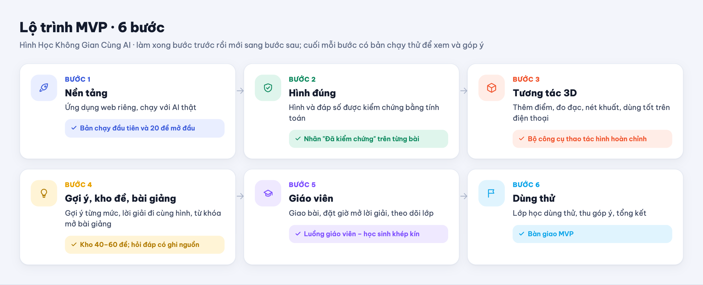

| Bước | Nội dung | Kết quả bàn giao |
|---|---|---|
| 1 · Nền tảng | Ứng dụng web riêng, chạy với AI thật | Bản chạy đầu tiên và 20 đề mở đầu |
| 2 · Hình đúng | Dựng hình từ điều kiện của đề và kiểm chứng đáp số bằng tính toán | Nhãn kiểm chứng trên từng bài |
| 3 · Tương tác 3D | Thêm điểm, đo độ dài và góc, nét đứt cho cạnh khuất, dùng tốt trên điện thoại | Bộ công cụ thao tác hình hoàn chỉnh |
| 4 · Gợi ý, kho đề, bài giảng | Gợi ý từng mức, lời giải đi cùng hình, từ khóa mở bài giảng, hỏi đáp có ghi nguồn | Kho 40–60 đề; bộ bài giảng mẫu có ghi nguồn |
| 5 · Giáo viên | Giao bài, đặt giờ mở lời giải, theo dõi lớp | Luồng giáo viên – học sinh khép kín |
| 6 · Dùng thử | Lớp học dùng thử, thu góp ý, tổng kết | Bàn giao MVP |

**MVP hoàn thành khi**
- Hình và đáp số trong kho đề đạt mức chính xác mục tiêu trên bộ đề chuẩn, và không bài sai nào mang nhãn "Đã kiểm chứng".
- Lời giải không lộ trước giờ giáo viên đặt, kể cả qua phần hỏi đáp.
- Toàn bộ tính năng trên chạy được trên iPad, iPhone và web.
- Kho đề có ít nhất 40 bài đã kiểm chứng.

**Chưa có trong MVP:** hình học phẳng; giáo viên tự soạn đề và bài giảng, import tài liệu và ảnh, giáo trình riêng cho từng học sinh; nộp bài viết tay và chấm điểm; tài khoản phụ huynh; quản trị cấp trường. Các phần này nằm ở những chặng sau.

## 4. Lộ trình sản phẩm

Hướng đi là làm thật tốt một môn rồi mở rộng dần thành hệ sinh thái giáo dục. Chín chặng nối tiếp nhau theo thứ tự dưới đây.

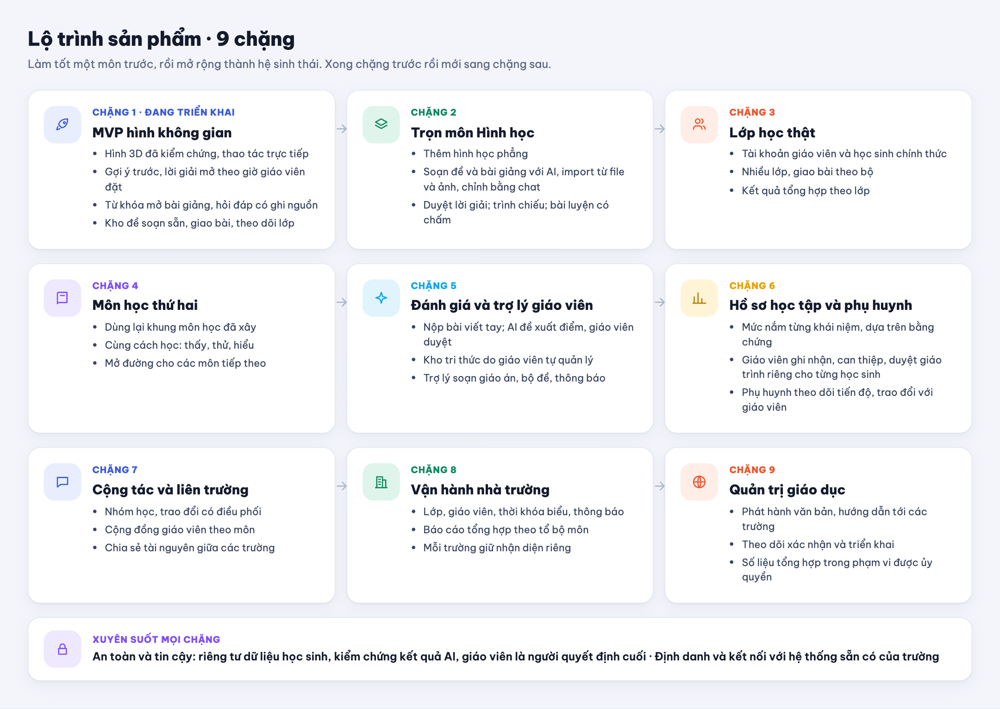

| Chặng | Trọng tâm | Người dùng nhận được |
|---|---|---|
| 1 · MVP hình không gian | Hình đúng, gợi ý trước, giáo viên kiểm soát lời giải | Nội dung ở mục 1 đến 3 |
| 2 · Trọn môn Hình học | Thêm hình học phẳng; giáo viên soạn đề và bài giảng với AI hoặc import từ file và ảnh, chat với AI để chỉnh bản nháp, duyệt rồi lưu vào giáo trình | Trình chiếu trên lớp, bài luyện có chấm tự động |
| 3 · Lớp học thật | Tài khoản chính thức, nhiều lớp, giao bài theo bộ | Kết quả tổng hợp theo lớp |
| 4 · Môn học thứ hai | Dùng lại khung môn học đã xây | Cùng cách học "thấy, thử, hiểu" cho một môn mới |
| 5 · Đánh giá và trợ lý giáo viên | Nộp bài viết tay; AI đề xuất điểm, giáo viên duyệt; kho tri thức do giáo viên tự quản lý, AI hỏi đáp dựa trên kho | Giáo viên giảm thời gian chấm và soạn bài |
| 6 · Hồ sơ học tập và phụ huynh | Mức nắm từng khái niệm dựa trên bằng chứng; giáo viên ghi nhận, can thiệp, duyệt giáo trình riêng cho từng học sinh | Học sinh có lộ trình của mình; phụ huynh theo dõi tiến độ và trao đổi với giáo viên |
| 7 · Cộng tác và liên trường | Nhóm học có điều phối; cộng đồng giáo viên theo môn | Chia sẻ tài nguyên giữa các trường |
| 8 · Vận hành nhà trường | Lớp, giáo viên, thời khóa biểu, thông báo | Báo cáo tổng hợp; mỗi trường giữ nhận diện riêng |
| 9 · Quản trị giáo dục | Phát hành văn bản, theo dõi triển khai | Số liệu tổng hợp trong phạm vi được ủy quyền |

**Xuyên suốt mọi chặng:** riêng tư dữ liệu học sinh, kiểm chứng kết quả AI, giáo viên là người quyết định cuối, và kết nối với hệ thống sẵn có của trường.

### Hình dung các chặng sau

Các hình dưới đây là bản phác ý tưởng cho những chặng sau MVP. Thiết kế sẽ được làm lại khi tới từng chặng.

#### Chặng 2 và 5 · Giáo viên chat với AI để chỉnh bản nháp

AI hỏi lại khi yêu cầu chưa rõ. Mỗi thay đổi hiện thành đề xuất "trước → sau" kèm lý do và chỗ AI chưa chắc. Giáo viên nhận hoặc bỏ từng đề xuất, hoàn tác, sửa tay; AI không tự lưu.

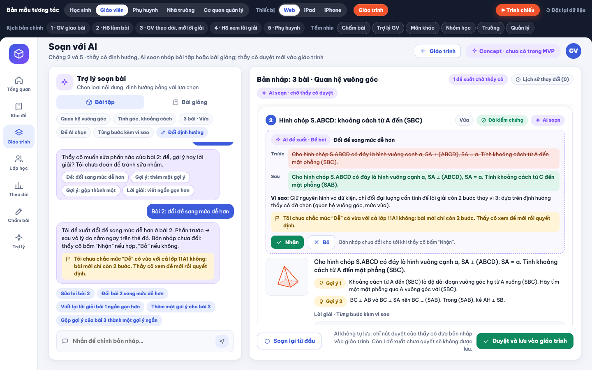

#### Chặng 2 và 5 · Soạn bài giảng với AI

Giáo viên định hướng khái niệm, lớp, có ví dụ và hình hay không; AI soạn nháp; giáo viên chỉnh, xem như học sinh rồi duyệt. Bài giảng ghi rõ nguồn và nhãn.

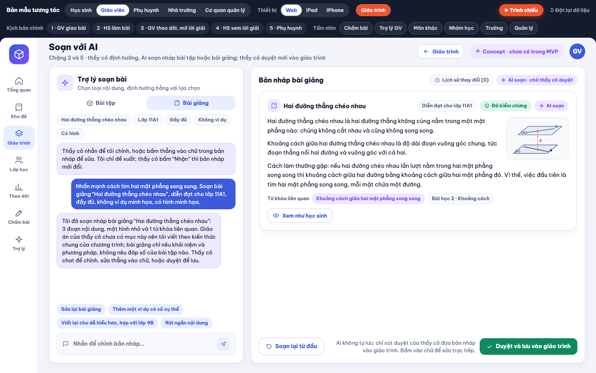

#### Chặng 2 và 5 · Import file: tách bài tập và bài giảng

File giáo án được tách thành hai nhóm. Giáo viên chọn mục muốn lưu, sửa bằng chat, rồi lưu vào giáo trình. Mục đã có trong kho được đối chiếu, không tạo bản trùng.

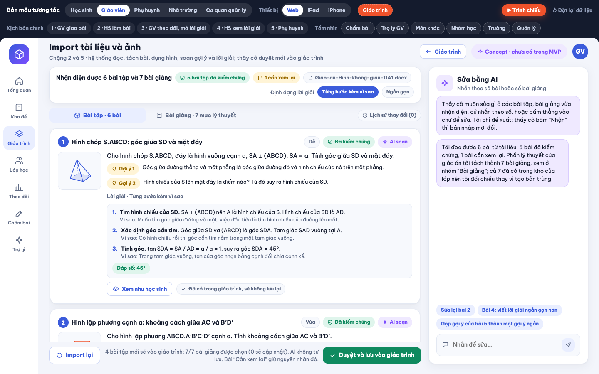

#### Chặng 2 và 5 · Import từ nhiều ảnh

Hệ thống đọc chữ trong ảnh, tô vàng chỗ máy chưa chắc để giáo viên sửa, rồi dựng bài với gợi ý và lời giải theo định dạng giáo viên chọn.

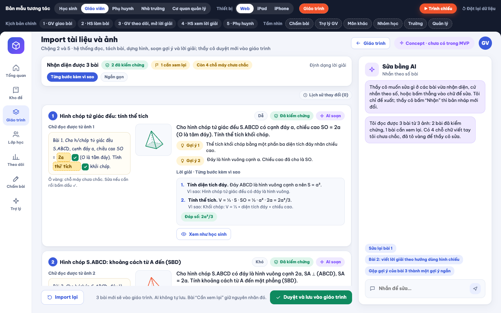

#### Chặng 6 · Giáo trình riêng cho từng học sinh

Từ giáo trình chung, AI đề xuất lộ trình riêng dựa trên phần đã vững và phần đang luyện, kèm bằng chứng. Giáo viên bỏ hoặc thêm từng mục rồi duyệt. Không gắn nhãn học sinh, không xếp hạng.

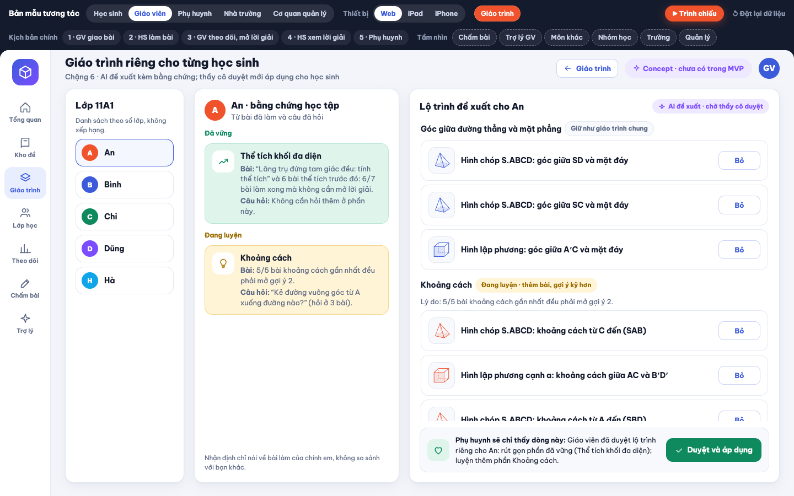

#### Chặng 5 · AI đề xuất điểm, giáo viên duyệt

AI đọc bài viết tay, đề xuất điểm theo từng tiêu chí và chỉ ra chỗ sai. Giáo viên nhận, sửa, rồi duyệt mới thành điểm chính thức.

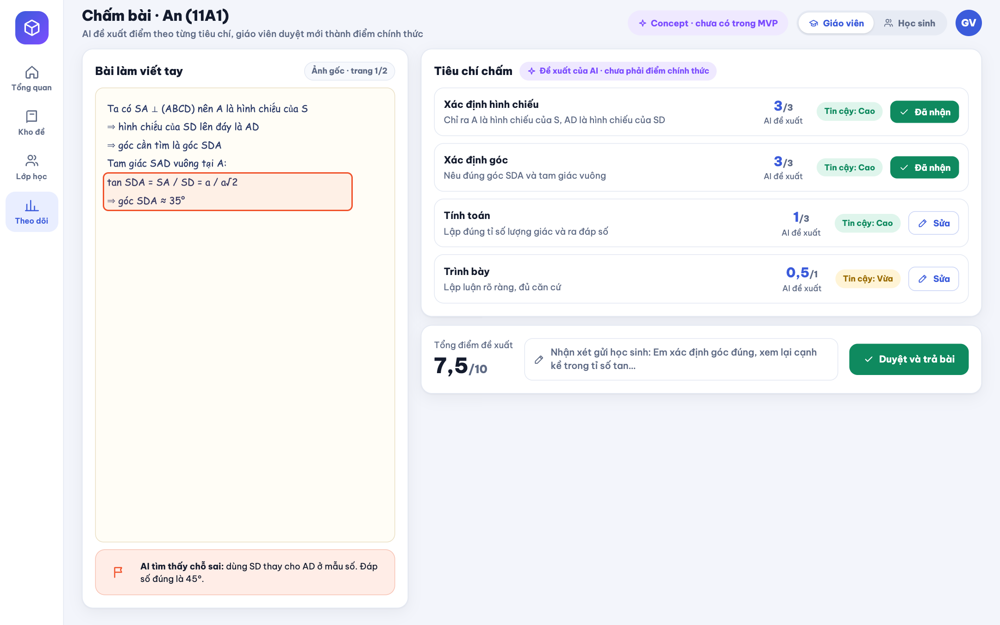

#### Chặng 5 · Trợ lý giáo viên

AI soạn nháp bộ đề, giáo án, thông báo từ tài liệu của thầy cô. Chỉ dùng khi thầy cô duyệt.

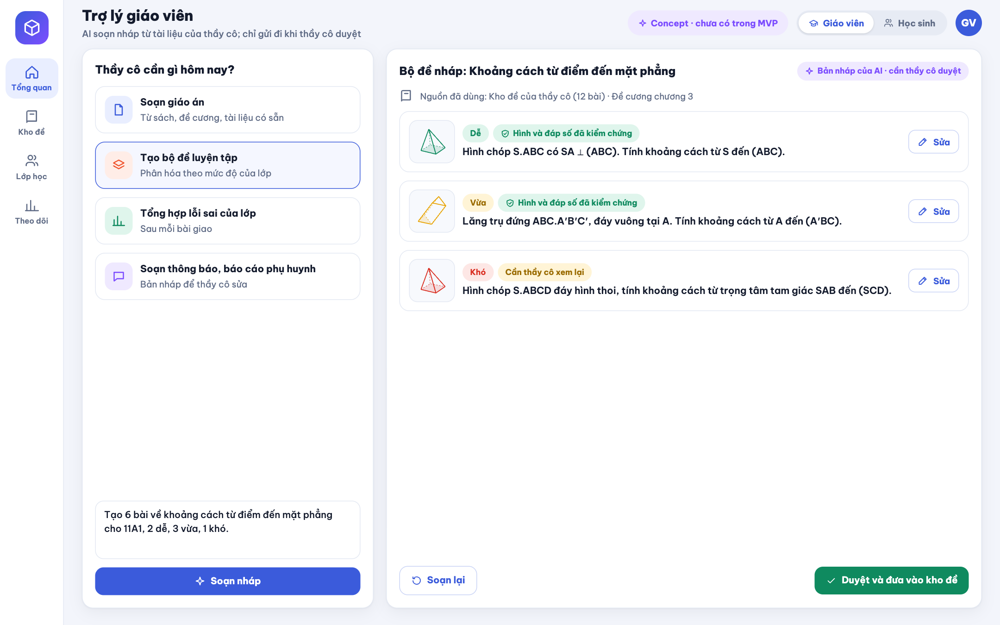

#### Chặng 6 · Hồ sơ học tập

Mức nắm từng khái niệm và chỗ hay vướng, kèm bài làm làm căn cứ.

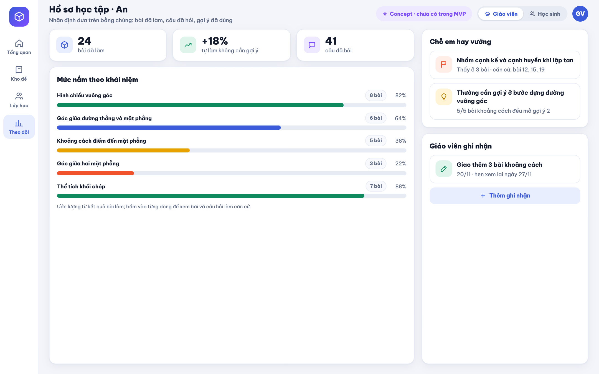

#### Chặng 6 · Phụ huynh

Tiến độ của con, điểm mạnh và phần cần luyện, lịch sắp tới, kênh trao đổi với giáo viên.

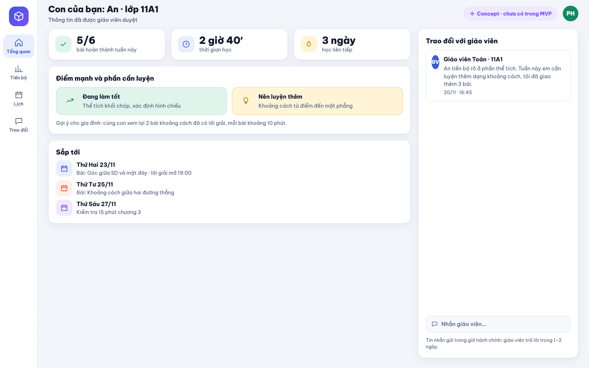

#### Chặng 7 · Cộng tác và liên trường

Nhóm học liên trường cùng thao tác trên một hình 3D, trao đổi có giáo viên điều phối, trợ lý nhóm chỉ gợi ý chứ không nêu đáp số. Nhóm do hai trường cùng duyệt và có nút báo cáo.

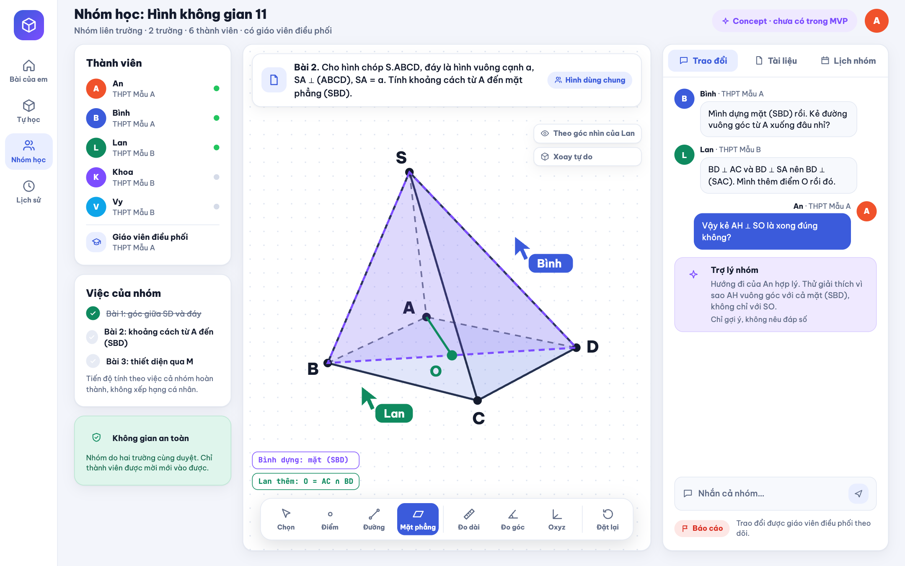

#### Chặng 8 · Vận hành nhà trường

Số liệu tổng hợp theo tổ bộ môn, thông báo của trường, nhận diện riêng của trường.

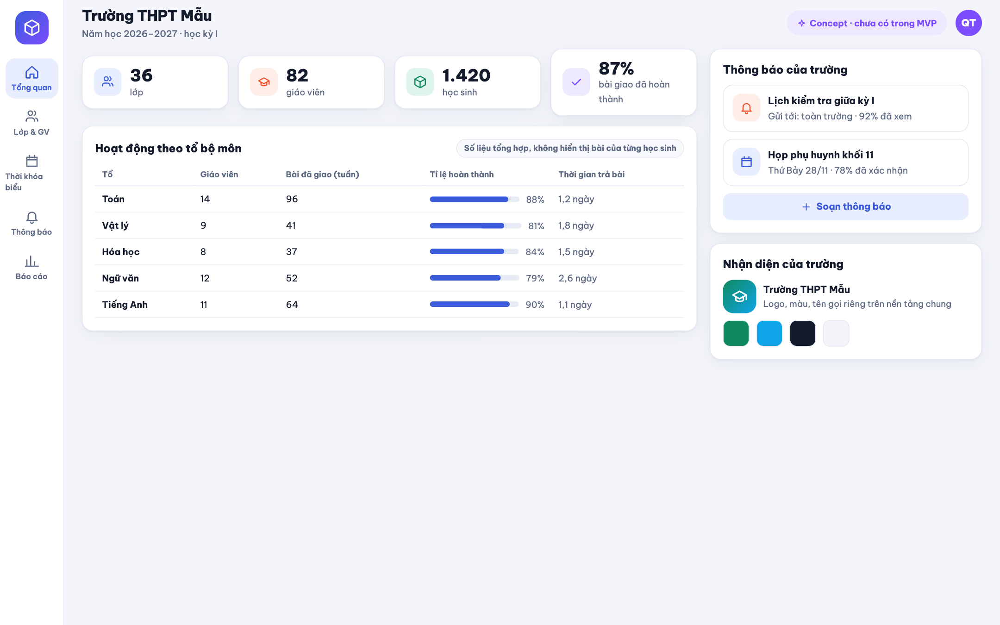

#### Chặng 9 · Quản trị giáo dục

Phát hành văn bản, theo dõi xác nhận và triển khai theo từng trường, trong phạm vi được ủy quyền.

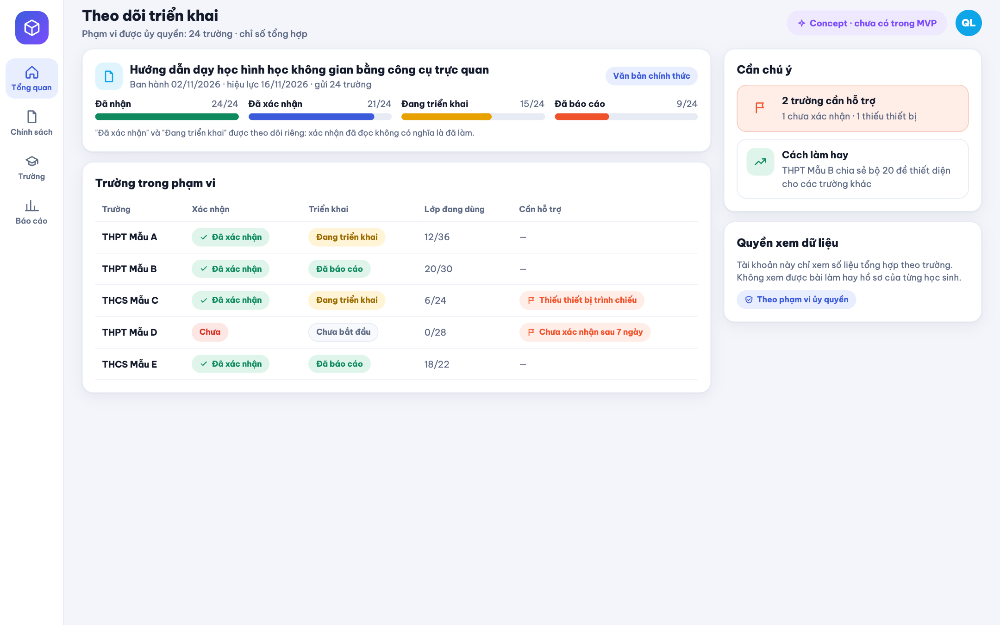

## 5. Phối hợp cần có

- Một giáo viên Toán soát kho đề và lời giải trước khi học sinh sử dụng.
- Một đến hai lớp học tham gia dùng thử ở bước 6.
- Góp ý sau mỗi bước để điều chỉnh bước kế tiếp.
