# Tài liệu kỹ thuật — Hình Học Cùng AI (GeometryMathSupport)

> Tài liệu mô tả ứng dụng hiện có, được dựng lại từ artifact https://claude.ai/artifact/6NFgVUTfH2Z2GxTYGXVpw9 (cập nhật 2026-09-19, bản `1789821348-62c8`, ~2.000 dòng HTML/JS một file).
> Ảnh màn hình nằm trong thư mục [`input/`](input/). **Lưu ý:** các ảnh được chụp bằng bản chạy local với dữ liệu mẫu (mock AI + mock DB), không phải kết quả AI thật. Nội dung đề/lời giải trong ảnh chỉ để minh họa bố cục và hành vi.

---

## 1. Tổng quan

**Mục tiêu:** giúp học sinh THCS/THPT hình dung hình học (đặc biệt hình học không gian) dễ hơn. Học sinh dán đề bài, AI vẽ hình, giải từng bước, giải thích nguyên lý; với bài không gian có mô hình 3D xoay được, và học sinh có thể tự thêm đường, mặt phẳng, điểm giao để khám phá.

**Người dùng:** học sinh cấp 2 và cấp 3 (tiếng Việt). Có thể mở rộng cho giáo viên.

**Giá trị chính**
1. Nhập đề bằng chữ hoặc ảnh (chụp/dán từ clipboard).
2. Lời giải từng bước, mỗi bước có "nguyên lý" (vì sao nghĩ ra bước này).
3. Thuật ngữ bấm được, ra bài giảng ngắn do AI viết.
4. Hình 2D (SVG) hoặc 3D (Three.js) xoay/zoom được, kèm bộ công cụ tương tác.
5. Chat hỏi thêm theo ngữ cảnh bài, có nhật ký hỏi đáp để ôn lại.
6. Lưu lịch sử bài đã giải, tìm kiếm, phân trang.

---

## 2. Màn hình và luồng sử dụng

Bố cục desktop (≥ 1150px) chia **3 cột**: Cột trái *Công cụ 3D* (300px) · Cột giữa *Nhập đề, lịch sử, nhật ký, lời giải* · Cột phải *Chat hỏi thêm*. Dưới 1150px chuyển thành 1 cột.

#### Hình 1. 01-trang-chu.png

Trang chủ. Cột trái hiện "Chưa có hình không gian nào để tương tác". Cột giữa: chọn cấp học, ô đề bài, chọn ảnh, nút **Giải bài**, panel **Bài đã giải gần đây** (có ô tìm kiếm). Cột phải: khung chat.

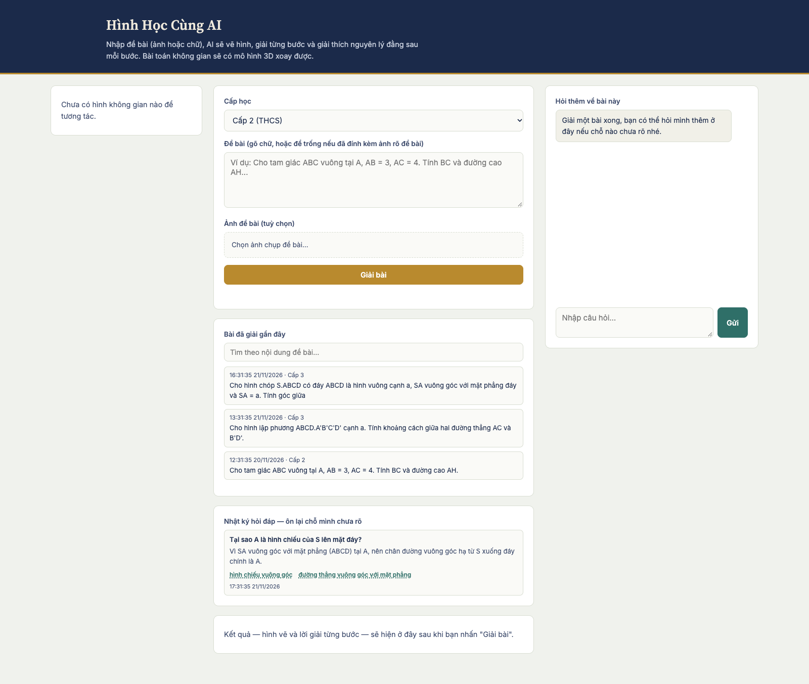

#### Hình 2. 02-nhap-de-bai.png

Đã chọn cấp 3 và gõ đề bài.

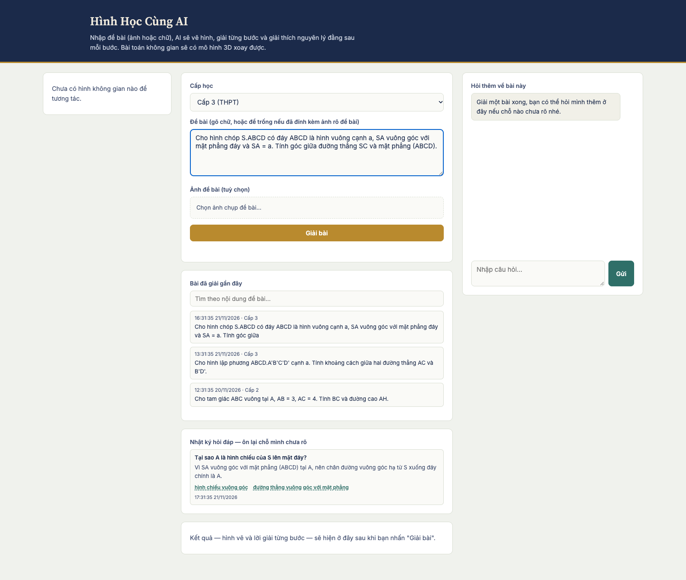

#### Hình 3. 03-loi-giai-3d-tong-quan.png

Sau khi giải bài 3D: đề bài chép lại, hình 3D, các bước giải; cột trái hiện đủ công cụ.

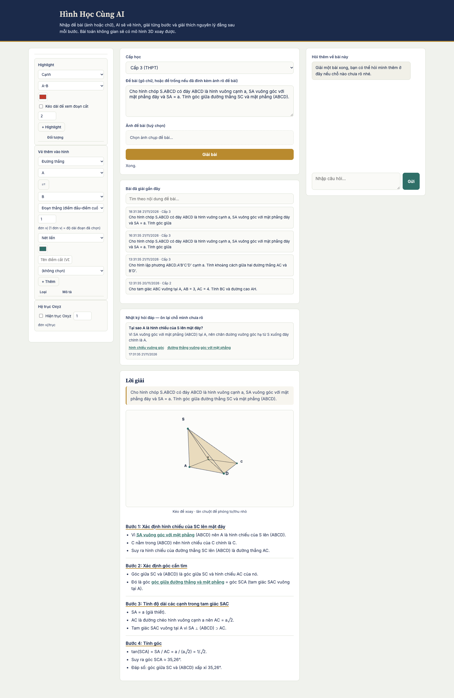

#### Hình 4. 04-hinh-3d-xoay-duoc.png

Khung hình 3D sau khi kéo chuột để xoay. Có nhãn đỉnh, mặt bán trong suốt, cạnh.

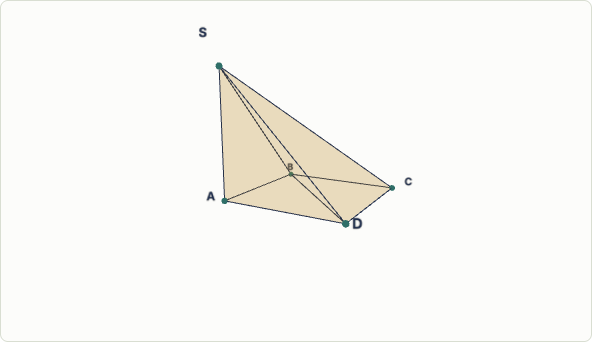

#### Hình 5. 05-cong-cu-highlight-oxyz.png

Highlight cạnh SC (đỏ), mặt SAB (xanh, có mặt mở rộng nét đứt) và hiện trục Oxyz.

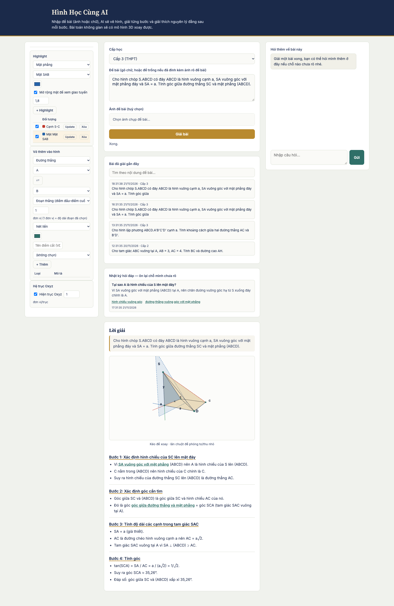

#### Hình 6. 06-ve-them-duong-mat-phang.png

Vẽ thêm đường AC nét đứt cắt BD tại O; dựng mặt phẳng (SBD) và giao tuyến MN với mặt đáy.

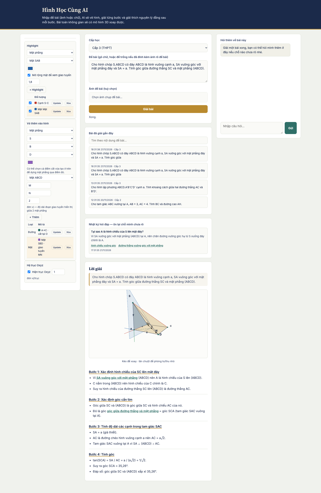

#### Hình 7. 07-bang-cong-cu-3d.png

Toàn bộ cột công cụ 3D: Highlight / Vẽ thêm vào hình / Hệ trục Oxyz, hai bảng đối tượng có Update/Xóa.

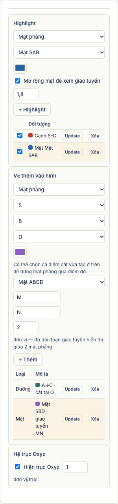

#### Hình 8. 08-tu-khoa-bai-giang.png

Bấm thuật ngữ (gạch chân chấm màu teal) ra modal bài giảng ngắn.

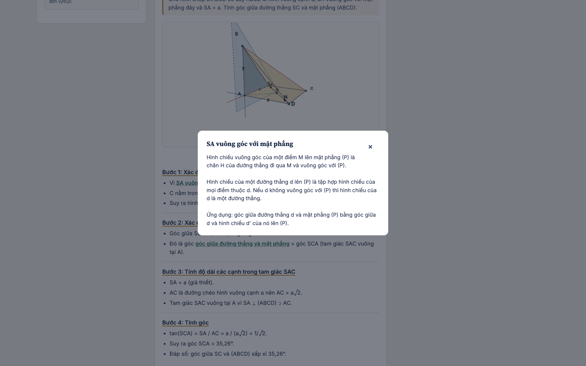

#### Hình 9. 09-nguyen-ly-buoc-giai.png

Bấm tiêu đề bước (gạch chân vàng đồng) ra modal "nguyên lý" của bước.

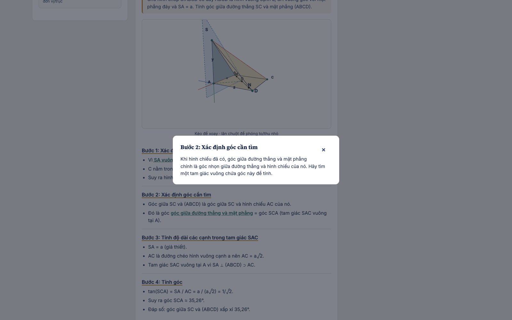

#### Hình 10. 10-chat-hoi-them.png

Chat hỏi thêm: câu trả lời ngắn + gợi ý từ khóa "Tìm hiểu thêm".


#### Hình 11. 11-lich-su-nhat-ky.png

Panel Nhật ký hỏi đáp (câu hỏi, trả lời, từ khóa, thời gian).

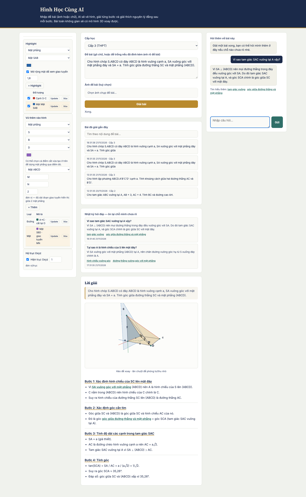

#### Hình 12. 12-loi-giai-2d.png

Bài phẳng: hình 2D dạng SVG; không có công cụ 3D.

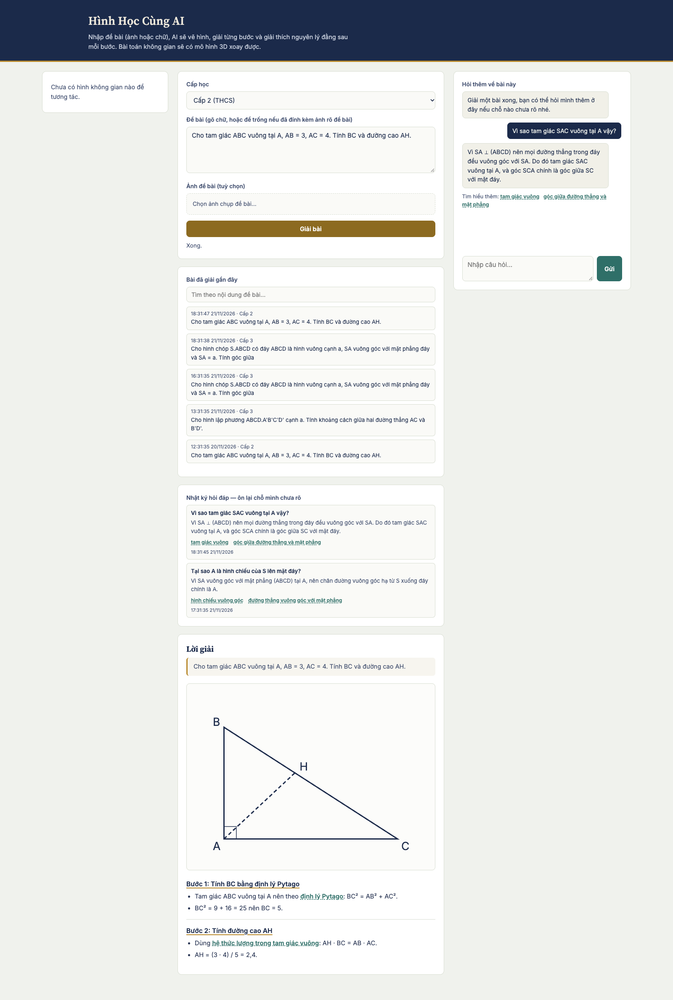

#### Hình 13. 13-mobile-trang-chu.png

Giao diện điện thoại (420px), 1 cột.

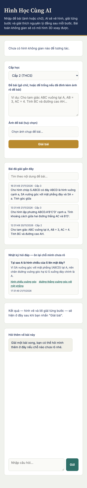

### Luồng chính
1. Chọn **cấp học** (THCS/THPT) → gõ đề và/hoặc chọn/dán ảnh → **Giải bài**.
2. AI trả về JSON (mục 5.1) → app vẽ hình, hiện các bước, lưu vào lịch sử.
3. Bài 3D: dùng công cụ cột trái để highlight, vẽ thêm, bật trục.
4. Bấm thuật ngữ hoặc tiêu đề bước để xem bài giảng/nguyên lý; hỏi thêm ở chat.

---

## 3. Yêu cầu chức năng

### 3.1 Nhập đề (FR-IN)
| ID | Yêu cầu |
|----|---------|
| FR-IN-1 | Chọn cấp học `thcs` (mặc định) hoặc `thpt`; ảnh hưởng độ sâu lời giải. |
| FR-IN-2 | Ô đề bài nhiều dòng; có thể để trống nếu đã đính kèm ảnh rõ đề. |
| FR-IN-3 | Đính kèm ảnh PNG/JPEG/WebP/GIF bằng chọn file **hoặc dán từ clipboard** (Ctrl/Cmd+V) ở bất kỳ đâu trong trang. |
| FR-IN-4 | Có ảnh và ô chữ đang trống → tự OCR bằng AI (model nhanh) rồi điền vào ô đề để học sinh sửa. Nếu ô chữ đã có nội dung thì **ưu tiên chữ**, không ghi đè. |
| FR-IN-5 | Nút "🔄 Nhận diện lại chữ trong ảnh" ghi đè ô đề. Nút × xóa ảnh. |
| FR-IN-6 | Khi bấm Giải: chỉ gửi ảnh cho AI nếu **không có chữ**; có chữ thì luôn dùng chữ. |
| FR-IN-7 | Nếu runtime báo `limits().images = false`, ẩn khu tải ảnh và thay bằng thông báo yêu cầu gõ đề. |
| FR-IN-8 | Không có chữ lẫn ảnh → báo lỗi "Hãy nhập đề bài hoặc chọn một ảnh." |

### 3.2 Lời giải (FR-SOL)
| ID | Yêu cầu |
|----|---------|
| FR-SOL-1 | Hiển thị đề bài đã được chép/OCR lại (`problem_text`). |
| FR-SOL-2 | Hiển thị hình theo `figure.type`: `2d` (chèn SVG), `3d` (Three.js), `none` ("Không có hình vẽ cho bài này"). |
| FR-SOL-3 | Mỗi bước gồm: tiêu đề (bấm được), nội dung dạng gạch đầu dòng 2–5 ý, `principle` ẩn trong modal. |
| FR-SOL-4 | Cú pháp `{{thuật ngữ}}` trong nội dung → thành từ khóa bấm được (FR-KW). Nội dung được escape HTML trước khi thay. |
| FR-SOL-5 | Nút Giải bị khóa trong lúc chờ; hiện trạng thái "Đang đọc đề và soạn lời giải… (30–60 giây)". |
| FR-SOL-6 | Lưu mỗi bài đã giải vào lịch sử (FR-HIS). |

### 3.3 Từ khóa và bài giảng (FR-KW)
- Bấm từ khóa (trong lời giải, gợi ý chat, nhật ký) → mở modal.
- Tra cache DB `keywords/{slug}` trước; nếu chưa có → gọi AI (model nhanh, `cache:true`) viết bài giảng 150–250 từ, tiếng Việt, công thức bằng văn bản thường, không LaTeX → lưu lại `keywords/{slug}`.
- `slug` = bỏ dấu, đ→d, chữ thường, ký tự lạ → `-`, tối đa 80 ký tự.
- Bấm tiêu đề bước → modal hiện `principle` (hoặc "(Không có diễn giải cho bước này.)").

### 3.4 Hình 3D (FR-3D)
**Dựng hình** từ `figure.solid`: `vertices` (tên + x,y,z), `edges` (cặp tên), `faces` (danh sách tên đỉnh, tùy chọn).

| ID | Yêu cầu |
|----|---------|
| FR-3D-1 | Mỗi **mặt** là 1 Mesh riêng (bán trong suốt, màu vàng đồng `#B98A2E`, opacity 0.16, hai mặt) để highlight độc lập. Mặt nhiều hơn 3 đỉnh được chia tam giác kiểu quạt từ đỉnh đầu (giả định lồi, đỉnh theo thứ tự). |
| FR-3D-2 | Mỗi **cạnh** là 1 Line riêng (màu `#1B2A4A`). Mỗi **đỉnh** là hình cầu nhỏ + nhãn tên (Sprite). |
| FR-3D-3 | Tự căn tâm hình về gốc, chuẩn hóa tỉ lệ để hình vừa khung (bán kính ≈ 1.8). |
| FR-3D-4 | **Xoay:** kéo chuột/chạm (Pointer Events), góc ban đầu rotX=0.35, rotY=0.6. **Zoom:** lăn chuột, khoảng cách camera 1.6–10. Khung cao 340px, tự co giãn theo chiều rộng. |
| FR-3D-5 | Chỉ một cảnh 3D chạy tại một thời điểm; khi giải bài mới thì dừng vòng lặp render cũ. |

**Công cụ 3D (cột trái)** chỉ hiện khi có hình 3D:

**A. Highlight** — chọn loại (Cạnh/Mặt phẳng), đối tượng, màu; tùy chọn "mở rộng":
- Cạnh: kéo dài hai phía thêm *N* lần độ dài cạnh (nét đứt, mờ). Mặc định N=2, bước 0.5, tối thiểu 0.5.
- Mặt: phóng mặt ra *k* lần quanh trọng tâm (mặt mờ + viền nét đứt) để thấy giao tuyến. Mặc định k=1.8, bước 0.1, tối thiểu 1.1.
- Bảng highlight: ô bật/tắt, nhãn + màu, **Update** (áp dụng form hiện tại lên dòng đang chọn), **Xóa**. Bấm dòng để nạp cấu hình vào form.

**B. Vẽ thêm vào hình**
- *Đường thẳng:* điểm đầu, điểm cuối (có nút ⇄ đổi chiều), chế độ `segment` / `extendB` (kéo dài qua điểm cuối) / `extendA` (qua điểm đầu), độ dài kéo thêm (đơn vị = độ dài đoạn đã chọn), nét liền/đứt, màu. Tùy chọn **cắt với** một cạnh hoặc một mặt (gốc hoặc mới tạo) và **đặt tên điểm cắt** (VD: H).
  - Cắt mặt: giao điểm tia–mặt phẳng, chỉ nhận khi t > 0 (về phía trước điểm xuất phát); đường dừng tại giao điểm.
  - Cắt cạnh: lấy điểm giữa của đoạn vuông góc chung giữa hai đường thẳng (với hai đường chéo nhau vẫn ra một điểm xấp xỉ).
- *Mặt phẳng:* chọn 3 điểm (kể cả điểm cắt vừa tạo), màu. Tùy chọn **cắt với**:
  - một cạnh → tạo **điểm giao** (đặt tên, VD: M);
  - một mặt → tạo **giao tuyến** là đoạn thẳng có 2 điểm đặt tên (VD: M, N) với độ dài hiển thị tùy chỉnh (mặc định 2 đơn vị, đặt giữa tại điểm gần gốc nhất của giao tuyến).
- Đối tượng mới được **đăng ký lại**: điểm mới xuất hiện trong các danh sách chọn điểm; đường/giao tuyến mới xuất hiện trong danh sách cạnh để highlight/cắt tiếp; mặt mới xuất hiện trong danh sách mặt.
- Bảng "vẽ thêm" dùng chung cho đường và mặt: Loại, Mô tả (vd "A→C · cắt tại O", "Mặt SBD · giao tuyến MN"), **Update**, **Xóa**. Xóa/Update gỡ luôn điểm, nhãn, cạnh đã đăng ký.

**C. Hệ trục Oxyz** — bật/tắt, độ dài mỗi trục (đơn vị hình, mặc định 1, bước 0.5, tối thiểu 0.5). Gốc đặt tại gốc tọa độ của đề (không phải tâm hình); trục x đỏ, y xanh lá, z xanh dương, có nhãn.

### 3.5 Hình 2D (FR-2D)
AI trả SVG hoàn chỉnh (`viewBox` ~400×320, nét `#1B2A4A`, nền trong suốt, có nhãn điểm, không dùng ảnh/font ngoài); app chèn nguyên vào khung.

### 3.6 Chat hỏi thêm (FR-CHAT)
- Ngữ cảnh gồm đề bài + tóm tắt các bước. Trả lời **tối đa 3–4 câu**, tiếng Việt có dấu, kèm 1–3 từ khóa gợi ý.
- Giữ hội thoại ngắn: 1 lượt hệ thống + tối đa 8 lượt gần nhất.
- Enter gửi, Shift+Enter xuống dòng; khóa ô nhập khi đang chờ; lỗi thì bỏ lượt hỏi lỗi khỏi ngữ cảnh.
- Chưa giải bài nào → "Hãy giải một bài trước, rồi hỏi mình về bài đó nhé."
- Mỗi cặp hỏi–đáp lưu vào `chat_history` và hiện trong **Nhật ký hỏi đáp** (20 mục gần nhất, kèm từ khóa bấm được).

### 3.7 Lịch sử (FR-HIS)
- Hiện tối đa 200 bài gần nhất, sắp theo thời gian giảm dần; mỗi trang 10 bài; thanh phân trang ‹ 1…5 › (tối đa 5 nút số).
- Tìm kiếm theo nội dung đề, **không phân biệt dấu/hoa thường** (chuẩn hóa NFD, đ→d).
- Bấm một bài → dựng lại lời giải đã lưu (không gọi lại AI), cuộn lên đầu trang.
- Panel ẩn khi chưa có dữ liệu hoặc chưa bật DB.

### 3.8 Thông báo lỗi
| Mã lỗi runtime | Thông báo cho học sinh |
|---|---|
| `invalid_json` | AI trả lời không đúng định dạng, hãy thử lại. |
| `rate_limited` | Đang bị giới hạn tốc độ, thử lại sau ít phút. |
| `not_granted` | Bạn cần cho phép trang này dùng AI để tiếp tục. |
| `image_rejected` | Ảnh không hợp lệ, hãy thử ảnh khác. |
| `images_unavailable` | Chế độ này không gửi được ảnh cho AI — hãy gõ đề bằng chữ. |
| Không có `sample` | Tính năng AI chưa khả dụng trong chế độ xem này. |

---

## 4. Kiến trúc và công nghệ

- **Hiện tại:** một file HTML tĩnh, JS thuần (IIFE), không framework. Three.js r128 từ cdnjs. Font Source Serif 4 + Inter (Google Fonts).
- **Phụ thuộc runtime của Artifact** (cần thay khi tách thành app riêng):
  - `claude.use('sample')`: gọi AI. `sample(prompt, {modelTier:'quick'|'complex', cache, images})` → `{text}`; `sample.json(prompt|turns, opts)` → object; `sample.limits()` → `{images}`.
  - `claude.use('db')`: kho tài liệu. `collection(name).add / orderBy().limit().get()`, `doc(path).get / set`.
- **Khi tách ra:** cần backend proxy gọi Claude API (giấu key), lưu trữ (SQLite/Postgres/Firestore), xử lý ảnh upload. Model nhanh cho OCR/chat/bài giảng, model mạnh cho lời giải.
- **Mô-đun gợi ý khi viết lại:** `solver` (prompt + parse), `solid3d` (scene + công cụ), `geometry-math` (vec, plane, intersection — thuần hàm, dễ test), `store` (history/chat/keywords), `ui`.

### Hàm toán dùng trong 3D
`vecSub/Add/Scale/Dot/Cross/Len/Norm`; `planeFromFace(3 điểm)` → điểm + pháp tuyến; `intersectRayPlane`; `closestPointsBetweenLines`; giao tuyến hai mặt phẳng: hướng `L = n1 × n2`, điểm `X0 = ((n2×L)·d1 + (L×n1)·d2) / |L|²`.

---

## 5. Hợp đồng dữ liệu

### 5.1 Đầu ra AI khi giải bài (JSON duy nhất, không markdown fence)
```json
{
  "problem_text": "đề bài chép lại đầy đủ, có dấu",
  "level": "thcs | thpt",
  "figure": {
    "type": "2d | 3d | none",
    "svg": "(chỉ khi 2d) <svg viewBox=\"0 0 400 320\" xmlns=\"http://www.w3.org/2000/svg\">…</svg>",
    "solid": {
      "vertices": [{"name": "A", "x": 0, "y": 0, "z": 0}],
      "edges": [["A", "B"]],
      "faces": [["A", "B", "C", "D"]]
    }
  },
  "steps": [
    {
      "title": "Bước 1: …",
      "content": ["ý 1 (có thể có {{thuật ngữ}})", "ý 2"],
      "principle": "nguyên lý/định lý/cách nghĩ ra bước này"
    }
  ]
}
```
Ràng buộc: tọa độ gọn (nguyên hoặc 1–2 chữ số thập phân); SVG 2D khớp tên điểm trong lời giải; `content` chia 2–5 gạch đầu dòng, **không** viết đoạn văn dài; `faces` tùy chọn. Trục y là trục "lên" trong scene Three.js.

### 5.2 Đầu ra AI cho chat
`{"answer": "…", "keywords": ["…", "…"]}`

### 5.3 Collection DB
| Collection | Trường |
|---|---|
| `problems` | `input_text`, `had_image`, `problem_text`, `level`, `figure_type`, `solution` (toàn bộ JSON 5.1), `createdAt` |
| `chat_history` | `problemId`, `problem_text`, `question`, `answer`, `keywords[]`, `createdAt` |
| `keywords` (doc id = slug) | `term`, `lecture`, `createdAt` |

---

## 6. Giao diện và thiết kế
- **Màu:** ink `#1B2A4A`, giấy `#F0F2ED`, đồng `#B98A2E` (nút chính, gạch chân bước), teal `#2F6F68` (từ khóa, nút gửi), đỏ `#B0432E` (lỗi). Chỉ có light theme.
- **Chữ:** tiêu đề Source Serif 4; thân Inter.
- **Responsive:** cột phải và cột trái xếp dọc dưới 1150px; panel chat/công cụ bỏ sticky.
- **Tương tác nhận biết được:** từ khóa gạch chấm teal; tiêu đề bước gạch đậm vàng; hàng bảng có hover/selected.

---

## 7. Hạn chế đã biết (phát hiện khi đọc code và chụp màn hình)

1. **Nhãn lặp:** bảng Highlight hiện "Mặt Mặt SAB" vì nhãn đối tượng đã có tiền tố "Mặt" rồi bị thêm lần nữa (cạnh thì đúng: "Cạnh S-C").
2. **Chưa có "thêm điểm tự do":** chỉ tạo được điểm giao (đường∩mặt, đường∩cạnh, mặt∩cạnh). Không thêm điểm tùy ý, trung điểm, hay điểm chia theo tỉ lệ.
3. **Chưa có "kéo giãn mặt phẳng" bằng chuột:** hiện chỉ phóng mặt theo hệ số số học (k) bằng ô nhập; mặt phẳng tự dựng luôn là tam giác 3 điểm, không phải mặt vô hạn/hình chữ nhật có thể kéo to nhỏ.
4. Giao điểm đường–cạnh dùng điểm giữa đoạn vuông góc chung; với hai đường chéo nhau vẫn "cắt" nhau, không cảnh báo.
5. Mặt nhiều hơn 3 đỉnh: tam giác hóa kiểu quạt (sai với mặt lõm hoặc đỉnh không theo thứ tự); mặt phẳng dựng từ mặt gốc chỉ dùng 3 đỉnh đầu.
6. Không có nét khuất/nét liền tự động (hình 3D vẽ tất cả cạnh nét liền), trong khi sách giáo khoa dùng nét đứt cho cạnh khuất.
7. Zoom chỉ bằng lăn chuột; chưa có pinch-zoom trên điện thoại. Chưa có nút đặt lại góc nhìn/xóa hết.
8. Nhật ký hỏi đáp lấy 20 mục gần nhất của **mọi** bài, không lọc theo bài đang xem.
9. Tọa độ hình do AI sinh ra không được kiểm tra hình học (vd: hình chóp đều có thật sự đều không); sai tọa độ thì hình 3D sai mà không báo.
10. Không có đăng nhập/tách dữ liệu theo từng học sinh; lịch sử dùng chung theo artifact.
11. Prompt gửi AI viết tiếng Việt không dấu (ASCII) cho an toàn mã hóa; đầu ra bắt buộc có dấu.

---

## 8. Backlog đề xuất

| Ưu tiên | Hạng mục |
|---|---|
| P0 | Sửa nhãn "Mặt Mặt …"; nút Đặt lại góc nhìn; pinch-zoom. |
| P0 | **Thêm điểm:** điểm tự do (nhập tọa độ), trung điểm, điểm chia đoạn theo tỉ lệ, điểm trên cạnh/mặt kéo được. |
| P0 | **Mặt phẳng kéo giãn được:** mặt phẳng dạng hình chữ nhật/tam giác có tay nắm (handle) ở góc để kéo to nhỏ, kéo điểm để đổi mặt; cập nhật giao tuyến theo thời gian thực. |
| P1 | Nét khuất/nét liền tự động theo góc nhìn; chọn đối tượng bằng cách bấm trực tiếp trên hình (raycaster). |
| P1 | Đo đạc: độ dài đoạn, góc giữa đường–đường/đường–mặt/mặt–mặt, khoảng cách, hiển thị ngay trên hình. |
| P1 | Kiểm tra hình học của kết quả AI (ví dụ tính lại độ dài/góc từ tọa độ, đối chiếu đáp số trong lời giải). |
| P2 | Chia sẻ bài (link), xuất PDF/ảnh lời giải, chế độ giáo viên, tài khoản học sinh. |
| P2 | Thư viện hình mẫu (chóp, lăng trụ, hộp, cầu, nón, trụ) dựng không cần AI. |

---

## 9. Tiêu chí nghiệm thu (rút từ app hiện tại)
1. Dán đề chữ bài hình chóp → trong ≤ 60 giây hiện hình 3D + ≥ 3 bước, mỗi bước bấm tiêu đề ra nguyên lý.
2. Hình 3D xoay bằng kéo chuột, zoom bằng lăn chuột, nhãn đỉnh luôn đọc được.
3. Highlight cạnh SC màu đỏ bật/tắt được; highlight mặt kèm "mở rộng" hiện thêm mặt nét đứt lớn hơn.
4. Vẽ đường A→C cắt cạnh BD đặt tên O → điểm O xuất hiện trên hình và có trong danh sách chọn điểm.
5. Dựng mặt (S,B,D) cắt mặt đáy → hiện đoạn giao tuyến MN; **Xóa** dòng đó thì đoạn, điểm M, N và nhãn biến mất, M/N không còn trong danh sách điểm.
6. Dán ảnh đề từ clipboard → ô đề tự điền chữ nhận diện, sửa được; có chữ sẵn thì không bị ghi đè.
7. Bấm từ khóa lần 2 lấy từ cache DB, không gọi lại AI.
8. Tìm "hinh chop" (không dấu) trong lịch sử vẫn ra bài "hình chóp".
9. Gõ câu hỏi vào chat → trả lời ≤ 4 câu + ≤ 3 từ khóa; câu hỏi và trả lời xuất hiện trong Nhật ký.
10. Trên điện thoại 420px bố cục 1 cột, không cuộn ngang.
