# Hình Học Cùng AI

**Biến đề toán hình học thành hình 3D mà học sinh có thể xoay, chạm và tự khám phá — kèm lời giải từng bước và một trợ giảng AI luôn sẵn sàng.**

> Tài liệu giới thiệu sản phẩm. Phần Vision và Định hướng phát triển để trống cho chủ sản phẩm bổ sung.
> Tài liệu kỹ thuật chi tiết: [`SPEC-technical.md`](SPEC-technical.md).
> Lưu ý: toàn bộ ảnh trong tài liệu là bản chạy thử với **dữ liệu mẫu**, dùng để minh họa giao diện và cách hoạt động, không phải kết quả AI thật.

---

## 1. Sản phẩm trong một phút

Học sinh dán (hoặc chụp ảnh) một đề hình học. Hình Học Cùng AI sẽ:

1. **Vẽ hình** — hình phẳng (2D) hoặc hình không gian (3D) xoay được.
2. **Giải từng bước** — mỗi bước kèm "nguyên lý": vì sao nghĩ ra bước đó.
3. **Cho học sinh tự khám phá** — highlight cạnh/mặt, kéo dài đường, dựng mặt phẳng, tìm giao điểm và giao tuyến ngay trên hình.
4. **Giải đáp tại chỗ** — bấm thuật ngữ ra bài giảng ngắn, hỏi thêm trong khung chat, ôn lại ở nhật ký hỏi đáp.

Dành cho học sinh THCS (cấp 2) và THPT (cấp 3), giao diện hoàn toàn bằng tiếng Việt.

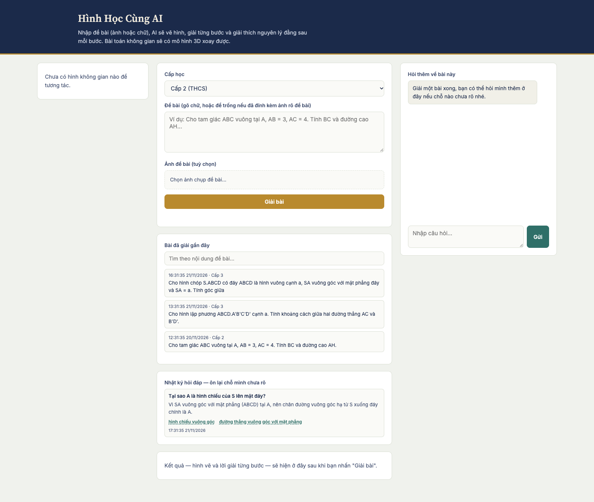

*Trang chủ: công cụ 3D (trái) · nhập đề, lịch sử bài đã giải (giữa) · chat hỏi thêm (phải).*

---

## 2. Vấn đề

Hình học không gian là phần nhiều học sinh thấy khó nhất, chủ yếu vì **không "nhìn" được hình**:

- Hình trong sách và trên bảng là ảnh phẳng của vật thể 3 chiều; học sinh phải tự tưởng tượng góc nhìn, đường khuất, mặt phẳng cắt nhau ra sao.
- Lời giải có sẵn chỉ cho kết quả, ít khi giải thích *vì sao* phải dựng đường phụ hay chọn mặt phẳng đó.
- Khi chưa hiểu một khái niệm, học sinh phải thoát ra tìm kiếm, mất mạch học.

---

## 3. Concept

Ý tưởng cốt lõi: **đưa hình học từ "xem lời giải" sang "tự tay thao tác trên hình"**, với AI đóng vai trò gia sư đi cạnh.

| Trụ cột | Ý nghĩa với học sinh |
|---|---|
| **Hiểu đề** | Gõ chữ hoặc dán ảnh đề; AI chép lại đề rõ ràng để học sinh kiểm tra lại. |
| **Nhìn thấy hình** | Hình 3D xoay/phóng to bằng chuột hoặc cảm ứng; nhãn đỉnh, mặt bán trong suốt giúp nhìn xuyên qua hình. |
| **Hiểu vì sao** | Mỗi bước có phần nguyên lý; thuật ngữ bấm được ra bài giảng ngắn. |
| **Tự thử** | Highlight, vẽ thêm đường/mặt phẳng, xem giao điểm/giao tuyến, bật hệ trục Oxyz. |
| **Hỏi lại, ôn lại** | Chat theo ngữ cảnh bài; mọi câu hỏi được lưu để ôn. |

---

## 4. Basic demo (kịch bản khoảng 5 phút)

Bài mẫu: *"Cho hình chóp S.ABCD có đáy ABCD là hình vuông cạnh a, SA vuông góc với mặt phẳng đáy, SA = a. Tính góc giữa đường thẳng SC và mặt phẳng (ABCD)."*

### Bước 1. Nhập đề
Chọn cấp học, gõ đề (hoặc dán ảnh từ clipboard — hệ thống tự đọc chữ trong ảnh rồi để học sinh sửa lại).

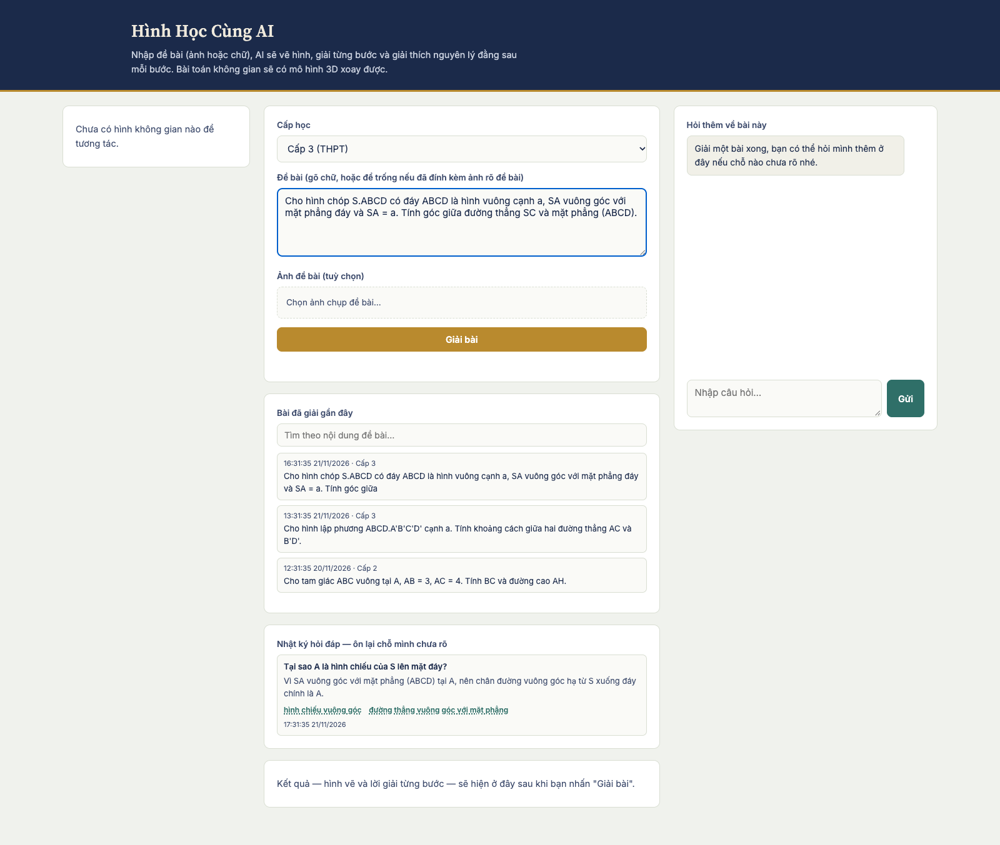

**Điểm nhấn demo:** chỉ cần dán ảnh chụp đề, không cần gõ lại.

### Bước 2. Nhận lời giải và hình 3D
Sau vài chục giây, trang hiện đề đã chép lại, hình 3D và các bước giải. Công cụ 3D xuất hiện ở cột trái.

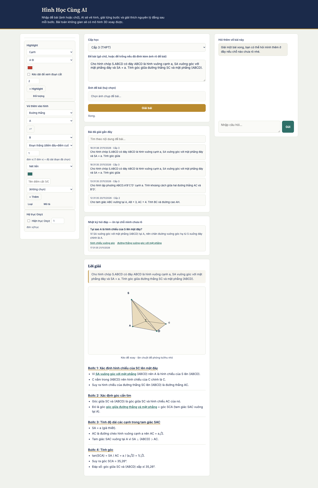

### Bước 3. Xoay và quan sát hình
Kéo chuột để xoay, lăn chuột để phóng to/thu nhỏ. Các mặt trong suốt giúp thấy cả cạnh khuất phía sau.

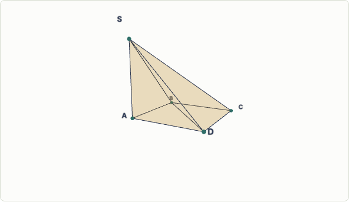

**Điểm nhấn demo:** xoay hình sang vài góc khác nhau để thấy SA vuông góc với đáy.

### Bước 4. Highlight cạnh, mặt và bật trục Oxyz
Tô màu cạnh SC, tô mặt SAB; bật "mở rộng" để xem mặt phẳng kéo dài ra vượt mép hình. Bật hệ trục Oxyz để liên hệ với tọa độ.

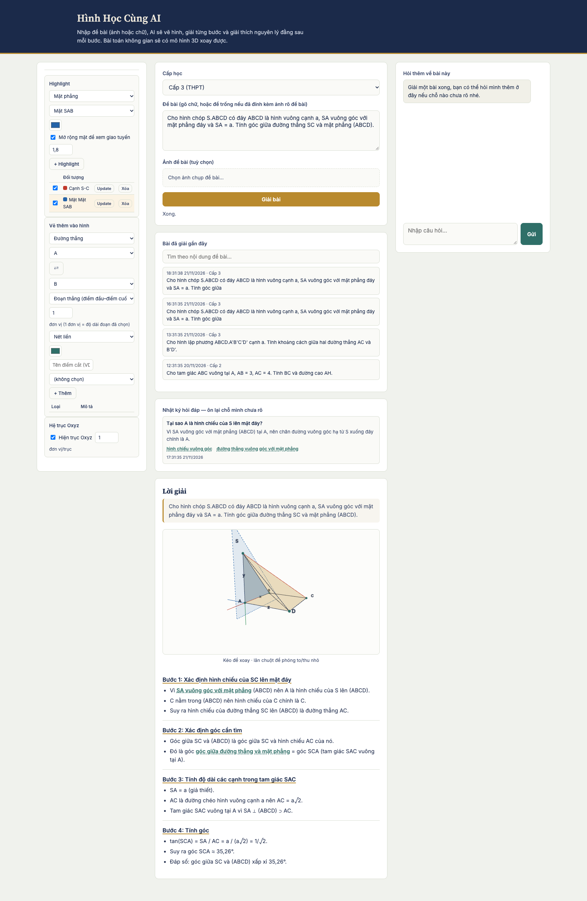

### Bước 5. Vẽ thêm đường và mặt phẳng, tìm giao tuyến
Vẽ đường AC (nét đứt) cắt BD tại điểm O; dựng mặt phẳng (SBD) và xem giao tuyến MN với mặt đáy. Mọi điểm mới tạo đều dùng lại được cho các bước vẽ tiếp theo.

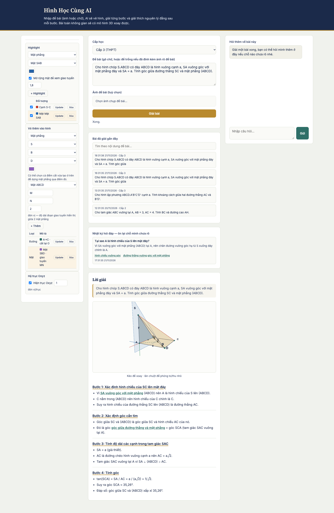

**Điểm nhấn demo:** đây là phần khác biệt lớn nhất so với hình tĩnh trong sách.

Chi tiết bảng công cụ 3D:

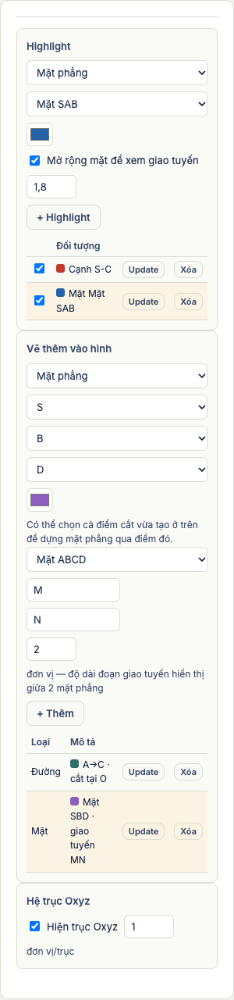

### Bước 6. Hiểu sâu từng khái niệm
Bấm thuật ngữ gạch chân (màu xanh) để đọc bài giảng ngắn:

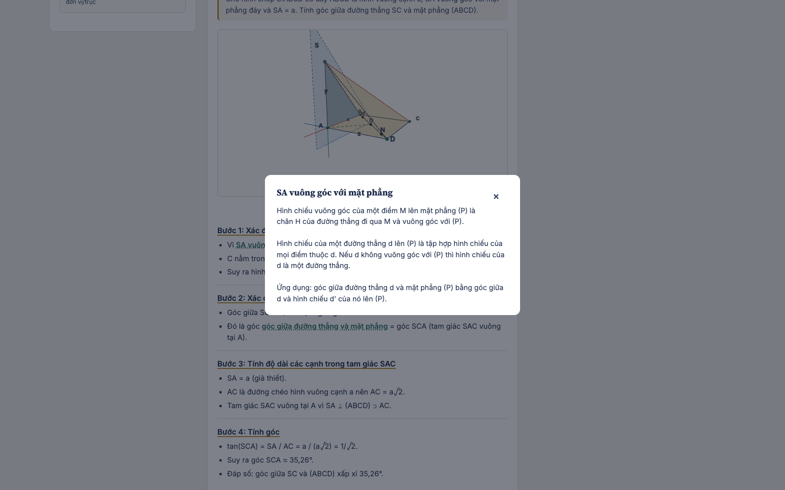

Bấm tiêu đề từng bước để xem **nguyên lý** — vì sao nghĩ ra bước này:

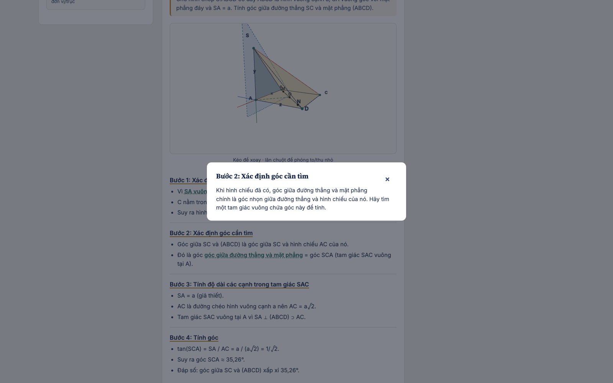

### Bước 7. Hỏi thêm và ôn lại
Hỏi bất kỳ chỗ nào chưa rõ; trợ giảng trả lời ngắn gọn và gợi ý từ khóa để tìm hiểu tiếp.

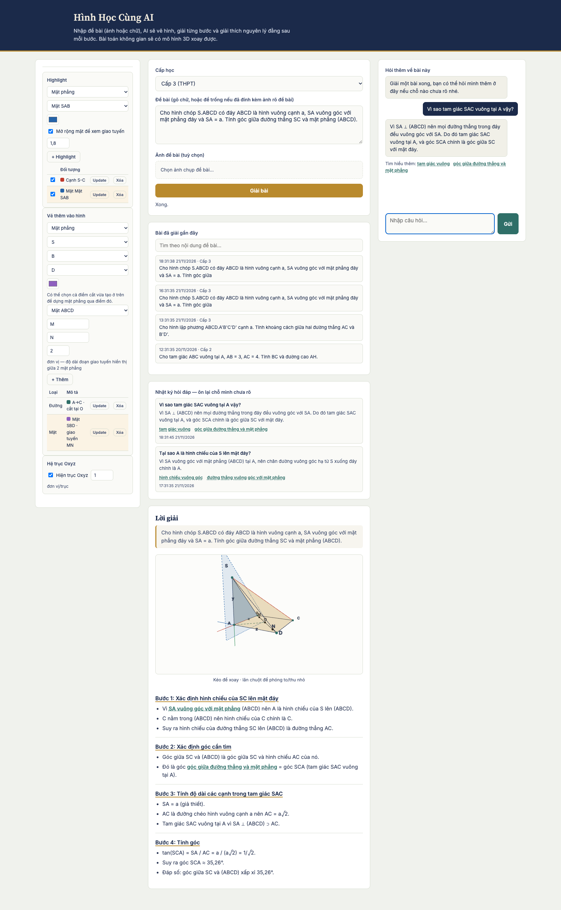

Mọi câu hỏi được ghi vào nhật ký, cùng với danh sách bài đã giải (có tìm kiếm không phân biệt dấu):

### Bước 8. Bài hình phẳng và điện thoại
Với bài hình phẳng, hệ thống vẽ hình 2D rõ ràng và giải từng bước như trên.

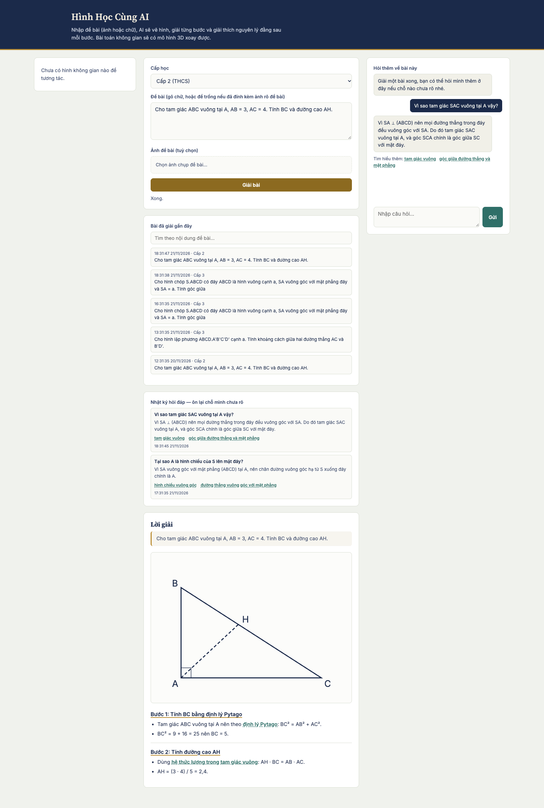

Giao diện co giãn cho điện thoại:

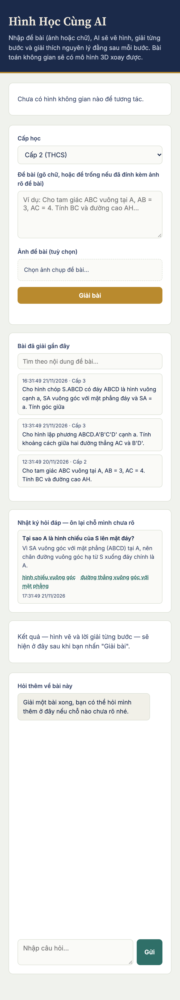

---

## 5. Tính năng hiện có

| Nhóm | Tính năng |
|---|---|
| Nhập đề | Gõ chữ; chọn ảnh hoặc dán ảnh từ clipboard; tự đọc chữ trong ảnh; chọn cấp học THCS/THPT. |
| Lời giải | Đề chép lại; hình 2D hoặc 3D; các bước ngắn gọn; nguyên lý cho từng bước. |
| Hình 3D | Xoay, phóng to; nhãn đỉnh; mặt bán trong suốt; highlight cạnh/mặt kèm mở rộng; vẽ thêm đường (kéo dài, nét đứt, giao điểm có tên); dựng mặt phẳng qua 3 điểm; giao điểm và giao tuyến; hệ trục Oxyz. |
| Học sâu | Thuật ngữ bấm được ra bài giảng; chat theo ngữ cảnh; gợi ý từ khóa. |
| Ôn tập | Lịch sử bài đã giải (tìm kiếm, phân trang); nhật ký hỏi đáp. |

---

## 6. Vision

> *Chủ sản phẩm bổ sung.*

Gợi ý các câu cần trả lời:
- Học sinh/giáo viên sẽ nói gì về sản phẩm sau 1–2 năm?
- Hình Học Cùng AI muốn trở thành gì: công cụ giải bài, bảng vẽ hình học tương tác, hay người bạn học hình học?
- Phạm vi: chỉ hình học, hay mở rộng sang các phần Toán/Lý khác?

&nbsp;

---

## 7. Định hướng phát triển

> *Chủ sản phẩm bổ sung (mục tiêu, mốc thời gian, ưu tiên).*

Gợi ý ban đầu từ bản demo hiện tại (nháp, chỉnh hoặc xóa tùy ý):
- **Thêm điểm** trực tiếp trên hình (điểm tự do, trung điểm, điểm chia theo tỉ lệ).
- **Mặt phẳng kéo giãn bằng chuột** để học sinh thấy mặt phẳng cắt hình thay đổi theo thời gian thực.
- Đo độ dài và góc trực tiếp trên hình.
- Chia sẻ bài giải, xuất PDF; chế độ cho giáo viên.

Chi tiết danh sách hạn chế và backlog kỹ thuật nằm trong [`SPEC-technical.md`](SPEC-technical.md), mục 7 và 8.

&nbsp;
