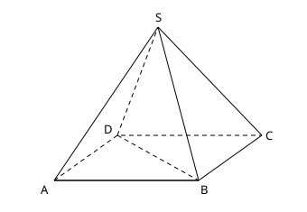

# Bài tập – Bài 10. Đường thẳng và mặt phẳng trong không gian

Phiên bản: v1.2 · 27/11/2026

> Tài liệu tổng hợp/biên soạn lại cho mục đích học tập (không sao chép nguyên văn SGK/SBT). Bộ sách xương sống: Toán 11 Kết nối tri thức với cuộc sống.

*Chương 4. Quan hệ song song trong không gian* · Lý thuyết: [ly-thuyet](../../ly-thuyet/chuong-04-quan-he-song-song/bai-10-duong-thang-va-mat-phang-trong-khong-gian.md)

### Nhận biết
**1.** Qua 4 điểm không đồng phẳng có bao nhiêu mặt phẳng đi qua 3 trong 4 điểm? *Giải.* $C_4^3=4$.

**2.** Hình chóp có đáy lục giác có bao nhiêu mặt? *Giải.* 6 mặt bên + 1 đáy = 7.

**3.** *[Trắc nghiệm]* Hình chóp có đáy là ngũ giác có tất cả bao nhiêu cạnh? A. $5$; B. $10$; C. $6$; D. $15$.
*Giải.* Đáy có $5$ cạnh, mỗi đỉnh đáy nối với đỉnh chóp bằng $1$ cạnh bên ($5$ cạnh): $5+5=10$. Chọn **B**.

### Thông hiểu
**4.** Chóp $S.ABCD$ đáy là hình bình hành. Tìm $(SAB)\cap(SCD)$. *Giải.* $S$ là điểm chung; $AB\parallel CD$ nên giao tuyến là đường thẳng qua $S$ song song $AB$ (định lí 3 giao tuyến).

**5.** *[Đúng/sai]* Cho tứ diện $ABCD$, $M\in AB$, $N\in AC$ ($M,N$ khác $A$). a) $M,N,B,C$ đồng phẳng; b) $MN$ và $BC$ luôn cắt nhau; c) $(DMN)\cap(ABC)=MN$; d) $A,M,N,D$ đồng phẳng.
*Giải.*
- a) $M,N,B,C$ cùng thuộc $(ABC)$: **Đúng**.
- b) Có thể song song (khi $\dfrac{AM}{AB}=\dfrac{AN}{AC}$): **Sai**.
- c) $M,N$ là hai điểm chung của $(DMN)$ và $(ABC)$, $D\notin(ABC)$: **Đúng**.
- d) $A,M,N$ không thẳng hàng nên xác định $(ABC)$, mà $D\notin(ABC)$: **Sai**.
- Đáp án: Đ – S – Đ – S.

### Vận dụng
**6.** Chóp $S.ABCD$ đáy là hình bình hành tâm $O$; $M$ là trung điểm $SC$. Tìm giao điểm $I$ của $AM$ và $(SBD)$.

*Giải.*
- Bước 1: $AM\subset(SAC)$ và $(SAC)\cap(SBD)=SO$ (vì $S,O$ là hai điểm chung).
- Bước 2: trong $(SAC)$, $AM$ và $SO$ cùng nằm trong một mặt phẳng nên cắt nhau tại $I$; $I\in AM$ và $I\in SO\subset(SBD)$, nên $I=AM\cap(SBD)$.
- Bước 3: $AM$, $SO$ là hai trung tuyến của $\triangle SAC$ ($O$ trung điểm $AC$, $M$ trung điểm $SC$) nên $I$ là trọng tâm, $\dfrac{AI}{AM}=\dfrac23$.

### Vận dụng cao
**7.** Cho tứ diện $ABCD$, $M\in AB$, $N\in AC$ sao cho $MN\not\parallel BC$. Tìm giao tuyến của $(DMN)$ và $(DBC)$.
*Giải.*
- Bước 1: $D$ là điểm chung thứ nhất của hai mặt phẳng.
- Bước 2: $MN$ và $BC$ cùng nằm trong $(ABC)$ và không song song nên cắt nhau tại $E$.
- Bước 3: $E\in MN\subset(DMN)$ và $E\in BC\subset(DBC)$, nên $E$ là điểm chung thứ hai.
- Bước 4: giao tuyến là đường thẳng $DE$.

## Nguồn

| Nội dung trong bài | Nguồn | Link | Ghi chú |
|---|---|---|---|
| Toàn bộ đề và lời giải | Tác giả tài liệu | - | tự soạn (cùng dạng với SGK/SBT, không trích nguyên văn) |
| Đối chiếu dạng bài | SBT Toán 11 KNTT trên loigiaihay | https://loigiaihay.com/sbt-toan-11-ket-noi-tri-thuc-c1567.html | chỉ tham khảo dạng, không chép |
| Đối chiếu dạng bài, mức độ | Giải bài tập SGK Toán 11 KNTT – loigiaihay (Bài 10) | https://loigiaihay.com/bai-10-duong-thang-va-mat-phang-trong-khong-gian-toan-11-ket-noi-tri-thuc-e31528.html | đã mở được (HTTP 200, 27/11/2026); chỉ dẫn, không chép đề/lời giải |
| Đối chiếu dạng bài, mức độ | Giải SGK Toán 11 KNTT – VietJack (Bài 10) | https://vietjack.com/toan-11-kn/bai-10-duong-thang-va-mat-phang-trong-khong-gian.jsp | đã mở được (HTTP 200, 27/11/2026); chỉ dẫn, không chép đề/lời giải |
| Đối chiếu dạng đề kiểm tra (trắc nghiệm, đúng/sai, trả lời ngắn) | Đề thi giữa kì 1 Toán 11 KNTT (đề số 9) – loigiaihay | https://loigiaihay.com/de-thi-giua-ki-1-toan-11-ket-noi-tri-thuc-de-so-9-a188921.html | đã mở được (HTTP 200, 27/11/2026); chỉ tham khảo dạng/mức độ, không chép đề |
| Đối chiếu cấu trúc đề 2025 | Đề thi giữa kì 1 Toán 11 cấu trúc mới KNTT – VietJack | https://vietjack.com/de-kiem-tra-lop-11/de-thi-giua-ki-1-toan-lop-11-cau-truc-moi-ket-noi.jsp | đã mở được (HTTP 200, 27/11/2026); chỉ tham khảo dạng, không chép đề |

## Lịch sử

| Phiên bản | Ngày | Thay đổi | Ai |
|---|---|---|---|
| v1.1 | 27/11/2026 | Bản trước: 5 bài, lời giải ngắn | agent runner-materials-l11 |
| v1.2 | 27/11/2026 | Thêm 2 bài (5→7, có trắc nghiệm/đúng-sai/trả lời ngắn), viết lại 2 lời giải từng bước, cập nhật nguồn | agent runner-mat-300 |
