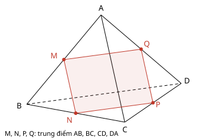

# Bài tập – Bài 11. Hai đường thẳng song song

Phiên bản: v1.2 · 27/11/2026

> Tài liệu tổng hợp/biên soạn lại cho mục đích học tập (không sao chép nguyên văn SGK/SBT). Bộ sách xương sống: Toán 11 Kết nối tri thức với cuộc sống.

*Chương 4. Quan hệ song song trong không gian* · Lý thuyết: [ly-thuyet](../../ly-thuyet/chuong-04-quan-he-song-song/bai-11-hai-duong-thang-song-song.md)

### Nhận biết
**1.** Hai đường thẳng không có điểm chung có song song không? *Giải.* Chưa chắc: có thể chéo nhau.

**2.** *[Trắc nghiệm]* Hai đường thẳng phân biệt cùng song song với một đường thẳng thứ ba thì: A. chéo nhau; B. cắt nhau; C. song song với nhau; D. có thể cắt nhau.
*Giải.* Đây là tính chất bắc cầu của quan hệ song song trong không gian. Chọn **C**.

### Thông hiểu
**3.** Tứ diện $ABCD$, $M,N$ là trung điểm $AB,AC$. Chứng minh $MN\parallel BC$.

*Giải.* (dùng hình, xét $\triangle ABC$ có $M,N$ là trung điểm hai cạnh)
- $MN$ nối trung điểm hai cạnh $AB,AC$ của $\triangle ABC$ nên $MN$ là đường trung bình.
- Do đó $MN\parallel BC$ và $MN=\dfrac12BC$.

### Vận dụng
**4.** Chóp $S.ABCD$ đáy hình thang $AB\parallel CD$. Tìm $(SAB)\cap(SCD)$. *Giải.* $S$ chung, $AB\parallel CD$: giao tuyến là đường thẳng $d$ qua $S$, $d\parallel AB\parallel CD$.

**5.** Chóp $S.ABCD$ đáy hình bình hành. $M,N$ trung điểm $SA,SB$. Chứng minh $MN\parallel CD$. *Giải.* $MN\parallel AB$ (đường trung bình $\triangle SAB$), $AB\parallel CD$ nên $MN\parallel CD$.

**6.** *[Trả lời ngắn]* Tứ diện $ABCD$ có $M,N,P,Q$ lần lượt là trung điểm $AB,BC,CD,DA$; $AC=6$, $BD=8$. Tính chu vi tứ giác $MNPQ$.

*Giải.*
- $MN$, $PQ$ là đường trung bình của $\triangle ABC$, $\triangle ACD$ nên $MN=PQ=\dfrac{AC}2=3$ (và cùng song song $AC$).
- $NP$, $MQ$ là đường trung bình của $\triangle BCD$, $\triangle ABD$ nên $NP=MQ=\dfrac{BD}2=4$.
- Chu vi $=2(3+4)=14$.

### Vận dụng cao
**7.** Tứ diện $ABCD$, $G_1,G_2$ là trọng tâm $\triangle ABC$, $\triangle ABD$. Chứng minh $G_1G_2\parallel CD$ và tính $\dfrac{G_1G_2}{CD}$.
*Giải.*
- Bước 1: gọi $E$ là trung điểm $AB$; $CE$ là trung tuyến của $\triangle ABC$ nên $G_1\in EC$ với $\dfrac{EG_1}{EC}=\dfrac13$. Tương tự $G_2\in ED$, $\dfrac{EG_2}{ED}=\dfrac13$.
- Bước 2: trong $\triangle ECD$, $\dfrac{EG_1}{EC}=\dfrac{EG_2}{ED}$ nên theo định lí Thalès đảo $G_1G_2\parallel CD$.
- Bước 3: hai tam giác $EG_1G_2$ và $ECD$ đồng dạng tỉ số $\dfrac13$ nên $\dfrac{G_1G_2}{CD}=\dfrac13$.

## Nguồn

| Nội dung trong bài | Nguồn | Link | Ghi chú |
|---|---|---|---|
| Toàn bộ đề và lời giải | Tác giả tài liệu | - | tự soạn (cùng dạng với SGK/SBT, không trích nguyên văn) |
| Đối chiếu dạng bài | SBT Toán 11 KNTT trên loigiaihay | https://loigiaihay.com/sbt-toan-11-ket-noi-tri-thuc-c1567.html | chỉ tham khảo dạng, không chép |
| Đối chiếu dạng bài, mức độ | Giải bài tập SGK Toán 11 KNTT – loigiaihay (Bài 11) | https://loigiaihay.com/bai-11-hai-duong-thang-song-song-toan-11-ket-noi-tri-thuc-e31531.html | đã mở được (HTTP 200, 27/11/2026); chỉ dẫn, không chép đề/lời giải |
| Đối chiếu dạng bài, mức độ | Giải SGK Toán 11 KNTT – VietJack (Bài 11) | https://vietjack.com/toan-11-kn/bai-11-hai-duong-thang-song-song.jsp | đã mở được (HTTP 200, 27/11/2026); chỉ dẫn, không chép đề/lời giải |
| Đối chiếu dạng đề kiểm tra (trắc nghiệm, đúng/sai, trả lời ngắn) | Đề thi giữa kì 1 Toán 11 KNTT (đề số 9) – loigiaihay | https://loigiaihay.com/de-thi-giua-ki-1-toan-11-ket-noi-tri-thuc-de-so-9-a188921.html | đã mở được (HTTP 200, 27/11/2026); chỉ tham khảo dạng/mức độ, không chép đề |
| Đối chiếu cấu trúc đề 2025 | Đề thi giữa kì 1 Toán 11 cấu trúc mới KNTT – VietJack | https://vietjack.com/de-kiem-tra-lop-11/de-thi-giua-ki-1-toan-lop-11-cau-truc-moi-ket-noi.jsp | đã mở được (HTTP 200, 27/11/2026); chỉ tham khảo dạng, không chép đề |

## Lịch sử

| Phiên bản | Ngày | Thay đổi | Ai |
|---|---|---|---|
| v1.1 | 27/11/2026 | Bản trước: 5 bài, lời giải ngắn | agent runner-materials-l11 |
| v1.2 | 27/11/2026 | Thêm 2 bài (5→7, có trắc nghiệm/đúng-sai/trả lời ngắn), viết lại 2 lời giải từng bước, cập nhật nguồn | agent runner-mat-300 |
