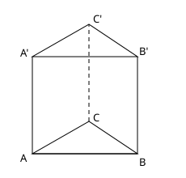
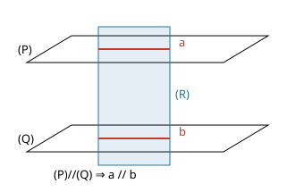

# Bài tập – Bài 13. Hai mặt phẳng song song

Phiên bản: v1.2 · 27/11/2026

> Tài liệu tổng hợp/biên soạn lại cho mục đích học tập (không sao chép nguyên văn SGK/SBT). Bộ sách xương sống: Toán 11 Kết nối tri thức với cuộc sống.

*Chương 4. Quan hệ song song trong không gian* · Lý thuyết: [ly-thuyet](../../ly-thuyet/chuong-04-quan-he-song-song/bai-13-hai-mat-phang-song-song.md)

### Nhận biết
**1.** Hai mặt phẳng phân biệt không cắt nhau thì? *Giải.* Song song.

**2.** *[Trắc nghiệm]* Nếu $(P)\parallel(Q)$ và đường thẳng $a\subset(P)$ thì: A. $a\parallel(Q)$; B. $a$ cắt $(Q)$; C. $a\subset(Q)$; D. $a$ và $(Q)$ chéo nhau.
*Giải.* $(P)$ và $(Q)$ không có điểm chung nên $a$ cũng không có điểm chung với $(Q)$, tức $a\parallel(Q)$. Chọn **A**.

### Thông hiểu
**3.** Hình hộp $ABCD.A'B'C'D'$. Chứng minh $(ABB'A')\parallel(CDD'C')$.

*Giải.*
- Bước 1: $ABCD$ là hình bình hành nên $AB\parallel CD$; $ADD'A'$ là hình bình hành nên $AA'\parallel DD'$.
- Bước 2: $AB,AA'$ cắt nhau trong $(ABB'A')$, $CD,DD'$ cắt nhau trong $(CDD'C')$ và $AB\parallel CD$, $AA'\parallel DD'$.
- Bước 3: theo dấu hiệu hai mặt phẳng song song, $(ABB'A')\parallel(CDD'C')$.

### Vận dụng
**4.** Lăng trụ $ABC.A'B'C'$. Chứng minh $(ABC)\parallel(A'B'C')$.

*Giải.*
- Bước 1: các mặt bên là hình bình hành nên $AB\parallel A'B'$ và $AC\parallel A'C'$.
- Bước 2: $AB$, $AC$ cắt nhau tại $A$ và cùng nằm trong $(ABC)$; $A'B'\subset(A'B'C')$, $A'C'\subset(A'B'C')$.
- Bước 3: theo dấu hiệu, $(ABC)\parallel(A'B'C')$.

**5.** Ba mặt phẳng song song cắt hai cát tuyến tại $A,B,C$ và $A',B',C'$. Biết $AB=3,BC=5,A'B'=4,5$. Tính $B'C'$. *Giải.* $\dfrac{AB}{BC}=\dfrac{A'B'}{B'C'}\Rightarrow B'C'=\dfrac{5\cdot4{,}5}3=7{,}5$.

**6.** *[Trả lời ngắn]* Ba mặt phẳng song song $(P),(Q),(R)$ cắt hai cát tuyến lần lượt tại $A,B,C$ và $A',B',C'$. Biết $\dfrac{AB}{BC}=\dfrac23$ và $A'C'=15$. Tính $A'B'$.

*Giải.*
- Định lí Thalès trong không gian: $\dfrac{A'B'}{B'C'}=\dfrac{AB}{BC}=\dfrac23$.
- $\dfrac{A'B'}{A'C'}=\dfrac{2}{2+3}=\dfrac25$ nên $A'B'=\dfrac25\cdot15=6$.

### Vận dụng cao
**7.** Hình hộp $ABCD.A'B'C'D'$. Chứng minh $(AB'D')\parallel(C'BD)$.

*Giải.*
- Bước 1: $BB'D'D$ là hình bình hành nên $B'D'\parallel BD$; $B'D'\subset(AB'D')$, $BD\subset(C'BD)$.
- Bước 2: $ABC'D'$ có $AB\parallel D'C'$ và $AB=D'C'$ nên là hình bình hành, suy ra $AD'\parallel BC'$; $AD'\subset(AB'D')$, $BC'\subset(C'BD)$.
- Bước 3: $B'D'$ và $AD'$ cắt nhau tại $D'$, song song với $BD$ và $BC'$ tương ứng, nên $(AB'D')\parallel(C'BD)$.

## Nguồn

| Nội dung trong bài | Nguồn | Link | Ghi chú |
|---|---|---|---|
| Toàn bộ đề và lời giải | Tác giả tài liệu | - | tự soạn (cùng dạng với SGK/SBT, không trích nguyên văn) |
| Đối chiếu dạng bài | SBT Toán 11 KNTT trên loigiaihay | https://loigiaihay.com/sbt-toan-11-ket-noi-tri-thuc-c1567.html | chỉ tham khảo dạng, không chép |
| Đối chiếu dạng bài, mức độ | Giải bài tập SGK Toán 11 KNTT – loigiaihay (Bài 13) | https://loigiaihay.com/bai-13-hai-mat-phang-song-song-toan-11-ket-noi-tri-thuc-e31533.html | đã mở được (HTTP 200, 27/11/2026); chỉ dẫn, không chép đề/lời giải |
| Đối chiếu dạng bài, mức độ | Giải SGK Toán 11 KNTT – VietJack (Bài 13) | https://vietjack.com/toan-11-kn/bai-13-hai-mat-phang-song-song.jsp | đã mở được (HTTP 200, 27/11/2026); chỉ dẫn, không chép đề/lời giải |
| Đối chiếu dạng đề kiểm tra (trắc nghiệm, đúng/sai, trả lời ngắn) | Đề thi giữa kì 1 Toán 11 KNTT (đề số 9) – loigiaihay | https://loigiaihay.com/de-thi-giua-ki-1-toan-11-ket-noi-tri-thuc-de-so-9-a188921.html | đã mở được (HTTP 200, 27/11/2026); chỉ tham khảo dạng/mức độ, không chép đề |
| Đối chiếu cấu trúc đề 2025 | Đề thi giữa kì 1 Toán 11 cấu trúc mới KNTT – VietJack | https://vietjack.com/de-kiem-tra-lop-11/de-thi-giua-ki-1-toan-lop-11-cau-truc-moi-ket-noi.jsp | đã mở được (HTTP 200, 27/11/2026); chỉ tham khảo dạng, không chép đề |

## Lịch sử

| Phiên bản | Ngày | Thay đổi | Ai |
|---|---|---|---|
| v1.1 | 27/11/2026 | Bản trước: 5 bài, lời giải ngắn | agent runner-materials-l11 |
| v1.2 | 27/11/2026 | Thêm 2 bài (5→7, có trắc nghiệm/đúng-sai/trả lời ngắn), viết lại 3 lời giải từng bước, cập nhật nguồn | agent runner-mat-300 |
