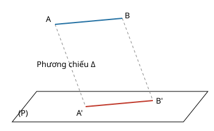

# Bài tập – Bài 14. Phép chiếu song song

Phiên bản: v1.2 · 27/11/2026

> Tài liệu tổng hợp/biên soạn lại cho mục đích học tập (không sao chép nguyên văn SGK/SBT). Bộ sách xương sống: Toán 11 Kết nối tri thức với cuộc sống.

*Chương 4. Quan hệ song song trong không gian* · Lý thuyết: [ly-thuyet](../../ly-thuyet/chuong-04-quan-he-song-song/bai-14-phep-chieu-song-song.md)

### Nhận biết
**1.** Phép chiếu song song có giữ trung điểm đoạn thẳng không? *Giải.* Có (giữ tỉ số).

**2.** *[Trắc nghiệm]* Phép chiếu song song biến hai đường thẳng song song (không song song với phương chiếu) thành: A. hai đường thẳng song song hoặc trùng nhau; B. hai đường thẳng cắt nhau; C. hai đường thẳng chéo nhau; D. luôn là hai đường thẳng song song phân biệt.
*Giải.* Tính chất bảo toàn song song: hai ảnh song song hoặc trùng (trùng khi hai đường thẳng nằm trong cùng một mặt phẳng song song phương chiếu). Chọn **A**.

### Thông hiểu
**3.** Hình vuông có hình biểu diễn là hình nào? *Giải.* Hình bình hành (có thể suy biến).

**4.** *[Đúng/sai]* Về phép chiếu song song: a) giữ tỉ số độ dài hai đoạn thẳng cùng nằm trên một đường thẳng; b) hình chiếu của trung điểm một đoạn thẳng là trung điểm hình chiếu của đoạn thẳng; c) hình chiếu của hình tròn luôn là hình tròn; d) hình chiếu của góc $60^\circ$ luôn có số đo $60^\circ$.
*Giải.*
- a) **Đúng**. b) **Đúng** (hệ quả của a).
- c) Thường là hình elip: **Sai**.
- d) Không bảo toàn góc: **Sai**.
- Đáp án: Đ – Đ – S – S.

### Vận dụng
**5.** $M$ thuộc đoạn $AB$, $MA=2MB$. Hình chiếu $M'$ trên $A'B'$ có $M'A'$ gấp mấy lần $M'B'$?

*Giải.*
- Phép chiếu song song bảo toàn tỉ số độ dài của hai đoạn thẳng nằm trên cùng một đường thẳng.
- $\dfrac{M'A'}{M'B'}=\dfrac{MA}{MB}=2$: gấp $2$ lần.

**6.** *[Trả lời ngắn]* Tam giác $ABC$ có hình biểu diễn $A'B'C'$. Điểm $M\in AB$ với $AM=3MB$; $A'B'=12$. Tính $A'M'$.
*Giải.*
- $\dfrac{AM}{AB}=\dfrac34$ và tỉ số này được bảo toàn: $\dfrac{A'M'}{A'B'}=\dfrac34$.
- $A'M'=\dfrac34\cdot12=9$.

### Vận dụng cao
**7.** Vì sao hình biểu diễn của tam giác đều nói chung không phải là tam giác đều?
*Giải.*
- Bước 1: phép chiếu song song không bảo toàn độ dài và độ lớn góc.
- Bước 2: nó chỉ bảo toàn tính song song và tỉ số độ dài trên cùng một đường thẳng (do đó giữ trung điểm, giữ trọng tâm).
- Bước 3: nên hình biểu diễn của tam giác đều là một tam giác bất kì (cạnh, góc có thể khác nhau), nhưng các đường trung tuyến vẫn biểu diễn các đường trung tuyến.

## Nguồn

| Nội dung trong bài | Nguồn | Link | Ghi chú |
|---|---|---|---|
| Toàn bộ đề và lời giải | Tác giả tài liệu | - | tự soạn (cùng dạng với SGK/SBT, không trích nguyên văn) |
| Đối chiếu dạng bài | SBT Toán 11 KNTT trên loigiaihay | https://loigiaihay.com/sbt-toan-11-ket-noi-tri-thuc-c1567.html | chỉ tham khảo dạng, không chép |
| Đối chiếu dạng bài, mức độ | Giải bài tập SGK Toán 11 KNTT – loigiaihay (Bài 14) | https://loigiaihay.com/bai-14-phep-chieu-song-song-toan-11-ket-noi-tri-thuc-e31534.html | đã mở được (HTTP 200, 27/11/2026); chỉ dẫn, không chép đề/lời giải |
| Đối chiếu dạng bài, mức độ | Giải SGK Toán 11 KNTT – VietJack (Bài 14) | https://vietjack.com/toan-11-kn/bai-14-phep-chieu-song-song.jsp | đã mở được (HTTP 200, 27/11/2026); chỉ dẫn, không chép đề/lời giải |
| Đối chiếu dạng đề kiểm tra (trắc nghiệm, đúng/sai, trả lời ngắn) | Đề thi giữa kì 1 Toán 11 KNTT (đề số 9) – loigiaihay | https://loigiaihay.com/de-thi-giua-ki-1-toan-11-ket-noi-tri-thuc-de-so-9-a188921.html | đã mở được (HTTP 200, 27/11/2026); chỉ tham khảo dạng/mức độ, không chép đề |
| Đối chiếu cấu trúc đề 2025 | Đề thi giữa kì 1 Toán 11 cấu trúc mới KNTT – VietJack | https://vietjack.com/de-kiem-tra-lop-11/de-thi-giua-ki-1-toan-lop-11-cau-truc-moi-ket-noi.jsp | đã mở được (HTTP 200, 27/11/2026); chỉ tham khảo dạng, không chép đề |

## Lịch sử

| Phiên bản | Ngày | Thay đổi | Ai |
|---|---|---|---|
| v1.1 | 27/11/2026 | Bản trước: 4 bài, lời giải ngắn | agent runner-materials-l11 |
| v1.2 | 27/11/2026 | Thêm 3 bài (4→7, có trắc nghiệm/đúng-sai/trả lời ngắn), viết lại 2 lời giải từng bước, cập nhật nguồn | agent runner-mat-300 |
