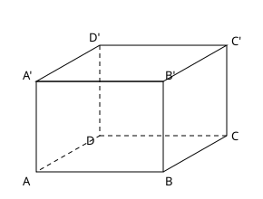
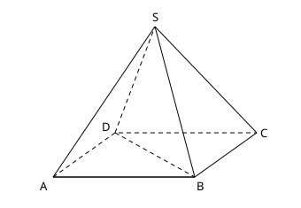

# Bài tập cuối chương 4. Quan hệ song song trong không gian

Phiên bản: v1.2 · 27/11/2026

> Tài liệu tổng hợp/biên soạn lại cho mục đích học tập (không sao chép nguyên văn SGK/SBT). Bộ sách xương sống: Toán 11 Kết nối tri thức với cuộc sống.

### Nhận biết
**1.** *[Trắc nghiệm]* Hai mặt phẳng phân biệt có một điểm chung thì chúng cắt nhau theo: A. một điểm; B. một đường thẳng đi qua điểm đó; C. hai đường thẳng; D. không có giao tuyến.
*Giải.* Theo tiên đề về giao tuyến, hai mặt phẳng phân biệt có điểm chung thì có đúng một đường thẳng chung qua điểm đó. Chọn **B**.

### Thông hiểu
**2.** Chứng minh trong tứ diện $ABCD$, các trung điểm $M,N,P,Q$ của $AB,BC,CD,DA$ tạo hình bình hành. *Giải.* $MN\parallel AC\parallel QP$ (đường trung bình) và $MQ\parallel BD\parallel NP$.

### Vận dụng
**3.** Chóp $S.ABCD$ đáy hình thang $AD\parallel BC$, $AD>BC$. Tìm $(SAB)\cap(SCD)$.
*Giải.*
- Bước 1: $S$ là điểm chung.
- Bước 2: $AB$ và $CD$ cùng nằm trong $(ABCD)$ và không song song (hai cạnh bên hình thang) nên cắt nhau tại $E$.
- Bước 3: $E\in AB\subset(SAB)$, $E\in CD\subset(SCD)$. Giao tuyến là $SE$.

**4.** Chóp $S.ABCD$ đáy hình bình hành. $M$ là trung điểm $SC$. Mặt phẳng $(ABM)$ cắt $SD$ tại $N$. Chứng minh $N$ là trung điểm $SD$.
*Giải.*
- Bước 1: $AB\parallel CD$, $CD\subset(SCD)$ nên $AB\parallel(SCD)$.
- Bước 2: $(ABM)\cap(SCD)=MN$ ($M,N$ cùng thuộc hai mặt phẳng), nên theo định lí giao tuyến $MN\parallel AB\parallel CD$.
- Bước 3: trong $\triangle SCD$, $M$ là trung điểm $SC$ và $MN\parallel CD$ nên $N$ là trung điểm $SD$.

**5.** Chóp $S.ABCD$ đáy hình bình hành. $(\alpha)$ qua $M\in SA$ song song $(ABCD)$ cắt $SB,SC,SD$ lần lượt tại $N,P,Q$. Chứng minh $MNPQ$ là hình bình hành. *Giải.* $(\alpha)\parallel(ABCD)$ nên $MN\parallel AB$, $QP\parallel DC$, $MQ\parallel AD$, $NP\parallel BC$; $AB\parallel DC$, $AD\parallel BC$ suy ra $MN\parallel QP$, $MQ\parallel NP$. ∎

### Vận dụng cao
**6.** Hình hộp $ABCD.A'B'C'D'$. Chứng minh $AC'$, $A'C$, $BD'$, $B'D$ cắt nhau tại một điểm là trung điểm của mỗi đường.

*Giải.*
- Bước 1: $ACC'A'$ là hình bình hành ($AA'\parallel CC'$, $AA'=CC'$) nên hai đường chéo $AC'$, $A'C$ cắt nhau tại trung điểm $O$ của mỗi đường.
- Bước 2: $ABC'D'$ là hình bình hành ($AB\parallel D'C'$, $AB=D'C'$) nên $AC'$ và $BD'$ có chung trung điểm; vậy trung điểm $BD'$ cũng là $O$.
- Bước 3: $BDD'B'$ là hình bình hành nên $BD'$ và $B'D$ có chung trung điểm, tức $B'D$ cũng nhận $O$ làm trung điểm.
- Kết luận: bốn đường chéo đồng quy tại $O$, là trung điểm của mỗi đường. ∎

**7.** *[Trả lời ngắn]* Chóp $S.ABCD$ đáy hình bình hành có diện tích $36$. $M\in SA$ với $SM=\dfrac13SA$; mặt phẳng $(\alpha)$ qua $M$ song song $(ABCD)$ cắt $SB,SC,SD$ lần lượt tại $N,P,Q$. Tính diện tích $MNPQ$.

*Giải.*
- Bước 1: $(\alpha)\parallel(ABCD)$ nên $MN\parallel AB$, $NP\parallel BC$, ... và $\dfrac{SM}{SA}=\dfrac{SN}{SB}=\dfrac{SP}{SC}=\dfrac{SQ}{SD}=\dfrac13$ (Thalès).
- Bước 2: $MNPQ$ đồng dạng với $ABCD$ với tỉ số $k=\dfrac13$ (hình bình hành, cạnh tương ứng song song, tỉ lệ $\dfrac13$).
- Bước 3: $S_{MNPQ}=k^2S_{ABCD}=\dfrac19\cdot36=4$.

## Nguồn

| Nội dung trong bài | Nguồn | Link | Ghi chú |
|---|---|---|---|
| Đề và lời giải ôn tập | Tác giả tài liệu | - | tự soạn |
| Đối chiếu tên mục "Bài tập cuối chương" | SGK Toán 11 KNTT – loigiaihay | https://loigiaihay.com/bai-tap-cuoi-chuong-4-toan-11-ket-noi-tri-thuc-e31535.html | đã mở được (HTTP 200, 27/11/2026); chỉ dẫn tới lời giải, không chép |
| Đối chiếu dạng bài cuối chương | Giải SGK Toán 11 KNTT – VietJack | https://vietjack.com/toan-11-kn/bai-tap-cuoi-chuong-iv.jsp | đã mở được (HTTP 200, 27/11/2026); chỉ dẫn, không chép |
| Tổng hợp lý thuyết chương | Lý thuyết Toán 11 KNTT – VietJack | https://vietjack.com/toan-11-kn/ly-thuyet-bai-tap-cuoi-chuong-4.jsp | đã mở được (HTTP 200, 27/11/2026); chỉ dẫn, không chép |
| Đối chiếu dạng đề kiểm tra (trắc nghiệm, đúng/sai, trả lời ngắn) | Đề thi giữa kì 1 Toán 11 KNTT (đề số 9) – loigiaihay | https://loigiaihay.com/de-thi-giua-ki-1-toan-11-ket-noi-tri-thuc-de-so-9-a188921.html | đã mở được (HTTP 200, 27/11/2026); chỉ tham khảo dạng/mức độ, không chép đề |
| Đối chiếu cấu trúc đề 2025 | Đề thi giữa kì 1 Toán 11 cấu trúc mới KNTT – VietJack | https://vietjack.com/de-kiem-tra-lop-11/de-thi-giua-ki-1-toan-lop-11-cau-truc-moi-ket-noi.jsp | đã mở được (HTTP 200, 27/11/2026); chỉ tham khảo dạng, không chép đề |

## Lịch sử

| Phiên bản | Ngày | Thay đổi | Ai |
|---|---|---|---|
| v1.1 | 27/11/2026 | Bản trước: 5 bài, lời giải ngắn | agent runner-materials-l11 |
| v1.2 | 27/11/2026 | Thêm 2 bài (5→7, có trắc nghiệm/đúng-sai/trả lời ngắn), viết lại 3 lời giải từng bước, cập nhật nguồn | agent runner-mat-300 |
