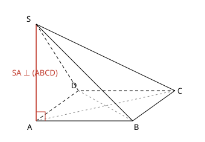
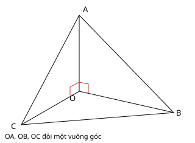

# Bài tập – Bài 23. Đường thẳng vuông góc với mặt phẳng

Phiên bản: v1.2 · 27/11/2026

> Tài liệu tổng hợp/biên soạn lại cho mục đích học tập (không sao chép nguyên văn SGK/SBT). Bộ sách xương sống: Toán 11 Kết nối tri thức với cuộc sống.

*Chương 7. Quan hệ vuông góc trong không gian* · Lý thuyết: [ly-thuyet](../../ly-thuyet/chuong-07-quan-he-vuong-goc/bai-23-duong-thang-vuong-goc-voi-mat-phang.md)

### Nhận biết
**1.** $d\perp(P)$ thì $d$ vuông góc với bao nhiêu đường thẳng trong $(P)$? *Giải.* Mọi đường thẳng trong $(P)$.

**2.** *[Trắc nghiệm]* Điều kiện đủ để đường thẳng $d$ vuông góc với mặt phẳng $(P)$ là: A. $d$ vuông góc với một đường thẳng nằm trong $(P)$; B. $d$ vuông góc với hai đường thẳng cắt nhau nằm trong $(P)$; C. $d$ vuông góc với hai đường thẳng song song nằm trong $(P)$; D. $d$ song song với một đường thẳng nằm trong $(P)$.
*Giải.* Đây là dấu hiệu nhận biết đường thẳng vuông góc với mặt phẳng; A và C chưa đủ, D sai. Chọn **B**.

### Thông hiểu
**3.** Chóp $S.ABCD$ đáy là hình vuông, $SA\perp(ABCD)$. Chứng minh $BC\perp(SAB)$.

*Giải.*
- Bước 1: $BC\perp AB$ (hình vuông).
- Bước 2: $SA\perp(ABCD)$ và $BC\subset(ABCD)$ nên $SA\perp BC$.
- Bước 3: $AB,SA$ cắt nhau tại $A$ và cùng nằm trong $(SAB)$, nên $BC\perp(SAB)$. ∎

**4.** *[Đúng/sai]* Chóp $S.ABCD$ đáy hình vuông, $SA\perp(ABCD)$. a) $SA\perp BD$; b) $CD\perp(SAD)$; c) $BD\perp SC$; d) $AC\perp(SBD)$.

*Giải.*
- a) $BD\subset(ABCD)$: **Đúng**.
- b) $CD\perp AD$, $CD\perp SA$, $AD,SA$ cắt nhau trong $(SAD)$: **Đúng**.
- c) $BD\perp AC$, $BD\perp SA\Rightarrow BD\perp(SAC)\Rightarrow BD\perp SC$: **Đúng**.
- d) $AC\perp BD$ nhưng $AC$ không vuông góc $SB$ (hoặc $SD$): **Sai**.
- Đáp án: Đ – Đ – Đ – S.

### Vận dụng
**5.** Với giả thiết trên, chứng minh $BD\perp(SAC)$. *Giải.* $BD\perp AC$ (hai đường chéo hình vuông), $BD\perp SA$.

**6.** Chóp $S.ABC$ có $SA=SB=SC$, $H$ là tâm đường tròn ngoại tiếp $\triangle ABC$. Chứng minh $SH\perp(ABC)$.
*Giải.*
- Bước 1: $HA=HB=HC$ (bán kính đường tròn ngoại tiếp) và $SA=SB=SC$.
- Bước 2: $S$ và $H$ cùng cách đều $A,B,C$ nên cùng thuộc trục của đường tròn ngoại tiếp $\triangle ABC$ — tập các điểm cách đều ba đỉnh là đường thẳng qua $H$ vuông góc $(ABC)$.
- Bước 3: vậy $SH\perp(ABC)$.

### Vận dụng cao
**7.** Tứ diện $OABC$ có $OA,OB,OC$ đôi một vuông góc, $H$ là trực tâm $\triangle ABC$. Chứng minh $OH\perp(ABC)$.

*Giải.*
- Bước 1: $OA\perp OB$, $OA\perp OC$ nên $OA\perp(OBC)$, suy ra $OA\perp BC$.
- Bước 2: $H$ là trực tâm nên $AH\perp BC$. $OA$ và $AH$ cắt nhau tại $A$ trong $(OAH)$ nên $BC\perp(OAH)$, do đó $BC\perp OH$.
- Bước 3: tương tự, $OB\perp(OAC)\Rightarrow OB\perp AC$ và $BH\perp AC$ nên $AC\perp(OBH)\Rightarrow AC\perp OH$.
- Bước 4: $BC,AC$ cắt nhau trong $(ABC)$ nên $OH\perp(ABC)$. ∎

## Nguồn

| Nội dung trong bài | Nguồn | Link | Ghi chú |
|---|---|---|---|
| Toàn bộ đề và lời giải | Tác giả tài liệu | - | tự soạn (cùng dạng với SGK/SBT, không trích nguyên văn) |
| Đối chiếu dạng bài | SBT Toán 11 KNTT trên loigiaihay | https://loigiaihay.com/sbt-toan-11-ket-noi-tri-thuc-c1567.html | chỉ tham khảo dạng, không chép |
| Đối chiếu dạng bài, mức độ | Giải bài tập SGK Toán 11 KNTT – loigiaihay (Bài 23) | https://loigiaihay.com/bai-23-duong-thang-vuong-goc-voi-mat-phang-toan-11-ket-noi-tri-thuc-e31960.html | đã mở được (HTTP 200, 27/11/2026); chỉ dẫn, không chép đề/lời giải |
| Đối chiếu dạng bài, mức độ | Giải SGK Toán 11 KNTT – VietJack (Bài 23) | https://vietjack.com/toan-11-kn/bai-23-duong-thang-vuong-goc-voi-mat-phang.jsp | đã mở được (HTTP 200, 27/11/2026); chỉ dẫn, không chép đề/lời giải |
| Đối chiếu dạng đề kiểm tra (trắc nghiệm, đúng/sai, trả lời ngắn) | Đề thi giữa kì 1 Toán 11 KNTT (đề số 9) – loigiaihay | https://loigiaihay.com/de-thi-giua-ki-1-toan-11-ket-noi-tri-thuc-de-so-9-a188921.html | đã mở được (HTTP 200, 27/11/2026); chỉ tham khảo dạng/mức độ, không chép đề |
| Đối chiếu cấu trúc đề 2025 | Đề thi giữa kì 1 Toán 11 cấu trúc mới KNTT – VietJack | https://vietjack.com/de-kiem-tra-lop-11/de-thi-giua-ki-1-toan-lop-11-cau-truc-moi-ket-noi.jsp | đã mở được (HTTP 200, 27/11/2026); chỉ tham khảo dạng, không chép đề |

## Lịch sử

| Phiên bản | Ngày | Thay đổi | Ai |
|---|---|---|---|
| v1.1 | 27/11/2026 | Bản trước: 5 bài, lời giải ngắn | agent runner-materials-l11 |
| v1.2 | 27/11/2026 | Thêm 2 bài (5→7, có trắc nghiệm/đúng-sai/trả lời ngắn), viết lại 3 lời giải từng bước, cập nhật nguồn | agent runner-mat-300 |
