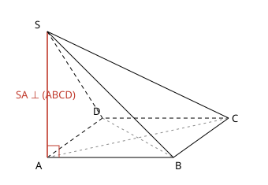

# Bài tập – Bài 24. Phép chiếu vuông góc. Góc giữa đường thẳng và mặt phẳng

Phiên bản: v1.2 · 27/11/2026

> Tài liệu tổng hợp/biên soạn lại cho mục đích học tập (không sao chép nguyên văn SGK/SBT). Bộ sách xương sống: Toán 11 Kết nối tri thức với cuộc sống.

*Chương 7. Quan hệ vuông góc trong không gian* · Lý thuyết: [ly-thuyet](../../ly-thuyet/chuong-07-quan-he-vuong-goc/bai-24-phep-chieu-vuong-goc-goc-giua-duong-thang-va-mat-phang.md)

### Nhận biết
**1.** Hình chiếu vuông góc của điểm $S$ lên $(ABC)$ là gì? *Giải.* Chân đường vuông góc hạ từ $S$.

**2.** *[Trắc nghiệm]* Góc giữa đường thẳng $d$ và mặt phẳng $(P)$ khi $d\perp(P)$ bằng: A. $0^\circ$; B. $45^\circ$; C. $60^\circ$; D. $90^\circ$.
*Giải.* Theo định nghĩa, nếu $d\perp(P)$ thì góc giữa $d$ và $(P)$ bằng $90^\circ$. Chọn **D**.

### Thông hiểu
**3.** Chóp $S.ABCD$ đáy hình vuông cạnh $a$, $SA\perp(ABCD)$, $SA=a$. Tính góc giữa $SC$ và mặt đáy.

*Giải.*
- Bước 1: $SA\perp(ABCD)$ nên $AC$ là hình chiếu của $SC$ lên $(ABCD)$; góc cần tìm là $\widehat{SCA}$.
- Bước 2: $AC=a\sqrt2$.
- Bước 3: $\tan\widehat{SCA}=\dfrac{SA}{AC}=\dfrac a{a\sqrt2}=\dfrac1{\sqrt2}$, suy ra góc $\approx35{,}26^\circ$.

**4.** *[Đúng/sai]* Chóp $S.ABCD$ đáy hình vuông cạnh $a$, $SA\perp(ABCD)$, $SA=a\sqrt2$. a) hình chiếu của $SC$ lên đáy là $AC$; b) góc giữa $SC$ và đáy là $\widehat{SCA}$; c) góc giữa $SC$ và đáy bằng $45^\circ$; d) góc giữa $SB$ và đáy bằng $60^\circ$.

*Giải.*
- a) **Đúng**; b) **Đúng**.
- c) $AC=a\sqrt2=SA$, $\tan\widehat{SCA}=1$: **Đúng**.
- d) $\tan\widehat{SBA}=\dfrac{a\sqrt2}a=\sqrt2\Rightarrow\approx54{,}7^\circ\ne60^\circ$: **Sai**.
- Đáp án: Đ – Đ – Đ – S.

### Vận dụng
**5.** Với dữ kiện trên ($SA=a$, đáy hình vuông cạnh $a$), tính góc giữa $SB$ và $(ABCD)$.
*Giải.*
- Hình chiếu của $SB$ lên $(ABCD)$ là $AB$; góc cần tìm là $\widehat{SBA}$.
- $\tan\widehat{SBA}=\dfrac{SA}{AB}=\dfrac aa=1$, nên góc bằng $45^\circ$.

### Vận dụng cao
**6.** Hình lập phương $ABCD.A'B'C'D'$ cạnh $a$. Tính góc giữa $A'C$ và $(ABCD)$.

*Giải.*
- Bước 1: $AA'\perp(ABCD)$ nên hình chiếu của $A'C$ lên $(ABCD)$ là $AC$; góc cần tìm là $\widehat{A'CA}$.
- Bước 2: $AC=a\sqrt2$, $AA'=a$.
- Bước 3: $\tan\widehat{A'CA}=\dfrac{a}{a\sqrt2}=\dfrac1{\sqrt2}$, góc $\approx35{,}26^\circ$.

**7.** *[Trả lời ngắn]* Chóp $S.ABCD$ đáy hình vuông cạnh $a$, $SA\perp(ABCD)$, $SA=a$. Tính $\sin$ góc giữa $SC$ và $(SAB)$.

*Giải.*
- Bước 1: $BC\perp AB$ và $BC\perp SA$ nên $BC\perp(SAB)$; hình chiếu của $C$ lên $(SAB)$ là $B$.
- Bước 2: góc giữa $SC$ và $(SAB)$ là $\widehat{CSB}$.
- Bước 3: $SC=\sqrt{SA^2+AC^2}=\sqrt{a^2+2a^2}=a\sqrt3$, $BC=a$.
- Bước 4: $\sin\widehat{CSB}=\dfrac{BC}{SC}=\dfrac1{\sqrt3}=\dfrac{\sqrt3}3$.

## Nguồn

| Nội dung trong bài | Nguồn | Link | Ghi chú |
|---|---|---|---|
| Toàn bộ đề và lời giải | Tác giả tài liệu | - | tự soạn (cùng dạng với SGK/SBT, không trích nguyên văn) |
| Đối chiếu dạng bài | SBT Toán 11 KNTT trên loigiaihay | https://loigiaihay.com/sbt-toan-11-ket-noi-tri-thuc-c1567.html | chỉ tham khảo dạng, không chép |
| Đối chiếu dạng bài, mức độ | Giải bài tập SGK Toán 11 KNTT – loigiaihay (Bài 24) | https://loigiaihay.com/bai-24-phep-chieu-vuong-goc-goc-giua-duong-thang-va-mat-phang-toan-11-ket-noi-tri-thuc-e31961.html | đã mở được (HTTP 200, 27/11/2026); chỉ dẫn, không chép đề/lời giải |
| Đối chiếu dạng bài, mức độ | Giải SGK Toán 11 KNTT – VietJack (Bài 24) | https://vietjack.com/toan-11-kn/bai-24-phep-chieu-vuong-goc.jsp | đã mở được (HTTP 200, 27/11/2026); chỉ dẫn, không chép đề/lời giải |
| Đối chiếu dạng đề kiểm tra (trắc nghiệm, đúng/sai, trả lời ngắn) | Đề thi giữa kì 1 Toán 11 KNTT (đề số 9) – loigiaihay | https://loigiaihay.com/de-thi-giua-ki-1-toan-11-ket-noi-tri-thuc-de-so-9-a188921.html | đã mở được (HTTP 200, 27/11/2026); chỉ tham khảo dạng/mức độ, không chép đề |
| Đối chiếu cấu trúc đề 2025 | Đề thi giữa kì 1 Toán 11 cấu trúc mới KNTT – VietJack | https://vietjack.com/de-kiem-tra-lop-11/de-thi-giua-ki-1-toan-lop-11-cau-truc-moi-ket-noi.jsp | đã mở được (HTTP 200, 27/11/2026); chỉ tham khảo dạng, không chép đề |

## Lịch sử

| Phiên bản | Ngày | Thay đổi | Ai |
|---|---|---|---|
| v1.1 | 27/11/2026 | Bản trước: 4 bài, lời giải ngắn | agent runner-materials-l11 |
| v1.2 | 27/11/2026 | Thêm 3 bài (4→7, có trắc nghiệm/đúng-sai/trả lời ngắn), viết lại 3 lời giải từng bước, cập nhật nguồn | agent runner-mat-300 |
