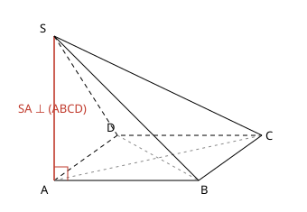

# Bài tập – Bài 25. Hai mặt phẳng vuông góc

Phiên bản: v1.2 · 27/11/2026

> Tài liệu tổng hợp/biên soạn lại cho mục đích học tập (không sao chép nguyên văn SGK/SBT). Bộ sách xương sống: Toán 11 Kết nối tri thức với cuộc sống.

*Chương 7. Quan hệ vuông góc trong không gian* · Lý thuyết: [ly-thuyet](../../ly-thuyet/chuong-07-quan-he-vuong-goc/bai-25-hai-mat-phang-vuong-goc.md)

### Nhận biết
**1.** Hai mặt phẳng vuông góc có góc bao nhiêu độ? *Giải.* $90^\circ$.

**2.** *[Trắc nghiệm]* Nếu mặt phẳng $(P)$ chứa một đường thẳng $a$ mà $a\perp(Q)$ thì: A. $(P)\parallel(Q)$; B. $(P)\perp(Q)$; C. $(P)$ trùng $(Q)$; D. $(P)$ và $(Q)$ cắt nhau nhưng không vuông góc.
*Giải.* Đây là dấu hiệu hai mặt phẳng vuông góc. Chọn **B**.

### Thông hiểu
**3.** Chóp $S.ABCD$, $SA\perp(ABCD)$. Chứng minh $(SAB)\perp(ABCD)$. *Giải.* $(SAB)\ni SA\perp(ABCD)$.

**4.** *[Đúng/sai]* Chóp $S.ABCD$ đáy hình vuông, $SA\perp(ABCD)$. a) $(SAB)\perp(ABCD)$; b) $(SAD)\perp(SAB)$; c) $(SAC)\perp(SBD)$; d) $(SBC)\perp(SAC)$.

*Giải.*
- a) $(SAB)\supset SA\perp(ABCD)$: **Đúng**.
- b) $(SAB)\cap(SAD)=SA$ và $AB\perp AD$, nên góc phẳng nhị diện $\widehat{BAD}=90^\circ$: **Đúng**.
- c) $BD\perp(SAC)$ (xem bài 4): **Đúng**.
- d) Chọn hệ tọa độ $A(0;0;0)$, $B(a;0;0)$, $D(0;a;0)$, $S(0;0;s)$: pháp tuyến $(SBC)$ là $(s;0;a)$, của $(SAC)$ là $(1;-1;0)$; tích vô hướng $s\ne0$: **Sai**.
- Đáp án: Đ – Đ – Đ – S.

### Vận dụng
**5.** Chóp $S.ABCD$ đáy hình vuông cạnh $a$, $SA\perp(ABCD)$, $SA=a\sqrt3$. Tính góc nhị diện $[S,BC,A]$.

*Giải.*
- Bước 1: $BC\perp(SAB)$ (vì $BC\perp AB$, $BC\perp SA$) nên $BC\perp SB$ và $BC\perp AB$.
- Bước 2: vậy $\widehat{SBA}$ là góc phẳng nhị diện của $[S,BC,A]$.
- Bước 3: $\tan\widehat{SBA}=\dfrac{SA}{AB}=\dfrac{a\sqrt3}a=\sqrt3\Rightarrow\widehat{SBA}=60^\circ$.

**6.** *[Trả lời ngắn]* Chóp $S.ABCD$ đáy hình vuông cạnh $a$, $SA\perp(ABCD)$, $SA=a$. Tính $\tan$ của góc giữa $(SBD)$ và $(ABCD)$.

*Giải.*
- Bước 1: gọi $O=AC\cap BD$; $AO\perp BD$ và $SO\perp BD$ (vì $BD\perp(SAC)$). Giao tuyến $BD$.
- Bước 2: góc cần tìm là $\widehat{SOA}$.
- Bước 3: $AO=\dfrac{a\sqrt2}2$, $\tan\widehat{SOA}=\dfrac{SA}{AO}=\dfrac a{a\sqrt2/2}=\sqrt2$.

### Vận dụng cao
**7.** Với giả thiết bài 3, chứng minh $(SBD)\perp(SAC)$.
*Giải.*
- Bước 1: $BD\perp AC$ (đường chéo hình vuông).
- Bước 2: $BD\perp SA$ (vì $SA\perp(ABCD)$).
- Bước 3: $AC,SA$ cắt nhau trong $(SAC)$ nên $BD\perp(SAC)$.
- Bước 4: $BD\subset(SBD)$ nên $(SBD)\perp(SAC)$. ∎

## Nguồn

| Nội dung trong bài | Nguồn | Link | Ghi chú |
|---|---|---|---|
| Toàn bộ đề và lời giải | Tác giả tài liệu | - | tự soạn (cùng dạng với SGK/SBT, không trích nguyên văn) |
| Đối chiếu dạng bài | SBT Toán 11 KNTT trên loigiaihay | https://loigiaihay.com/sbt-toan-11-ket-noi-tri-thuc-c1567.html | chỉ tham khảo dạng, không chép |
| Đối chiếu dạng bài, mức độ | Giải bài tập SGK Toán 11 KNTT – loigiaihay (Bài 25) | https://loigiaihay.com/bai-25-hai-mat-phang-vuong-goc-toan-11-ket-noi-tri-thuc-e31962.html | đã mở được (HTTP 200, 27/11/2026); chỉ dẫn, không chép đề/lời giải |
| Đối chiếu dạng bài, mức độ | Giải SGK Toán 11 KNTT – VietJack (Bài 25) | https://vietjack.com/toan-11-kn/bai-25-hai-mat-phang-vuong-goc.jsp | đã mở được (HTTP 200, 27/11/2026); chỉ dẫn, không chép đề/lời giải |
| Đối chiếu dạng đề kiểm tra (trắc nghiệm, đúng/sai, trả lời ngắn) | Đề thi giữa kì 1 Toán 11 KNTT (đề số 9) – loigiaihay | https://loigiaihay.com/de-thi-giua-ki-1-toan-11-ket-noi-tri-thuc-de-so-9-a188921.html | đã mở được (HTTP 200, 27/11/2026); chỉ tham khảo dạng/mức độ, không chép đề |
| Đối chiếu cấu trúc đề 2025 | Đề thi giữa kì 1 Toán 11 cấu trúc mới KNTT – VietJack | https://vietjack.com/de-kiem-tra-lop-11/de-thi-giua-ki-1-toan-lop-11-cau-truc-moi-ket-noi.jsp | đã mở được (HTTP 200, 27/11/2026); chỉ tham khảo dạng, không chép đề |

## Lịch sử

| Phiên bản | Ngày | Thay đổi | Ai |
|---|---|---|---|
| v1.1 | 27/11/2026 | Bản trước: 4 bài, lời giải ngắn | agent runner-materials-l11 |
| v1.2 | 27/11/2026 | Thêm 3 bài (4→7, có trắc nghiệm/đúng-sai/trả lời ngắn), viết lại 2 lời giải từng bước, cập nhật nguồn | agent runner-mat-300 |
