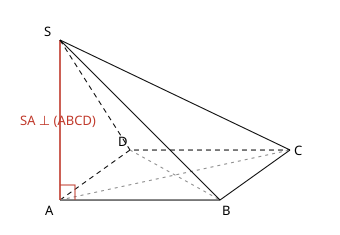
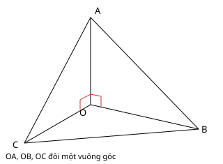

# Bài tập – Bài 26. Khoảng cách

Phiên bản: v1.2 · 27/11/2026

> Tài liệu tổng hợp/biên soạn lại cho mục đích học tập (không sao chép nguyên văn SGK/SBT). Bộ sách xương sống: Toán 11 Kết nối tri thức với cuộc sống.

*Chương 7. Quan hệ vuông góc trong không gian* · Lý thuyết: [ly-thuyet](../../ly-thuyet/chuong-07-quan-he-vuong-goc/bai-26-khoang-cach.md)

### Nhận biết
**1.** Khoảng cách từ $A'$ đến $(ABCD)$ trong hình lập phương cạnh $a$? *Giải.* $a$.

**2.** *[Trắc nghiệm]* Hình lập phương cạnh $a$. Khoảng cách giữa hai mặt phẳng song song $(ABCD)$ và $(A'B'C'D')$ bằng: A. $a$; B. $a\sqrt2$; C. $\dfrac a2$; D. $a\sqrt3$.
*Giải.* Hai mặt đáy song song và $AA'\perp$ cả hai, nên khoảng cách bằng $AA'=a$. Chọn **A**.

### Thông hiểu
**3.** Chóp $S.ABC$, $SA\perp(ABC)$, $SA=a$, $\triangle ABC$ vuông tại $B$, $AB=a$. Tính $d(A,(SBC))$.
*Giải.*
- Bước 1: $BC\perp AB$, $BC\perp SA$ nên $BC\perp(SAB)$.
- Bước 2: kẻ $AH\perp SB$ ($H\in SB$). $AH\perp BC$ (vì $BC\perp(SAB)$) nên $AH\perp(SBC)$, tức $d(A,(SBC))=AH$.
- Bước 3: $SB=a\sqrt2$, trong tam giác vuông $SAB$: $AH=\dfrac{SA\cdot AB}{SB}=\dfrac{a^2}{a\sqrt2}=\dfrac{a\sqrt2}2$.

**4.** *[Đúng/sai]* Chóp $S.ABCD$ đáy hình vuông cạnh $a$, $SA\perp(ABCD)$, $SA=a$. a) $d(S,(ABCD))=a$; b) $d(A,(SBC))=\dfrac{a\sqrt2}2$; c) $d(AB,(SCD))=a$; d) $BC\perp(SAB)$.

*Giải.*
- a) $SA\perp(ABCD)$: **Đúng**.
- b) $BC\perp(SAB)$; kẻ $AH\perp SB$ thì $AH\perp(SBC)$, $AH=\dfrac{a\cdot a}{a\sqrt2}=\dfrac{a\sqrt2}2$: **Đúng**.
- c) $AB\parallel CD\Rightarrow AB\parallel(SCD)$, $d(AB,(SCD))=d(A,(SCD))=\dfrac{SA\cdot AD}{SD}=\dfrac{a\sqrt2}2\ne a$: **Sai**.
- d) **Đúng**.
- Đáp án: Đ – Đ – S – Đ.

### Vận dụng
**5.** Hình lập phương cạnh $a$. Tính khoảng cách giữa hai đường thẳng chéo nhau $AB$ và $A'D'$.

*Giải.*
- Bước 1: $AA'\perp AB$ và $AA'\perp A'D'$ (vì $AA'\perp$ đáy, mặt $A'B'C'D'$ vuông góc với $AA'$).
- Bước 2: $AA'$ cắt $AB$ tại $A$ và cắt $A'D'$ tại $A'$, nên $AA'$ là đoạn vuông góc chung.
- Bước 3: $d(AB,A'D')=AA'=a$.

### Vận dụng cao
**6.** Tứ diện $OABC$ có $OA,OB,OC$ đôi một vuông góc, $OA=OB=OC=a$. Tính $d(O,(ABC))$.

*Giải.*
- Bước 1: kẻ $OK\perp BC$ ($K\in BC$), $K$ là trung điểm $BC$; $\dfrac1{OK^2}=\dfrac1{OB^2}+\dfrac1{OC^2}=\dfrac2{a^2}$.
- Bước 2: $BC\perp(OAK)$; kẻ $OH\perp AK$ thì $OH\perp(ABC)$, $d=OH$.
- Bước 3: trong tam giác vuông $OAK$: $\dfrac1{OH^2}=\dfrac1{OA^2}+\dfrac1{OK^2}=\dfrac1{a^2}+\dfrac2{a^2}=\dfrac3{a^2}$.
- Bước 4: $OH=\dfrac a{\sqrt3}=\dfrac{a\sqrt3}3$.

**7.** *[Trả lời ngắn]* Chóp $S.ABCD$ đáy hình vuông cạnh $3$, $SA\perp(ABCD)$, $SA=3$. Tính $d(A,(SBD))$.

*Giải.*
- Bước 1: $AS,AB,AD$ đôi một vuông góc, nên $A$ có khoảng cách tới $(SBD)$ thỏa $\dfrac1{d^2}=\dfrac1{AS^2}+\dfrac1{AB^2}+\dfrac1{AD^2}$.
- Bước 2: $\dfrac1{d^2}=\dfrac19+\dfrac19+\dfrac19=\dfrac13\Rightarrow d=\sqrt3$.
- Kiểm tra theo cách dựng: $AO=\dfrac{3\sqrt2}2$, $SO=\sqrt{9+\frac92}=\dfrac{3\sqrt6}2$, $d=\dfrac{SA\cdot AO}{SO}=\dfrac{3\cdot\frac{3\sqrt2}2}{\frac{3\sqrt6}2}=\sqrt3$.

## Nguồn

| Nội dung trong bài | Nguồn | Link | Ghi chú |
|---|---|---|---|
| Toàn bộ đề và lời giải | Tác giả tài liệu | - | tự soạn (cùng dạng với SGK/SBT, không trích nguyên văn) |
| Đối chiếu dạng bài | SBT Toán 11 KNTT trên loigiaihay | https://loigiaihay.com/sbt-toan-11-ket-noi-tri-thuc-c1567.html | chỉ tham khảo dạng, không chép |
| Đối chiếu dạng bài, mức độ | Giải bài tập SGK Toán 11 KNTT – loigiaihay (Bài 26) | https://loigiaihay.com/bai-26-khoang-cach-toan-11-ket-noi-tri-thuc-e31963.html | đã mở được (HTTP 200, 27/11/2026); chỉ dẫn, không chép đề/lời giải |
| Đối chiếu dạng bài, mức độ | Giải SGK Toán 11 KNTT – VietJack (Bài 26) | https://vietjack.com/toan-11-kn/bai-26-khoang-cach.jsp | đã mở được (HTTP 200, 27/11/2026); chỉ dẫn, không chép đề/lời giải |
| Đối chiếu dạng đề kiểm tra (trắc nghiệm, đúng/sai, trả lời ngắn) | Đề thi giữa kì 1 Toán 11 KNTT (đề số 9) – loigiaihay | https://loigiaihay.com/de-thi-giua-ki-1-toan-11-ket-noi-tri-thuc-de-so-9-a188921.html | đã mở được (HTTP 200, 27/11/2026); chỉ tham khảo dạng/mức độ, không chép đề |
| Đối chiếu cấu trúc đề 2025 | Đề thi giữa kì 1 Toán 11 cấu trúc mới KNTT – VietJack | https://vietjack.com/de-kiem-tra-lop-11/de-thi-giua-ki-1-toan-lop-11-cau-truc-moi-ket-noi.jsp | đã mở được (HTTP 200, 27/11/2026); chỉ tham khảo dạng, không chép đề |

## Lịch sử

| Phiên bản | Ngày | Thay đổi | Ai |
|---|---|---|---|
| v1.1 | 27/11/2026 | Bản trước: 4 bài, lời giải ngắn | agent runner-materials-l11 |
| v1.2 | 27/11/2026 | Thêm 3 bài (4→7, có trắc nghiệm/đúng-sai/trả lời ngắn), viết lại 3 lời giải từng bước, cập nhật nguồn | agent runner-mat-300 |
