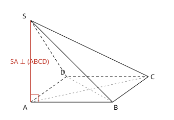

# Bài tập – Bài 27. Thể tích

Phiên bản: v1.2 · 27/11/2026

> Tài liệu tổng hợp/biên soạn lại cho mục đích học tập (không sao chép nguyên văn SGK/SBT). Bộ sách xương sống: Toán 11 Kết nối tri thức với cuộc sống.

*Chương 7. Quan hệ vuông góc trong không gian* · Lý thuyết: [ly-thuyet](../../ly-thuyet/chuong-07-quan-he-vuong-goc/bai-27-the-tich.md)

### Nhận biết
**1.** Thể tích chóp đáy vuông cạnh 3, cao 4. *Giải.* $\dfrac13\cdot9\cdot4=12$.

**2.** *[Trắc nghiệm]* Thể tích khối lăng trụ có diện tích đáy $B$ và chiều cao $h$ là: A. $Bh$; B. $\dfrac13Bh$; C. $\dfrac12Bh$; D. $3Bh$.
*Giải.* Lăng trụ: $V=Bh$ (khối chóp mới là $\dfrac13Bh$). Chọn **A**.

### Thông hiểu
**3.** Lăng trụ đứng đáy là tam giác vuông cân cạnh góc vuông $a$, cạnh bên $2a$. Thể tích. *Giải.* $\dfrac{a^2}2\cdot2a=a^3$.

**4.** *[Đúng/sai]* Lăng trụ đứng $ABC.A'B'C'$ có đáy là tam giác vuông tại $A$, $AB=3$, $AC=4$, $AA'=5$. a) $S_{ABC}=6$; b) $V_{ABC.A'B'C'}=30$; c) $V_{A'.ABC}=10$; d) $V_{A.BCC'B'}=15$.
*Giải.*
- a) $\dfrac12\cdot3\cdot4=6$: **Đúng**.
- b) $V=6\cdot5=30$: **Đúng**.
- c) $V_{A'.ABC}=\dfrac13\cdot6\cdot5=10$: **Đúng**.
- d) $V_{A.A'B'C'}=10$ nên $V_{A.BCC'B'}=30-10=20\ne15$: **Sai**.
- Đáp án: Đ – Đ – Đ – S.

### Vận dụng
**5.** Chóp $S.ABCD$ đáy hình vuông cạnh $a$, $SA\perp(ABCD)$, $SC$ tạo với đáy góc $45^\circ$. Tính thể tích.

*Giải.*
- Bước 1: góc giữa $SC$ và đáy là $\widehat{SCA}=45^\circ$.
- Bước 2: $AC=a\sqrt2$; tam giác $SAC$ vuông cân tại $A$ nên $SA=AC=a\sqrt2$.
- Bước 3: $V=\dfrac13S_{ABCD}\cdot SA=\dfrac13a^2\cdot a\sqrt2=\dfrac{a^3\sqrt2}3$.

**6.** $S.ABC$, $M$ trung điểm $SB$, $N\in SC$ với $SN=2NC$. Tỉ số $\dfrac{V_{S.AMN}}{V_{S.ABC}}$. *Giải.* $1\cdot\dfrac12\cdot\dfrac23=\dfrac13$.

### Vận dụng cao
**7.** Tính thể tích khối tứ diện đều cạnh $a$.
*Giải.*
- Bước 1: đáy $BCD$ là tam giác đều cạnh $a$: $S=\dfrac{a^2\sqrt3}4$. Chân đường cao $H$ là trọng tâm $\triangle BCD$ nên $HB=\dfrac{a\sqrt3}3$.
- Bước 2: chiều cao $AH=\sqrt{AB^2-HB^2}=\sqrt{a^2-\dfrac{a^2}3}=\dfrac{a\sqrt6}3$.
- Bước 3: $V=\dfrac13\cdot\dfrac{a^2\sqrt3}4\cdot\dfrac{a\sqrt6}3=\dfrac{a^3\sqrt{18}}{36}=\dfrac{a^3\sqrt2}{12}$.

**8.** *[Trả lời ngắn]* Chóp $S.ABCD$ đáy hình vuông cạnh $2a$, tam giác $SAB$ đều và nằm trong mặt phẳng vuông góc với đáy. Tính thể tích theo $a$.
*Giải.*
- Bước 1: gọi $H$ là trung điểm $AB$; $\triangle SAB$ đều nên $SH\perp AB$ và $SH=\dfrac{2a\sqrt3}2=a\sqrt3$.
- Bước 2: $(SAB)\perp(ABCD)$, giao tuyến $AB$, $SH\perp AB$ nên $SH\perp(ABCD)$.
- Bước 3: $V=\dfrac13S_{ABCD}\cdot SH=\dfrac13\cdot4a^2\cdot a\sqrt3=\dfrac{4\sqrt3a^3}3$.

## Nguồn

| Nội dung trong bài | Nguồn | Link | Ghi chú |
|---|---|---|---|
| Toàn bộ đề và lời giải | Tác giả tài liệu | - | tự soạn (cùng dạng với SGK/SBT, không trích nguyên văn) |
| Đối chiếu dạng bài | SBT Toán 11 KNTT trên loigiaihay | https://loigiaihay.com/sbt-toan-11-ket-noi-tri-thuc-c1567.html | chỉ tham khảo dạng, không chép |
| Đối chiếu dạng bài, mức độ | Giải bài tập SGK Toán 11 KNTT – loigiaihay (Bài 27) | https://loigiaihay.com/bai-27-the-tich-toan-11-ket-noi-tri-thuc-e31964.html | đã mở được (HTTP 200, 27/11/2026); chỉ dẫn, không chép đề/lời giải |
| Đối chiếu dạng bài, mức độ | Giải SGK Toán 11 KNTT – VietJack (Bài 27) | https://vietjack.com/toan-11-kn/bai-27-the-tich.jsp | đã mở được (HTTP 200, 27/11/2026); chỉ dẫn, không chép đề/lời giải |
| Đối chiếu dạng đề kiểm tra (trắc nghiệm, đúng/sai, trả lời ngắn) | Đề thi giữa kì 1 Toán 11 KNTT (đề số 9) – loigiaihay | https://loigiaihay.com/de-thi-giua-ki-1-toan-11-ket-noi-tri-thuc-de-so-9-a188921.html | đã mở được (HTTP 200, 27/11/2026); chỉ tham khảo dạng/mức độ, không chép đề |
| Đối chiếu cấu trúc đề 2025 | Đề thi giữa kì 1 Toán 11 cấu trúc mới KNTT – VietJack | https://vietjack.com/de-kiem-tra-lop-11/de-thi-giua-ki-1-toan-lop-11-cau-truc-moi-ket-noi.jsp | đã mở được (HTTP 200, 27/11/2026); chỉ tham khảo dạng, không chép đề |

## Lịch sử

| Phiên bản | Ngày | Thay đổi | Ai |
|---|---|---|---|
| v1.1 | 27/11/2026 | Bản trước: 5 bài, lời giải ngắn | agent runner-materials-l11 |
| v1.2 | 27/11/2026 | Thêm 3 bài (5→8, có trắc nghiệm/đúng-sai/trả lời ngắn), viết lại 2 lời giải từng bước, cập nhật nguồn | agent runner-mat-300 |
