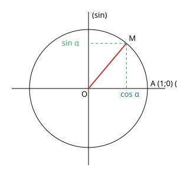

# Bài 1. Giá trị lượng giác của góc lượng giác

Phiên bản: v1.1 · 27/11/2026

> Tài liệu tổng hợp/biên soạn lại cho mục đích học tập (không sao chép nguyên văn SGK/SBT). Bộ sách xương sống: Toán 11 Kết nối tri thức với cuộc sống.

*Chương 1. Hàm số lượng giác và phương trình lượng giác (Tập 1)* · Bài tập: [bai-tap](../../bai-tap/chuong-01-ham-so-luong-giac-va-phuong-trinh-luong-giac/bai-01-gia-tri-luong-giac-cua-goc-luong-giac.md)

## 1. Góc lượng giác
- **Góc lượng giác** $(Ou,Ov)$: góc sinh ra khi tia quay từ tia đầu $Ou$ đến tia cuối $Ov$; có chiều quay (dương: ngược chiều kim đồng hồ) và có thể quay nhiều vòng. Số đo xác định sai khác $k\cdot 360^\circ$ (hay $k\cdot 2\pi$).
- **Radian**: $1\ \text{rad}$ là số đo góc ở tâm chắn cung dài bằng bán kính. $\pi\ \text{rad}=180^\circ$.
- Đổi đơn vị: $\alpha^\circ=\dfrac{\pi\alpha}{180}$ rad; $a\ \text{rad}=\left(\dfrac{180a}{\pi}\right)^\circ$.
- Độ dài cung: $\ell=R\alpha$ ($\alpha$ tính bằng rad).

## 2. Đường tròn lượng giác và giá trị lượng giác

Trên đường tròn lượng giác (tâm $O$, bán kính 1, gốc $A(1;0)$), điểm $M$ xác định bởi góc $\alpha$ có toạ độ $M(\cos\alpha;\sin\alpha)$. Từ đó:
$$\tan\alpha=\frac{\sin\alpha}{\cos\alpha}\ (\cos\alpha\ne0),\qquad \cot\alpha=\frac{\cos\alpha}{\sin\alpha}\ (\sin\alpha\ne0).$$
- $-1\le\sin\alpha\le1$, $-1\le\cos\alpha\le1$.
- $\sin(\alpha+k2\pi)=\sin\alpha$, $\cos(\alpha+k2\pi)=\cos\alpha$; $\tan,\cot$ tuần hoàn chu kì $\pi$.

## 3. Giá trị đặc biệt
| $\alpha$ | $0$ | $\pi/6$ | $\pi/4$ | $\pi/3$ | $\pi/2$ |
|---|---|---|---|---|---|
| $\sin$ | 0 | 1/2 | $\sqrt2/2$ | $\sqrt3/2$ | 1 |
| $\cos$ | 1 | $\sqrt3/2$ | $\sqrt2/2$ | 1/2 | 0 |
| $\tan$ | 0 | $\sqrt3/3$ | 1 | $\sqrt3$ | không xác định |

## 4. Hệ thức cơ bản
$\sin^2\alpha+\cos^2\alpha=1$; $1+\tan^2\alpha=\dfrac1{\cos^2\alpha}$; $1+\cot^2\alpha=\dfrac1{\sin^2\alpha}$; $\tan\alpha\cot\alpha=1$.

## 5. Giá trị lượng giác của các góc liên quan
- Đối: $\cos(-\alpha)=\cos\alpha$; $\sin(-\alpha)=-\sin\alpha$.
- Bù: $\sin(\pi-\alpha)=\sin\alpha$; $\cos(\pi-\alpha)=-\cos\alpha$.
- Phụ: $\sin(\tfrac\pi2-\alpha)=\cos\alpha$; $\cos(\tfrac\pi2-\alpha)=\sin\alpha$.
- Hơn kém $\pi$: $\sin(\alpha+\pi)=-\sin\alpha$; $\cos(\alpha+\pi)=-\cos\alpha$; $\tan(\alpha+\pi)=\tan\alpha$.

**Ví dụ.** $\sin\dfrac{5\pi}{6}=\sin\left(\pi-\dfrac\pi6\right)=\dfrac12$. Biết $\sin\alpha=\dfrac35$, $\alpha\in(\tfrac\pi2;\pi)$: $\cos\alpha=-\sqrt{1-\tfrac9{25}}=-\dfrac45$, $\tan\alpha=-\dfrac34$.

## Nguồn

| Nội dung trong bài | Nguồn | Link | Ghi chú |
|---|---|---|---|
| Vị trí bài, thứ tự mục | SGK Toán 11 KNTT (mục lục) | https://loigiaihay.com/sgk-toan-11-ket-noi-tri-thuc-c1370.html | tham chiếu mục lục |
| Định nghĩa, định lí, công thức, ví dụ | Kiến thức chương trình GDPT 2018 | - | tự soạn/viết lại bằng lời riêng |
| Đối chiếu tên bài, thứ tự mục lý thuyết | SGK Toán 11 KNTT – loigiaihay (Bài 1) | https://loigiaihay.com/bai-1-gia-tri-luong-giac-cua-goc-luong-giac-toan-11-ket-noi-tri-thuc-e30741.html | đã mở được (HTTP 200, 27/11/2026); chỉ dẫn, không chép |
| Đối chiếu lý thuyết trọng tâm | Lý thuyết Toán 11 KNTT – VietJack (Bài 1) | https://vietjack.com/toan-11-kn/ly-thuyet-bai-1-gia-tri-luong-giac-cua-goc-luong-giac.jsp | đã mở được (HTTP 200, 27/11/2026); chỉ dẫn, không chép |
