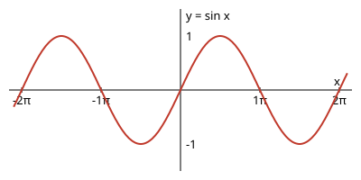
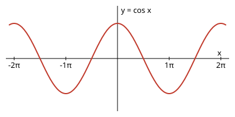
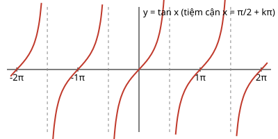

# Bài 3. Hàm số lượng giác

Phiên bản: v1.1 · 27/11/2026

> Tài liệu tổng hợp/biên soạn lại cho mục đích học tập (không sao chép nguyên văn SGK/SBT). Bộ sách xương sống: Toán 11 Kết nối tri thức với cuộc sống.

*Chương 1. Hàm số lượng giác và phương trình lượng giác (Tập 1)* · Bài tập: [bai-tap](../../bai-tap/chuong-01-ham-so-luong-giac-va-phuong-trinh-luong-giac/bai-03-ham-so-luong-giac.md)

## 1. Hàm số $y=\sin x$, $y=\cos x$
- TXĐ $\mathbb R$; tập giá trị $[-1;1]$; tuần hoàn chu kì $2\pi$.
- $\sin$ là hàm lẻ (đồ thị đối xứng qua $O$); $\cos$ là hàm chẵn (đối xứng qua $Oy$).
- $y=\sin x$: đồng biến trên $[-\tfrac\pi2+k2\pi;\tfrac\pi2+k2\pi]$, nghịch biến trên $[\tfrac\pi2+k2\pi;\tfrac{3\pi}2+k2\pi]$.
- $y=\cos x$: đồng biến trên $[-\pi+k2\pi;k2\pi]$, nghịch biến trên $[k2\pi;\pi+k2\pi]$.

## 2. Hàm số $y=\tan x$, $y=\cot x$
- $y=\tan x$: TXĐ $\mathbb R\setminus\{\tfrac\pi2+k\pi\}$; tập giá trị $\mathbb R$; chu kì $\pi$; hàm lẻ; đồng biến trên mỗi khoảng $(-\tfrac\pi2+k\pi;\tfrac\pi2+k\pi)$; tiệm cận $x=\tfrac\pi2+k\pi$.
- $y=\cot x$: TXĐ $\mathbb R\setminus\{k\pi\}$; tập giá trị $\mathbb R$; chu kì $\pi$; hàm lẻ; nghịch biến trên mỗi khoảng $(k\pi;\pi+k\pi)$.

## 3. Lưu ý
Hàm $y=f(x)$ tuần hoàn chu kì $T$ nếu $f(x+T)=f(x)$ với mọi $x$ thuộc TXĐ ($T>0$ nhỏ nhất). Chu kì của $\sin(ax+b)$, $\cos(ax+b)$ là $\dfrac{2\pi}{|a|}$; của $\tan(ax+b)$ là $\dfrac{\pi}{|a|}$.

## Nguồn

| Nội dung trong bài | Nguồn | Link | Ghi chú |
|---|---|---|---|
| Vị trí bài, thứ tự mục | SGK Toán 11 KNTT (mục lục) | https://loigiaihay.com/sgk-toan-11-ket-noi-tri-thuc-c1370.html | tham chiếu mục lục |
| Định nghĩa, định lí, công thức, ví dụ | Kiến thức chương trình GDPT 2018 | - | tự soạn/viết lại bằng lời riêng |
| Đối chiếu tên bài, thứ tự mục lý thuyết | SGK Toán 11 KNTT – loigiaihay (Bài 3) | https://loigiaihay.com/bai-3-ham-so-luong-giac-toan-11-ket-noi-tri-thuc-e30802.html | đã mở được (HTTP 200, 27/11/2026); chỉ dẫn, không chép |
| Đối chiếu lý thuyết trọng tâm | Lý thuyết Toán 11 KNTT – VietJack (Bài 3) | https://vietjack.com/toan-11-kn/ly-thuyet-bai-3-ham-so-luong-giac.jsp | đã mở được (HTTP 200, 27/11/2026); chỉ dẫn, không chép |
