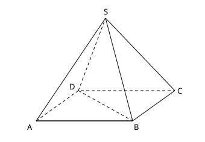
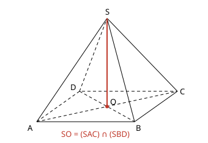

# Bài 10. Đường thẳng và mặt phẳng trong không gian

Phiên bản: v1.1 · 27/11/2026

> Tài liệu tổng hợp/biên soạn lại cho mục đích học tập (không sao chép nguyên văn SGK/SBT). Bộ sách xương sống: Toán 11 Kết nối tri thức với cuộc sống.

*Chương 4. Quan hệ song song trong không gian (Tập 1)* · Bài tập: [bai-tap](../../bai-tap/chuong-04-quan-he-song-song/bai-10-duong-thang-va-mat-phang-trong-khong-gian.md)

## 1. Các khái niệm cơ bản
Điểm, đường thẳng, mặt phẳng là khái niệm không định nghĩa. Mặt phẳng $(P)$ thường vẽ bằng hình bình hành. Hình không gian vẽ nét liền cho cạnh thấy, nét đứt cho cạnh bị che.

## 2. Các tính chất thừa nhận
1. Qua hai điểm phân biệt có duy nhất một đường thẳng.
2. Qua ba điểm không thẳng hàng có duy nhất một mặt phẳng.
3. Nếu một đường thẳng có hai điểm chung với mặt phẳng thì nó nằm trong mặt phẳng.
4. Hai mặt phẳng phân biệt có điểm chung thì giao nhau theo một đường thẳng (giao tuyến).
5. Trên mỗi mặt phẳng, mọi kết quả của hình học phẳng đều đúng.

## 3. Cách xác định mặt phẳng
Qua ba điểm không thẳng hàng; qua một đường thẳng và một điểm ngoài nó; qua hai đường thẳng cắt nhau; qua hai đường thẳng song song.

## 4. Hình chóp và hình tứ diện
Hình chóp $S.A_1\dots A_n$: đỉnh $S$, đáy đa giác $A_1\dots A_n$, các mặt bên là tam giác. Tứ diện $ABCD$ là hình chóp tam giác có 4 mặt là tam giác.

## 5. Tìm giao tuyến của hai mặt phẳng
Tìm **hai điểm chung** của hai mặt phẳng. Ví dụ chóp $S.ABCD$, đáy là hình bình hành tâm $O$: $S$ và $O$ cùng thuộc $(SAC)$ và $(SBD)$ nên $(SAC)\cap(SBD)=SO$.

## 6. Giao điểm của đường thẳng và mặt phẳng
Để tìm $d\cap(P)$: chọn mặt phẳng $(Q)\supset d$, tìm giao tuyến $\Delta=(P)\cap(Q)$; $d\cap\Delta$ chính là giao điểm cần tìm.

## Nguồn

| Nội dung trong bài | Nguồn | Link | Ghi chú |
|---|---|---|---|
| Vị trí bài, thứ tự mục | SGK Toán 11 KNTT (mục lục) | https://loigiaihay.com/sgk-toan-11-ket-noi-tri-thuc-c1370.html | tham chiếu mục lục |
| Định nghĩa, định lí, công thức, ví dụ | Kiến thức chương trình GDPT 2018 | - | tự soạn/viết lại bằng lời riêng |
| Đối chiếu tên bài, thứ tự mục lý thuyết | SGK Toán 11 KNTT – loigiaihay (Bài 10) | https://loigiaihay.com/bai-10-duong-thang-va-mat-phang-trong-khong-gian-toan-11-ket-noi-tri-thuc-e31528.html | đã mở được (HTTP 200, 27/11/2026); chỉ dẫn, không chép |
| Đối chiếu lý thuyết trọng tâm | Lý thuyết Toán 11 KNTT – VietJack (Bài 10) | https://vietjack.com/toan-11-kn/ly-thuyet-bai-10-duong-thang-va-mat-phang-trong-khong-gian.jsp | đã mở được (HTTP 200, 27/11/2026); chỉ dẫn, không chép |
