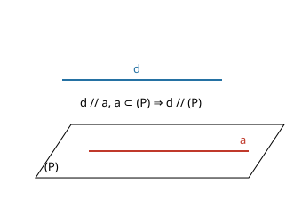

# Bài 12. Đường thẳng và mặt phẳng song song

Phiên bản: v1.0 · 27/11/2026

> Tài liệu tổng hợp/biên soạn lại cho mục đích học tập (không sao chép nguyên văn SGK/SBT). Bộ sách xương sống: Toán 11 Kết nối tri thức với cuộc sống.

*Chương 4. Quan hệ song song trong không gian (Tập 1)* · Bài tập: [bai-tap](../../bai-tap/chuong-04-quan-he-song-song/bai-12-duong-thang-va-mat-phang-song-song.md)

## 1. Định nghĩa
Đường thẳng $d$ và mặt phẳng $(P)$ song song nếu chúng không có điểm chung. Kí hiệu $d\parallel(P)$.

## 2. Điều kiện và tính chất
- **Điều kiện**: $d\not\subset(P)$ và $d\parallel a$ với $a\subset(P)$ thì $d\parallel(P)$.
- Nếu $d\parallel(P)$ và $(Q)\supset d$ cắt $(P)$ theo $a$ thì $a\parallel d$.
- Nếu hai mặt phẳng cắt nhau cùng song song một đường thẳng thì giao tuyến của chúng song song với đường thẳng đó.

## Nguồn

| Nội dung trong bài | Nguồn | Link | Ghi chú |
|---|---|---|---|
| Vị trí bài, thứ tự mục | SGK Toán 11 KNTT (mục lục) | https://loigiaihay.com/sgk-toan-11-ket-noi-tri-thuc-c1370.html | tham chiếu mục lục |
| Định nghĩa, định lí, công thức, ví dụ | Kiến thức chương trình GDPT 2018 | - | tự soạn/viết lại bằng lời riêng |
