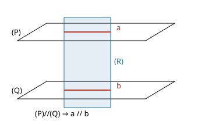
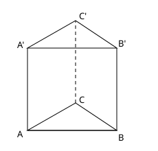

# Bài 13. Hai mặt phẳng song song

Phiên bản: v1.1 · 27/11/2026

> Tài liệu tổng hợp/biên soạn lại cho mục đích học tập (không sao chép nguyên văn SGK/SBT). Bộ sách xương sống: Toán 11 Kết nối tri thức với cuộc sống.

*Chương 4. Quan hệ song song trong không gian (Tập 1)* · Bài tập: [bai-tap](../../bai-tap/chuong-04-quan-he-song-song/bai-13-hai-mat-phang-song-song.md)

## 1. Định nghĩa
$(P)\parallel(Q)$ nếu không có điểm chung.

## 2. Điều kiện
Nếu $(P)$ chứa hai đường thẳng cắt nhau $a,b$ cùng song song với $(Q)$ thì $(P)\parallel(Q)$.

## 3. Tính chất
- Qua một điểm ngoài $(Q)$ có duy nhất mặt phẳng $(P)\parallel(Q)$.
- Nếu $(P)\parallel(Q)$ thì mọi đường thẳng trong $(P)$ song song $(Q)$.
- Mặt phẳng thứ ba $(R)$ cắt hai mặt phẳng song song theo hai giao tuyến song song.
- **Định lí Thalès** trong không gian: ba mặt phẳng song song chắn trên hai cát tuyến những đoạn tương ứng tỉ lệ.

## 4. Hình lăng trụ, hình hộp
Lăng trụ $ABC.A'B'C'$: hai đáy song song, các cạnh bên song song và bằng nhau, mặt bên là hình bình hành. Hình hộp là lăng trụ đáy hình bình hành.

## Nguồn

| Nội dung trong bài | Nguồn | Link | Ghi chú |
|---|---|---|---|
| Vị trí bài, thứ tự mục | SGK Toán 11 KNTT (mục lục) | https://loigiaihay.com/sgk-toan-11-ket-noi-tri-thuc-c1370.html | tham chiếu mục lục |
| Định nghĩa, định lí, công thức, ví dụ | Kiến thức chương trình GDPT 2018 | - | tự soạn/viết lại bằng lời riêng |
| Đối chiếu tên bài, thứ tự mục lý thuyết | SGK Toán 11 KNTT – loigiaihay (Bài 13) | https://loigiaihay.com/bai-13-hai-mat-phang-song-song-toan-11-ket-noi-tri-thuc-e31533.html | đã mở được (HTTP 200, 27/11/2026); chỉ dẫn, không chép |
| Đối chiếu lý thuyết trọng tâm | Lý thuyết Toán 11 KNTT – VietJack (Bài 13) | https://vietjack.com/toan-11-kn/ly-thuyet-bai-13-hai-mat-phang-song-song.jsp | đã mở được (HTTP 200, 27/11/2026); chỉ dẫn, không chép |
