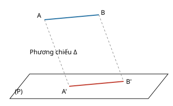

# Bài 14. Phép chiếu song song

Phiên bản: v1.0 · 27/11/2026

> Tài liệu tổng hợp/biên soạn lại cho mục đích học tập (không sao chép nguyên văn SGK/SBT). Bộ sách xương sống: Toán 11 Kết nối tri thức với cuộc sống.

*Chương 4. Quan hệ song song trong không gian (Tập 1)* · Bài tập: [bai-tap](../../bai-tap/chuong-04-quan-he-song-song/bai-14-phep-chieu-song-song.md)

## 1. Định nghĩa
Cho mặt phẳng $(P)$ và đường thẳng $\Delta$ cắt $(P)$. Với mỗi điểm $M$, đường thẳng qua $M$ song song $\Delta$ cắt $(P)$ tại $M'$: $M'$ là hình chiếu song song của $M$ lên $(P)$ theo phương $\Delta$.

## 2. Tính chất
- Giữ nguyên **tính thẳng hàng** và thứ tự các điểm; đường thẳng $\to$ đường thẳng (hoặc điểm).
- Biến hai đường thẳng song song thành hai đường thẳng song song (hoặc trùng).
- Giữ nguyên **tỉ số** độ dài các đoạn trên cùng đường thẳng hoặc hai đường thẳng song song.
- Không bảo toàn độ lớn góc, độ dài tuyệt đối.

## 3. Hình biểu diễn của hình không gian
Hình vẽ trên mặt phẳng là hình chiếu song song của hình không gian: hình vuông $\to$ hình bình hành; giữ quan hệ song song, trung điểm.

## Nguồn

| Nội dung trong bài | Nguồn | Link | Ghi chú |
|---|---|---|---|
| Vị trí bài, thứ tự mục | SGK Toán 11 KNTT (mục lục) | https://loigiaihay.com/sgk-toan-11-ket-noi-tri-thuc-c1370.html | tham chiếu mục lục |
| Định nghĩa, định lí, công thức, ví dụ | Kiến thức chương trình GDPT 2018 | - | tự soạn/viết lại bằng lời riêng |
