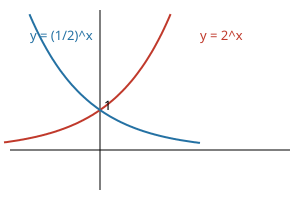
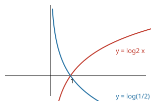

# Bài 20. Hàm số mũ và hàm số lôgarit

Phiên bản: v1.1 · 27/11/2026

> Tài liệu tổng hợp/biên soạn lại cho mục đích học tập (không sao chép nguyên văn SGK/SBT). Bộ sách xương sống: Toán 11 Kết nối tri thức với cuộc sống.

*Chương 6. Hàm số mũ và hàm số lôgarit (Tập 2)* · Bài tập: [bai-tap](../../bai-tap/chuong-06-ham-so-mu-va-logarit/bai-20-ham-so-mu-va-ham-so-logarit.md)

## 1. Hàm số mũ $y=a^x$ ($a>0,a\ne1$)
TXĐ $\mathbb R$; tập giá trị $(0;+\infty)$; $a>1$ đồng biến, $0<a<1$ nghịch biến; đồ thị luôn đi qua $(0;1)$, nhận $Ox$ làm tiệm cận ngang.

## 2. Hàm số lôgarit $y=\log_ax$
TXĐ $(0;+\infty)$; tập giá trị $\mathbb R$; $a>1$ đồng biến, $0<a<1$ nghịch biến; đồ thị qua $(1;0)$, nhận $Oy$ làm tiệm cận đứng. Đồ thị $y=a^x$ và $y=\log_ax$ đối xứng nhau qua đường $y=x$.

## 3. Một số giới hạn và số $e$
$e\approx2{,}718$; $\lim\left(1+\tfrac1n\right)^n=e$; $y=e^x$, $y=\ln x$.

## Nguồn

| Nội dung trong bài | Nguồn | Link | Ghi chú |
|---|---|---|---|
| Vị trí bài, thứ tự mục | SGK Toán 11 KNTT (mục lục) | https://loigiaihay.com/sgk-toan-11-ket-noi-tri-thuc-c1370.html | tham chiếu mục lục |
| Định nghĩa, định lí, công thức, ví dụ | Kiến thức chương trình GDPT 2018 | - | tự soạn/viết lại bằng lời riêng |
| Đối chiếu tên bài, thứ tự mục lý thuyết | SGK Toán 11 KNTT – loigiaihay (Bài 20) | https://loigiaihay.com/bai-20-ham-so-mu-va-ham-so-logarit-toan-11-ket-noi-tri-thuc-e31937.html | đã mở được (HTTP 200, 27/11/2026); chỉ dẫn, không chép |
| Đối chiếu lý thuyết trọng tâm | Lý thuyết Toán 11 KNTT – VietJack (Bài 20) | https://vietjack.com/toan-11-kn/ly-thuyet-bai-20-ham-so-mu-va-ham-so-logarit.jsp | đã mở được (HTTP 200, 27/11/2026); chỉ dẫn, không chép |
