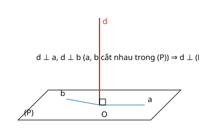

# Bài 23. Đường thẳng vuông góc với mặt phẳng

Phiên bản: v1.1 · 27/11/2026

> Tài liệu tổng hợp/biên soạn lại cho mục đích học tập (không sao chép nguyên văn SGK/SBT). Bộ sách xương sống: Toán 11 Kết nối tri thức với cuộc sống.

*Chương 7. Quan hệ vuông góc trong không gian (Tập 2)* · Bài tập: [bai-tap](../../bai-tap/chuong-07-quan-he-vuong-goc/bai-23-duong-thang-vuong-goc-voi-mat-phang.md)

## 1. Định nghĩa
$d\perp(P)$ nếu $d$ vuông góc với mọi đường thẳng nằm trong $(P)$.

## 2. Điều kiện
$d$ vuông góc với hai đường thẳng cắt nhau $a,b\subset(P)$ thì $d\perp(P)$.

## 3. Tính chất
- Qua một điểm có duy nhất một mặt phẳng vuông góc với đường thẳng cho trước, và duy nhất một đường thẳng vuông góc với mặt phẳng cho trước.
- $a\parallel b$, $(P)\perp a\Rightarrow(P)\perp b$; $a\perp(P)$, $b\perp(P)\Rightarrow a\parallel b$.
- $(P)\parallel(Q)$, $d\perp(P)\Rightarrow d\perp(Q)$.

## 4. Mặt phẳng trung trực
Mặt phẳng vuông góc với $AB$ tại trung điểm $AB$: tập các điểm cách đều $A,B$.

## 5. Định lí ba đường vuông góc
Cho $a\subset(P)$, $b$ là hình chiếu vuông góc của $d$ lên $(P)$: $a\perp d\Leftrightarrow a\perp b$.

## Nguồn

| Nội dung trong bài | Nguồn | Link | Ghi chú |
|---|---|---|---|
| Vị trí bài, thứ tự mục | SGK Toán 11 KNTT (mục lục) | https://loigiaihay.com/sgk-toan-11-ket-noi-tri-thuc-c1370.html | tham chiếu mục lục |
| Định nghĩa, định lí, công thức, ví dụ | Kiến thức chương trình GDPT 2018 | - | tự soạn/viết lại bằng lời riêng |
| Đối chiếu tên bài, thứ tự mục lý thuyết | SGK Toán 11 KNTT – loigiaihay (Bài 23) | https://loigiaihay.com/bai-23-duong-thang-vuong-goc-voi-mat-phang-toan-11-ket-noi-tri-thuc-e31960.html | đã mở được (HTTP 200, 27/11/2026); chỉ dẫn, không chép |
| Đối chiếu lý thuyết trọng tâm | Lý thuyết Toán 11 KNTT – VietJack (Bài 23) | https://vietjack.com/toan-11-kn/ly-thuyet-bai-23-duong-thang-vuong-goc-voi-mat-phang.jsp | đã mở được (HTTP 200, 27/11/2026); chỉ dẫn, không chép |
