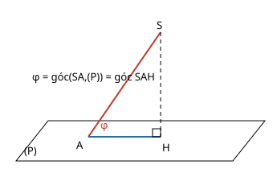

# Bài 24. Phép chiếu vuông góc. Góc giữa đường thẳng và mặt phẳng

Phiên bản: v1.0 · 27/11/2026

> Tài liệu tổng hợp/biên soạn lại cho mục đích học tập (không sao chép nguyên văn SGK/SBT). Bộ sách xương sống: Toán 11 Kết nối tri thức với cuộc sống.

*Chương 7. Quan hệ vuông góc trong không gian (Tập 2)* · Bài tập: [bai-tap](../../bai-tap/chuong-07-quan-he-vuong-goc/bai-24-phep-chieu-vuong-goc-goc-giua-duong-thang-va-mat-phang.md)

## 1. Phép chiếu vuông góc
Là phép chiếu song song theo phương vuông góc với $(P)$. Hình chiếu của $M$ là chân đường vuông góc $H$ hạ từ $M$ xuống $(P)$.

## 2. Góc giữa đường thẳng và mặt phẳng
Nếu $d\perp(P)$ góc là $90^\circ$; nếu $d\parallel(P)$ hoặc $d\subset(P)$ góc là $0^\circ$. Ngược lại: góc giữa $d$ và hình chiếu $d'$ của nó trên $(P)$.

Nếu $SH\perp(P)$ ($H\in(P)$), $A\in(P)$ thì $\widehat{(SA,(P))}=\widehat{SAH}$ và $\sin\varphi=\dfrac{SH}{SA}$.

## Nguồn

| Nội dung trong bài | Nguồn | Link | Ghi chú |
|---|---|---|---|
| Vị trí bài, thứ tự mục | SGK Toán 11 KNTT (mục lục) | https://loigiaihay.com/sgk-toan-11-ket-noi-tri-thuc-c1370.html | tham chiếu mục lục |
| Định nghĩa, định lí, công thức, ví dụ | Kiến thức chương trình GDPT 2018 | - | tự soạn/viết lại bằng lời riêng |
