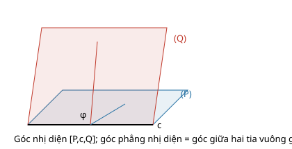

# Bài 25. Hai mặt phẳng vuông góc

Phiên bản: v1.1 · 27/11/2026

> Tài liệu tổng hợp/biên soạn lại cho mục đích học tập (không sao chép nguyên văn SGK/SBT). Bộ sách xương sống: Toán 11 Kết nối tri thức với cuộc sống.

*Chương 7. Quan hệ vuông góc trong không gian (Tập 2)* · Bài tập: [bai-tap](../../bai-tap/chuong-07-quan-he-vuong-goc/bai-25-hai-mat-phang-vuong-goc.md)

## 1. Góc giữa hai mặt phẳng, góc nhị diện
Góc nhị diện $[P,c,Q]$ gồm hai nửa mặt phẳng chung cạnh $c$. **Góc phẳng nhị diện**: góc giữa hai tia cùng vuông góc với $c$ tại một điểm, mỗi tia nằm trong một mặt. Góc giữa hai mặt phẳng cắt nhau là góc nhỏ trong hai góc phẳng (từ $0^\circ$ đến $90^\circ$).

## 2. Hai mặt phẳng vuông góc
$(P)\perp(Q)$ nếu góc giữa chúng $90^\circ$.
**Điều kiện**: $(P)$ chứa một đường thẳng vuông góc với $(Q)$ thì $(P)\perp(Q)$.

## 3. Tính chất
- $(P)\perp(Q)$, giao tuyến $c$: đường thẳng $a\subset(P)$, $a\perp c$ thì $a\perp(Q)$.
- Hai mặt phẳng cắt nhau cùng vuông góc mặt phẳng thứ ba thì giao tuyến vuông góc mặt phẳng ấy.

## 4. Hình lăng trụ đứng, hình chóp đều
Lăng trụ đứng: cạnh bên vuông góc đáy. Hình chóp đều: đáy đa giác đều, chân đường cao là tâm đáy; cạnh bên bằng nhau.

## Nguồn

| Nội dung trong bài | Nguồn | Link | Ghi chú |
|---|---|---|---|
| Vị trí bài, thứ tự mục | SGK Toán 11 KNTT (mục lục) | https://loigiaihay.com/sgk-toan-11-ket-noi-tri-thuc-c1370.html | tham chiếu mục lục |
| Định nghĩa, định lí, công thức, ví dụ | Kiến thức chương trình GDPT 2018 | - | tự soạn/viết lại bằng lời riêng |
| Đối chiếu tên bài, thứ tự mục lý thuyết | SGK Toán 11 KNTT – loigiaihay (Bài 25) | https://loigiaihay.com/bai-25-hai-mat-phang-vuong-goc-toan-11-ket-noi-tri-thuc-e31962.html | đã mở được (HTTP 200, 27/11/2026); chỉ dẫn, không chép |
| Đối chiếu lý thuyết trọng tâm | Lý thuyết Toán 11 KNTT – VietJack (Bài 25) | https://vietjack.com/toan-11-kn/ly-thuyet-bai-25-hai-mat-phang-vuong-goc.jsp | đã mở được (HTTP 200, 27/11/2026); chỉ dẫn, không chép |
