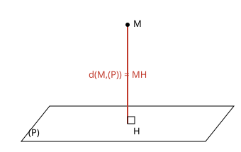

# Bài 26. Khoảng cách

Phiên bản: v1.1 · 27/11/2026

> Tài liệu tổng hợp/biên soạn lại cho mục đích học tập (không sao chép nguyên văn SGK/SBT). Bộ sách xương sống: Toán 11 Kết nối tri thức với cuộc sống.

*Chương 7. Quan hệ vuông góc trong không gian (Tập 2)* · Bài tập: [bai-tap](../../bai-tap/chuong-07-quan-he-vuong-goc/bai-26-khoang-cach.md)

## 1. Khoảng cách từ điểm đến đường thẳng, đến mặt phẳng
$d(M,\Delta)=MH$ với $H$ là chân đường vuông góc hạ từ $M$ lên $\Delta$; $d(M,(P))=MH$ với $H$ là hình chiếu vuông góc của $M$ lên $(P)$.

## 2. Khoảng cách giữa các đối tượng song song
$d(a,(P))$ với $a\parallel(P)$ bằng khoảng cách từ một điểm bất kì của $a$ đến $(P)$. $d((P),(Q))$ với $(P)\parallel(Q)$ bằng khoảng cách từ một điểm bất kì của mặt này đến mặt kia.

## 3. Khoảng cách giữa hai đường thẳng chéo nhau
Là độ dài đoạn vuông góc chung. Cách tính: đưa về khoảng cách từ một điểm đến mặt phẳng: $d(a,b)=d(a,(P))$ với $(P)\supset b$, $(P)\parallel a$.

## 4. Mẹo
Nếu $SA\perp(ABC)$, kẻ $AK\perp BC$ rồi $AH\perp SK$ thì $AH\perp(SBC)$ và $\dfrac1{AH^2}=\dfrac1{SA^2}+\dfrac1{AK^2}$.

## Nguồn

| Nội dung trong bài | Nguồn | Link | Ghi chú |
|---|---|---|---|
| Vị trí bài, thứ tự mục | SGK Toán 11 KNTT (mục lục) | https://loigiaihay.com/sgk-toan-11-ket-noi-tri-thuc-c1370.html | tham chiếu mục lục |
| Định nghĩa, định lí, công thức, ví dụ | Kiến thức chương trình GDPT 2018 | - | tự soạn/viết lại bằng lời riêng |
| Đối chiếu tên bài, thứ tự mục lý thuyết | SGK Toán 11 KNTT – loigiaihay (Bài 26) | https://loigiaihay.com/bai-26-khoang-cach-toan-11-ket-noi-tri-thuc-e31963.html | đã mở được (HTTP 200, 27/11/2026); chỉ dẫn, không chép |
| Đối chiếu lý thuyết trọng tâm | Lý thuyết Toán 11 KNTT – VietJack (Bài 26) | https://vietjack.com/toan-11-kn/ly-thuyet-bai-26-khoang-cach.jsp | đã mở được (HTTP 200, 27/11/2026); chỉ dẫn, không chép |
