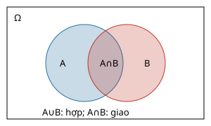

# Bài 28. Biến cố hợp, biến cố giao, biến cố độc lập

Phiên bản: v1.1 · 27/11/2026

> Tài liệu tổng hợp/biên soạn lại cho mục đích học tập (không sao chép nguyên văn SGK/SBT). Bộ sách xương sống: Toán 11 Kết nối tri thức với cuộc sống.

*Chương 8. Các quy tắc tính xác suất (Tập 2)* · Bài tập: [bai-tap](../../bai-tap/chuong-08-quy-tac-tinh-xac-suat/bai-28-bien-co-hop-bien-co-giao-bien-co-doc-lap.md)

## 1. Biến cố hợp, biến cố giao
Cho hai biến cố $A,B$ của cùng một phép thử.
- **Hợp** $A\cup B$: xảy ra khi $A$ hoặc $B$ xảy ra.
- **Giao** $A\cap B$ (còn $AB$): xảy ra khi cả $A$ và $B$ cùng xảy ra.
- **Xung khắc**: $A\cap B=\varnothing$ (không đồng thời xảy ra).
- **Đối**: $\bar A$ là biến cố "$A$ không xảy ra", $P(\bar A)=1-P(A)$.

## 2. Biến cố độc lập
$A,B$ độc lập nếu việc xảy ra hay không của biến cố này không ảnh hưởng đến xác suất của biến cố kia. Khi đó $A$ và $\bar B$, $\bar A$ và $B$, $\bar A$ và $\bar B$ cũng độc lập.

**Ví dụ.** Gieo một đồng xu hai lần: "lần 1 sấp" và "lần 2 ngửa" độc lập. Gieo một xúc xắc: "số chẵn" và "số lẻ" xung khắc (không độc lập).

## Nguồn

| Nội dung trong bài | Nguồn | Link | Ghi chú |
|---|---|---|---|
| Vị trí bài, thứ tự mục | SGK Toán 11 KNTT (mục lục) | https://loigiaihay.com/sgk-toan-11-ket-noi-tri-thuc-c1370.html | tham chiếu mục lục |
| Định nghĩa, định lí, công thức, ví dụ | Kiến thức chương trình GDPT 2018 | - | tự soạn/viết lại bằng lời riêng |
| Đối chiếu tên bài, thứ tự mục lý thuyết | SGK Toán 11 KNTT – loigiaihay (Bài 28) | https://loigiaihay.com/bai-28-bien-co-hop-bien-co-giao-bien-co-doc-lap-toan-11-ket-noi-tri-thuc-e31967.html | đã mở được (HTTP 200, 27/11/2026); chỉ dẫn, không chép |
| Đối chiếu lý thuyết trọng tâm | Lý thuyết Toán 11 KNTT – VietJack (Bài 28) | https://vietjack.com/toan-11-kn/ly-thuyet-bai-28-bien-co-hop-bien-co-giao.jsp | đã mở được (HTTP 200, 27/11/2026); chỉ dẫn, không chép |
