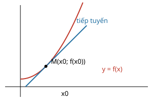

# Bài 31. Định nghĩa và ý nghĩa của đạo hàm

Phiên bản: v1.0 · 27/11/2026

> Tài liệu tổng hợp/biên soạn lại cho mục đích học tập (không sao chép nguyên văn SGK/SBT). Bộ sách xương sống: Toán 11 Kết nối tri thức với cuộc sống.

*Chương 9. Đạo hàm (Tập 2)* · Bài tập: [bai-tap](../../bai-tap/chuong-09-dao-ham/bai-31-dinh-nghia-va-y-nghia-cua-dao-ham.md)

## 1. Đạo hàm tại một điểm
$$f'(x_0)=\lim_{x\to x_0}\frac{f(x)-f(x_0)}{x-x_0}=\lim_{\Delta x\to0}\frac{f(x_0+\Delta x)-f(x_0)}{\Delta x}.$$
Hàm có đạo hàm tại $x_0$ thì liên tục tại $x_0$ (ngược lại không đúng, vd $y=|x|$ tại 0).

## 2. Đạo hàm trên một khoảng
$f'(x)$ là hàm số tính được tại mọi điểm của khoảng.

## 3. Ý nghĩa hình học
$f'(x_0)$ là **hệ số góc** của tiếp tuyến đồ thị tại $M(x_0;f(x_0))$. Phương trình tiếp tuyến: $y=f'(x_0)(x-x_0)+f(x_0)$.

## 4. Ý nghĩa vật lí
Vận tốc tức thời $v(t_0)=s'(t_0)$; cường độ dòng điện tức thời $I(t)=Q'(t)$.

## Nguồn

| Nội dung trong bài | Nguồn | Link | Ghi chú |
|---|---|---|---|
| Vị trí bài, thứ tự mục | SGK Toán 11 KNTT (mục lục) | https://loigiaihay.com/sgk-toan-11-ket-noi-tri-thuc-c1370.html | tham chiếu mục lục |
| Định nghĩa, định lí, công thức, ví dụ | Kiến thức chương trình GDPT 2018 | - | tự soạn/viết lại bằng lời riêng |
